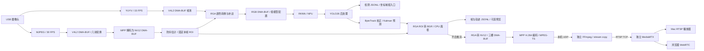
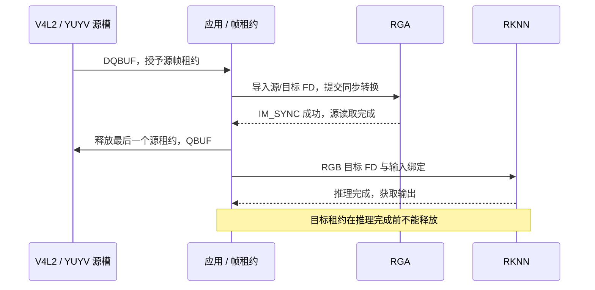
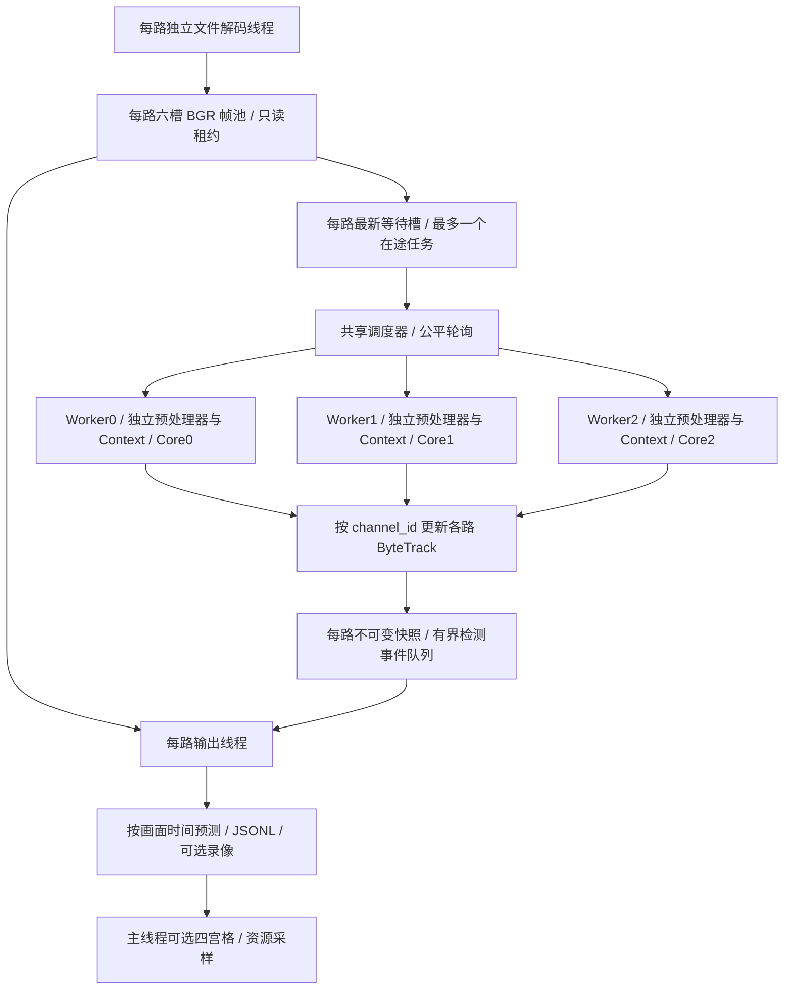
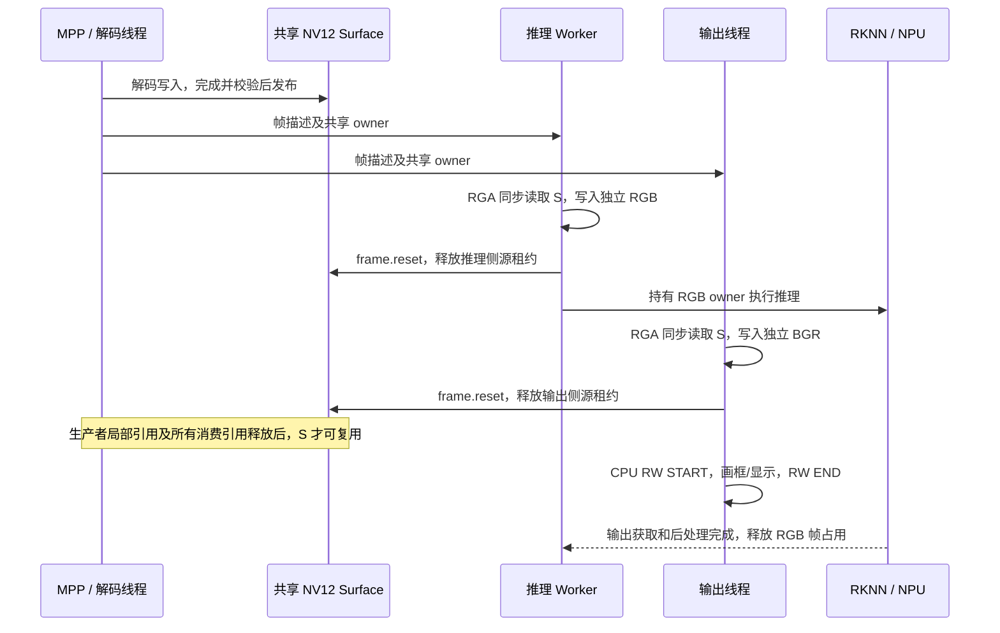

# 架构、并发与缓冲所有权

核对日期：2026-11-18（Asia/Shanghai）。以当前工作区源码为准，包含 DMA-BUF 单路径、COCO640 和默认开启的平移防抖。运行命令见 [项目入口](../README.md)，专题导航见 [文档索引](README.md)。

本文中的 800×608 / 10 类是默认交通模型；640×640 / 80 类须使用配套 COCO 配置。实时默认检测与显示坐标为防抖后的 800×600 画布。

## 整体架构



`camera_run` 采用 YUYV 逐帧检测，不做跟踪；`camera_live` 采用 MJPEG 实时流水线，输出和检测分别调度，增加 `--stream on` 可开启编码。`yolo_run` 处理本地图片/视频，视频可用 LK 在检测之间补充运动估计。四个入口（含本地文件 `yolo_multi`）复用同一套 RKNN 和 YOLO26 检测逻辑；多路文件输入使用软件解码。

MPP 编码和 MPEG-TS 封装在 C++ 内完成；FFmpeg 只复制编码流并发布，MediaMTX 独立接收和分发，不将其源码集成进工程。MediaMTX 停止或发布器重启期间，摄像头、推理和 JSONL 继续运行。

**学习重点**：图像数据所在的内存、描述这块内存的 FD、设备导入句柄、消费者持有的帧租约，是不同层次的对象。硬件共享内存还需要正确的格式、步长、缓存同步和执行完成条件。

## 当前采用的方案：独立源与模型输入缓冲

### 方案 B 在现有代码中是什么样

当前 RGA 检测预处理采用 **Out-of-place（独立输入输出）**：源图和模型输入各自占用独立的底层分配。这里的 A/B 是对 RGA 源/目标的示意命名；后文实时链路图把它们分别标为 S（NV12 源）和 I（RGB 模型输入），另外的 BGR 显示缓冲不属于模型输入。

```text
方案 A，原地处理：源 A → RGA 读写 A → RKNN 使用 A（当前未实现、未验证）
方案 B，当前实现：源 A → RGA 读取 A、写入 B → RKNN 导入并使用 B
```

**采用方案 B 不表示整个系统只有两块 DMA-BUF，也不表示两个缓冲池的大小必须相等。** 实际数量由采集、解码和固定 Worker 的占用需求决定：

| 入口 / 模式 | RGA 的源 | 独立的 RGB 模型输入 | RKNN Context 与执行方式 |
|---|---|---|---|
| `camera_run --io dmabuf` | V4L2 初始化请求 4 个 YUYV DMA-BUF；代码接受驱动返回 2～4 个，以元信息 `buffers` 为准 | 一个预处理器复用 1 块 RGB DMA-BUF | 1 个 Context；应用逐帧执行 RGA、推理和结果写出 |
| `camera_live --decoder mpp --npu-mode split`，当前默认 | 4 个 V4L2 队列槽 / 8 块压缩输入 DMA-BUF → 8 个 MPP NV12 Surface | 3 个 Worker 各自复用 1 块 RGB DMA-BUF，合计最多 3 块 | 3 个独立 Context，分别绑定 NPU Core0/1/2，处理不同帧 |
| `camera_live --decoder mpp`，选择 `--npu-mode default` 或 `--npu-mode all` | 同样的压缩包池和 NV12 Surface 池 | 1 个 Worker 复用 1 块 RGB DMA-BUF | 1 个 Context；`default` 保留 Runtime 核选择，`all` 绑定三个 NPU 核 |

所以，“4 个采集缓冲、2～3 个 RGA 输出、先用 1 个 Context”可以作为架构设计时的起点，**不是当前代码所有入口共同采用的配置**。尤其是默认实时入口已经使用 3 个 Context；它的 3 块 RGB 是 Worker 各自独占的输入，不是单个 Context 在共享三槽池中轮换输入。实时显示还另外使用两槽 BGR 缓冲；开启推流时，再增加独立的三槽编码 NV12 池和压缩输出缓冲，不与模型 RGB 混用。

采集、压缩包和 MPP Surface 在各自初始化时建立；RGB 模型目标在各预处理器第一次处理帧时按需分配，第一次 DMA 推理时建立 RKNN FD 注册，之后复用。没有逐帧分配大块 RGB 像素内存，但每帧仍会建立小型租约/结果对象，并执行输入绑定，不能把它描述为“每帧完全零分配、零 API 开销”。

### 为什么当前图像转换不采用原地处理

摄像头源为 `800×600 YUYV` 或 MPP 的可见 `800×600 NV12`。默认交通模型为 **800×608 RGB UINT8/NHWC**，上下各补 4 行；显式 COCO 配置为 **640×640 / 80 类**，800×600 画布缩为 640×480，上下各补 80 行，均填充 114。实时防抖开启时，RGA 先在同一次处理内读取该帧 ROI，再映射到虚拟 800×600 画布和模型输入。

以紧密排列的 YUYV 为例，源图需要 `800×600×2 = 960000` 字节，而 RGB 可见画布需要 `800×608×3 = 1459200` 字节，已经大于源容量。实际分配还要满足驱动的 `sizeimage`、源 stride，以及 RKNN native 属性给出的 `size/size_with_stride`，不能只用这两个乘法决定容量。

即使人为扩大源分配，格式变化、源目标区域重叠、设备处理顺序和覆盖依赖仍需单独验证。当前工程没有实现或证明该转换可以在同一底层分配上安全完成；把相同 FD 同时传作 RGA 源和目标不能替代硬件能力验证。

| 对比项 | 方案 A：原地处理，假设该操作支持 | 方案 B：当前独立源 / 目标 |
|---|---|---|
| 格式与容量 | 同一分配须同时容纳源布局和目标布局，并处理重叠访问限制 | 源按采集/解码布局，目标按 RKNN 输入布局各自分配 |
| 源帧被占用多久 | 若 RKNN 继续使用 A，该帧需保留到 NPU 完成读取 | 检测侧在 RGA 成功读完源后即可归还源租约 |
| 摄像头是否能继续采集 | 有其他已排队采集槽时仍可继续；不必然整体停止 | 较早归还源槽，减少采集池被下游长期占用的机会 |
| 多阶段重叠 | 多槽条件下仍可能并发，但采集与模型输入占用相互耦合 | 不同帧可分别占用采集/解码源和 Worker RGB，便于独立调度 |
| CPU 像素复制 | 不能仅凭“原地”认定无复制 | 直接 DMA 路径中 RGA 写独立 RGB，不需要 CPU 再搬运这张 RGB |
| 管理与代价 | 少一些独立目标分配，但需证明重叠读写和长期占用安全 | 增加独立目标内存与租约管理，读写边界更清楚 |

这里保留两个内存角色，是为了同时满足格式转换、所有权隔离和源槽及时复用；实际吞吐是否提升，取决于调度和设备瓶颈。

### 一帧何时归还，何时真正释放内存

YUYV 直接路径中，采集缓冲 A 由应用的 `DmaBuffer` 持有底层分配，V4L2 驱动在入队期间使用它；RGB 缓冲 B 由 `ImagePreprocessor` 长期持有，并由 RKNN 输入注册保留分配引用。应用通过帧租约控制当前像素何时允许被覆盖。

```text
源 A 的使用权：
  QBUF → 驱动可写 → DQBUF → 应用持有源租约 → RGA 读取
       → IM_SYNC 成功 → 最后一个源租约释放 → QBUF → 下一次采集

目标 B 的当前帧占用：
  空闲 → RGA 写入 RGB → IM_SYNC 成功 → TensorInput 持有租约
       → RKNN 绑定 / 推理 / 取输出 / 后处理 → 所有输入帧租约释放 → 可再次写入
```

**QBUF 归还的是采集槽的使用权，不是释放 A 的物理内存；归还 RGB 帧租约也不销毁 B。** 分配、mmap 和设备导入对象在正常运行中持续存在，退出或更换分配时才按清理顺序释放。V4L2 入队后交由驱动访问，应用不能继续读写该槽；接口语义见 [Linux V4L2 QBUF/DQBUF 文档](https://docs.kernel.org/userspace-api/media/v4l/vidioc-qbuf.html)。

在 [camera_run 主循环](../yolo_run/camera/main.cpp) 中，可以直接看到以下连续语句，中间省略计时和元数据读取：

```cpp
auto tensor = processor.prepareYuyv(frame->image); // 同步 RGA：读取源 A，写独立 RGB B。
frame.reset();                                   // RGA 已读完，最后一个源租约释放时 QBUF。
auto result = engine.infer(tensor, sequence);     // NPU 使用 B；tensor 仍保护当前 RGB。
```

这里的 `sequence` 已在 `frame.reset()` 前保存。正常循环结束时，调用方的 `tensor` 释放；engine 内的 `active_input` 也已在推理及输出处理完成后清空，下一轮预处理才能覆盖 B。若继续保留旧 `TensorInput`，`frame_lease.expired()` 检查会拒绝覆盖；仅靠 allocation 的引用数无法判断帧是否空闲，因为 RKNN 注册缓存也会长期持有它。

MJPEG 实时路径要分两次归还：

1. V4L2 将压缩帧写入输入 DMA-BUF。DQBUF 后换入空闲 DMA-BUF 并 QBUF，原缓冲由压缩包租约保留给 MPP；应用不再复制 `bytesused`。
2. MPP 产生的 NV12 Surface 由检测预处理和输出转换共同只读。检测 Worker 的 RGA 完成后只释放检测侧源租约；输出侧和其他帧引用也释放后，该 Surface 才能再次用于解码。NPU 此时使用 Worker 自己的 RGB，可以尚未结束。

“RGA 读完就归还 A”因此还要满足**没有其他消费者继续持有 A**。同步 RGA 和 RKNN 的实际完成条件、CPU Cache Sync、错误时保留内存及退出清理见 [所有权与同步](#内存所有权缓存同步和执行同步)。当前采用同步 RGA 和阻塞 RKNN，未采用应用层异步 RGA fence 流水线。

### 当前哪些阶段可以并行

**`camera_run` 的源/目标虽然分开，单个应用循环仍按帧顺序执行 RGA → NPU → 结果处理；它没有单独的预处理线程或两个 RGB 目标来重叠相邻帧的 RGA 与 NPU。** V4L2 可以利用其他已排队槽继续采集，且本帧源已在推理前归还，但不能由此宣称应用已经实现各阶段完整流水线。

**`camera_live` 使用固定采集线程、解码线程和 1 或 3 个推理 Worker，输出由调用线程处理。** 默认 split 中每个 Worker 内部仍顺序执行同步 RGA 和阻塞 RKNN，但不同 Worker 可处理不同帧；例如以下是允许的占用关系，不是一次实测硬件时间线：

| 阶段 | 同一时刻可能处理的帧与缓冲 |
|---|---|
| 摄像头 / 采集线程 | 后续帧的 MJPEG，写入排队的空闲 DMA-BUF |
| MPP 解码线程 | 较新帧，写入空闲 NV12 Surface |
| Worker 0 | 持有帧 n 的独立 RGB，执行 NPU 推理 |
| Worker 1 | RGA 读取另一帧的 NV12，写入自己独占的 RGB |
| 输出线程 | 读取它取得的 NV12，转换到独立 BGR 后画框 |
| 可选编码 Worker | 读取独立编码 NV12，执行 MPP H.264 编码和本机 MPEG-TS 发送 |

输出帧与检测帧由各自的最新槽调度，不保证每个源帧都被检测，也不保证 Worker 按固定轮次领取帧。同一 Context 不并发执行多帧，Worker 之间不共享可写 RGB；实际同时执行程度受 RGA/NPU 调度、内存带宽等因素限制。

仅作流水线原理说明：若采集周期为 33.3 ms、RGA 耗时 3 ms、NPU 耗时 20 ms，则一帧的这两段设备处理仍至少需要约 23 ms。充分重叠不同帧、忽略其他开销的理想模型下，稳态间隔由 `max(33.3, 3, 20)` 限制，约 30 FPS；因为 23 ms 本来就小于采集周期，增加缓冲并不保证比顺序处理得到更高 FPS。**这些数字不是本板测量值，也不用于推导三核性能。** 真实表现需同时查看检测 FPS、输出 FPS、延迟分位数、丢帧、CPU/NPU、RSS/FD 和温度。

### 地址不同为什么不等于多一次 CPU 拷贝

源 A 和目标 B 是独立分配，RGA 必须读取源像素并写入转换后的目标像素，会消耗设备执行时间和内存带宽。优化的是避免再用 CPU 把 B 整张复制到另一块 RKNN 输入，而不是让颜色转换不发生数据读写。

当前 [RGA 预处理](../yolo_run/image/image_processing.cpp) 返回目标 B 的 FD、mmap 地址、容量、尺寸和 stride；[RKNN 输入绑定](../yolo_run/model/yolo_engine.cpp) 对同一目标调用 `rknn_create_mem_from_fd`，再用 `rknn_set_io_mem` 绑定。两者共享 B 的 allocation，并未在应用中重新复制一张 RGB。

FD 是内核缓冲对象的句柄，CPU 虚拟地址、物理地址和设备 DMA/IOVA 映射属于不同层次；设备映射地址不同不能直接用来判断是否复制像素，`dup` 得到不同 FD 也不表示创建了独立缓冲。相关机制见 [Linux DMA-BUF 文档](https://docs.kernel.org/driver-api/dma-buf.html)。本机 V4L2 直接路径是应用经 DMA Heap 分配后由驱动导入，区别于从 V4L2 MMAP 导出，参见 [V4L2 DMA-BUF 导入接口](https://docs.kernel.org/userspace-api/media/v4l/dmabuf.html)。

本工程 RKNN 输入为 `pass_through=0`，Runtime 内部仍可能转换输入；MJPEG 保留 256 字节包尾 CPU 清零，UVC 内核路径也未证明完全无复制。因此可描述为“独立源/目标缓冲与 RGA → RKNN 的共享 FD 输入”，**尚不能宣称从摄像头到显示端到端零拷贝**。

### 如何核对这套方案

先按下文完成 [生产和测试构建](../README.md#环境与构建)，沿下列源码核对关键交接：

| 源码 | 应看到的行为 |
|---|---|
| [v4l2_camera.cpp](../yolo_run/camera/v4l2_camera.cpp) | 采集请求 4 槽、实际数量检查、源租约最后释放时 QBUF、停止后不再重新入队 |
| [image_processing.cpp](../yolo_run/image/image_processing.cpp) | 独立 `source/destination`、目标按需建立并复用、`IM_SYNC`、旧 RGB 租约未释放时拒绝覆盖 |
| [live_pipeline.cpp](../yolo_run/camera/live_pipeline.cpp) 与 [yolo_engine.cpp](../yolo_run/model/yolo_engine.cpp) | 每 Worker 独占 processor/engine、RGA 后释放源、FD 注册及逐帧绑定、推理及输出处理完成前保留目标租约 |

运行现有回归，不新增测试或更改 SDK：

```bash
cd /home/yolo/test
env -u LD_LIBRARY_PATH -u LD_PRELOAD ctest --preset rk3588-release \
  -R '^(camera_preprocess|hardware|live_media|live_core)$' --output-on-failure
```

其中 `camera_preprocess/hardware/live_media` 会使用真实 RGA/NPU/MPP，应与其他硬件任务错开。真实摄像头的 DMA/CPU 参考像素检查见 [独立像素验证](../test/README.md#像素摄像头与防抖)，短运行命令见 [四个入口](../README.md#四个运行入口)。检查 YUYV 元信息的 `io_mode/buffers` 和汇总的 `application_upload_bytes`：直接 DMA 路径稳态上传应为 0。实时元信息应包含所选 `npu_mode/workers`、真实摄像头 `packet_pool: 8`（回放为 4）和 `decoded_pool: 8`；RGB 目标数量仍需结合 Worker 构造与预处理代码确认，不能单凭元信息推断。

当前选型及数量已按源码核对，已有像素、租约和注册测试证据见 [DMA 单路径验收](../test/reports/dma_only_validation.md) 与 [FD 输入验证](../test/validation/rknn_dma_input/report.md)。本节文档补充没有重新运行硬件测试，没有新增方案 A 对照实验，也没有证明方案 B 相对 A 的 FPS 提升比例。硬件仍在使用时提前 QBUF、覆盖 RGB 或释放 FD 是实际风险，现有租约和完成检查必须保留。

## 链路一：YUYV 摄像头到 RKNN

### V4L2 如何交出一帧

入口为 [camera/main.cpp](../yolo_run/camera/main.cpp)，采集实现在 [v4l2_camera.cpp](../yolo_run/camera/v4l2_camera.cpp)。主要顺序是：

```text
open → QUERYCAP → S_FMT / G_FMT → S_PARM / G_PARM
     → REQBUFS 请求四槽 → 按驱动返回的 2～4 槽建立缓冲 → QBUF → STREAMON
     → poll → DQBUF → 使用帧 → 最后一个帧租约释放 → QBUF
     → STREAMOFF → 清理映射、导入对象与 FD
```

`S_FMT` 是请求，`G_FMT` 才是驱动实际接受的格式；宽高、YUYV、行步长与容量必须匹配。不能忽略驱动调整后的参数。`DQBUF` 将完成帧交给应用，`QBUF` 允许驱动再次写入这个槽；提前 QBUF 会造成 RGA 读到被覆盖的图像。

**DMA-BUF 模式**：应用通过 DMA Heap 按驱动实际返回的槽数分配 uncached YUYV 缓冲，以 `V4L2_MEMORY_DMABUF` 和 FD 入队；初始化请求四槽，代码接受 2～4 槽。该工程是应用分配、驱动导入，未采用 `VIDIOC_EXPBUF` 从 MMAP 导出 FD。实际 UVC 驱动能导入不代表传感器直接 DMA 到这块内存，内核内部仍可能有复制。

YUYV 采集仅保留 DMA-BUF 模式，不再建立 MMAP 采集缓冲或 CPU 上传源。

YUYV 每两个像素存储 `Y0 U Y1 V`，属于 YUV 4:2:2。当前链路按 BT.601 limited 转换。源图通常行步长 1600 字节，代码仍按实际 stride 检查，不能把所有图像当紧密排列。

### RGA 如何生成模型输入

[ImagePreprocessor](../yolo_run/image/image_processing.cpp) 的 `prepareYuyv()` 使用源 FD/RGA handle，按实际源步长描述 YUYV，转换为 RGB。800×600 原图放到 800×608 画布，上下各补 4 行、RGB 填充值为 114；无需拉伸原图。

目标是可复用的 uncached DMA-BUF。`importbuffer_fd` 把已有 FD 注册给 RGA；它不等于新分配图像。RGA 任务使用 `IM_SYNC`，返回成功后才能释放采集源帧。目标 RGB 还有自己的租约，必须存活到 RKNN 完成。



源帧可在 NPU 开始前归还，因为 NPU 使用独立 RGB 目标；它不再读取 YUYV 源槽。这里通过明确的读写依赖提高复用效率。

## 链路二：MJPEG、MPP 实时流水线

### 为什么接入 MPP

本摄像头 800×600 的 YUYV 仅支持约 15 FPS，而 MJPEG 支持约 30 FPS。原始 YUYV 数据量约为 `800×600×2×15×8 = 115.2 Mbps`，未计 USB 协议开销；MJPEG 码率随画面变化。MJPEG 是压缩码流，必须先解码，不能直接当 RGB/YUV 像素交给 RGA。

[camera/live_media.cpp](../yolo_run/camera/live_media.cpp) 的 `CameraSource` 使用四个 V4L2 DMA-BUF 队列槽和八块预分配输入 DMA-BUF。DQBUF 后换入空闲缓冲，MPP 读取原缓冲；仅保留包尾 256 字节清零与缓存同步，`compressed_copy_bytes` 恒为 0。

`MjpegDecoder` 用现有 MPP 解码 MJPEG，输出为线性 NV12。输入、输出 DMA-BUF 通过 `MPP_BUFFER_TYPE_EXT_DMA` 导入。此 SDK 的 EXT_DMA 按 FD 导入，不把用户 mmap 指针当作 MPP 自己的映射。

输出池有八槽，每槽预留 `800×608×4` 字节的保守容量；真正的宽高、水平/垂直 stride、格式和所需 NV12 容量在解码后检查。**可见高度 600 不等于分配高度或垂直 stride**。NV12 的 UV 起点须使用 `width_stride×height_stride` 计算，不能直接用可见宽高相乘。

### 一帧 MJPEG 从采集到检测的缓冲流转

以下对应 `camera_live --decoder mpp` 的 RGA 推理路径。DMA-A、DMA-B、DMA-C 分别代表压缩输入、解码输出和模型输入三类独立分配；每类的实际数量由池槽或 Worker 数决定，不表示整个程序只有三块 DMA-BUF。

```text
DMA-A：V4L2 直接写入 MJPEG 压缩输入，属于 PacketStorage
    │ 出队后换入空闲 DMA-BUF 并 QBUF；原缓冲由租约保留
    │ MPP 读取 A，解码结果写入 B
    ▼
DMA-B：NV12 图像，属于 Surface
    │ 解码线程先估计防抖并固定本帧 ROI；RGA 读取 B 的 ROI，转换并补边到 C
    ▼
DMA-C：RGB 模型输入
    │ RKNN 读取 C
    ▼
模型输出 → 后处理 → 检测结果
```

这里的 A/B/C 只用于标记本图中的三类分配，对应后文所有权图的 P/S/I。MPP 解码写入独立的 NV12 输出，不会在压缩输入 A 上原地变成 NV12；RGA 与 RKNN 则共享 RGB 目标 C 的同一个 DMA-BUF。`mpp_buffer_import`、RGA 导入和 RKNN FD 导入建立设备注册，本身不复制一份图像。

| 缓冲 | 判断可复用的对象与条件 | 正常流程中的归还时机 |
|---|---|---|
| DMA-A：压缩输入 | 包池中 `shared_ptr<PacketStorage>` 的 `use_count() == 1` | 确认 MPP 完成并校验返回的输入包后，`decode()` 结束本次 MppPacket 包装；解码线程再执行 `packet.reset()` 归还包槽租约 |
| DMA-B：NV12 输出 | 输出池中 `shared_ptr<Surface>` 的 `use_count() == 1` | 推理侧 RGA 完成后归还自己的源租约；输出侧和其他持有者也归还后，该槽才可复用 |
| DMA-C：RGB 输入 | 预处理器观察到 `frame_lease.expired()` | RKNN 执行和后处理完成，engine 清空 `active_input`，调用方及其他 `TensorInput` 副本也释放本帧 `owner` 后，允许写入下一帧 |

`use_count()` 检查的是整个包槽或 Surface 的占用，不是底层 `DmaBuffer` 的引用数。RGB 使用独立帧租约，是因为 RKNN 的长期注册缓存也持有 allocation，不能用分配的引用数判断当前帧是否仍被使用。引用计数和 weak lease 都不监测硬件进度：MPP 完成结果与身份校验、RGA 的 `IM_SYNC`、RKNN 执行及取输出负责确认设备完成，再由应用归还租约。

上述“归还”通常只是允许池复用、覆盖下一帧，底层 DMA-BUF 仍保留。图中仅展开推理支路；同一 NV12 的输出支路见下一节。复制、租约与同步实现分别见 [采集与解码](../yolo_run/camera/live_media.cpp)、[流水线交接](../yolo_run/camera/live_pipeline.cpp)、[RGA 预处理](../yolo_run/image/image_processing.cpp) 和 [RKNN 推理](../yolo_run/model/yolo_engine.cpp)，各池数量及析构顺序见 [生命周期详解](#当前缓冲池的分配和复用)。

### 同一解码帧为什么能供两路消费

解码线程在分流前完成小图灰度/背景平移估计，将 ROI 按值绑定到该帧；两条支路使用同一个 ROI。NV12 帧由共享租约管理：一路由 NPU Worker 的 RGA 生成 RGB，一路由主输出线程的 RGA 生成 BGR。两路都完成读取并释放租约后，最后一个消费者才允许输出槽复用。生产者对象销毁也不能让仍被租用的 allocation 失效。

RGB 输入由每个推理 Worker 独占；输出 BGR 使用双槽，CPU 画框期间持有同步访问区间。`EncodedFrame::withCpuRead()` 为夹具录制提供同步 CPU 只读视图：回调执行期间保持 allocation 和 Cache Sync，回调不能保存裸指针供之后使用。录制实现位于 `test/support/`，正式程序不链接它。

### 调度与背压

[camera/live_pipeline.cpp](../yolo_run/camera/live_pipeline.cpp) 使用固定线程：采集、解码、1 或 3 个推理 Worker、轨迹校正、JSONL 写入；调用线程负责输出转换、画框和可选显示。开启推流后增加一个固定编码 Worker；调用线程先同步 RGA 生成独立编码 NV12，再交给该 Worker。

| 缓冲/队列 | 容量 | 满或落后时的行为 |
|---|---:|---|
| 压缩包待处理槽 | 1 | 替换尚未处理的旧包 |
| 待推理 NV12 槽 | 1 | 取最新帧，替换旧等待帧 |
| 待输出 NV12 槽 | 1 | 替换旧等待帧 |
| 检测结果队列 | 3 | 有界等待；持续满 250 ms 报错停止 |
| 不可变轨迹快照历史 | 64 | 移除最旧快照 |
| JSONL 队列 | 64 | 有界等待；持续满 250 ms 报错停止 |
| 可选编码 NV12 池 / 等待槽 | 3 / 1 | 无空闲槽时丢弃本次推流提交；新帧替换旧等待项，保护在途编码帧 |

最新槽替换只丢弃尚未执行的项，不覆盖正在被设备使用的帧。计数区分驱动序号缺口、应用主动丢旧帧、池耗尽与停止时舍弃；它们描述不同位置的丢帧。

多 Worker 可能乱序完成。校正线程维护已接受结果的序号和时间水位，拒绝迟到结果覆盖新状态。输出只使用不晚于当前图像时间的快照，再预测到图像时间；不会拿未来检测直接给旧图画框。

默认 `--max-predict-ms 500`：目标超过 500 ms 未获得匹配校正后不再显示预测框；丢失轨迹在内部最多保留约 1 秒以恢复 ID。预测保持画面连续，但不产生新的视觉观测，不能替代实际检测。

## 实时平移防抖与坐标域

`camera_live` 默认开启 `FrameStabilizer`，在唯一解码线程完成防抖估计后再向检测/输出发布。RGA 将 NV12 下采样到两槽 320×240 灰度，CPU 执行背景角点、双向 LK 和 EMA；每帧 ROI 按值保存，两条支路分别把该 ROI 融合进既有 RGA 转换。

保留 ROI 为 720×540，输出画布为 800×600；原图点映射为 `view_x=(raw_x-roi.x)*800/720`、`view_y=(raw_y-roi.y)*600/540`。后处理和 ByteTrack 使用防抖画布；JSONL schema v2 以 `bbox_coordinates` 和每条 frame/detection 自身 ROI 明确坐标，不能用最新帧 ROI 还原旧检测。

关闭防抖使用 `--stabilize off`。纹理不足时估计失锁并平滑回中，不能把这类运行算作有效抑抖；只补偿平移，不消除旋转/透视/运动模糊。参数、租约与缓存同步细节见 [防抖专题](../yolo_run/deploy/STABILIZATION.md)，定量条件见 [验收](../test/reports/stabilization_validation.md)。文件视频的 LK 跟踪与实时防抖的背景 LK 是不同用途，`yolo_multi` 未接入此防抖模块。

## 从单张图像到多路 NPU：30 FPS 设计详解

本节以当前 C++17 实现为依据，说明如何把一次图像检测扩展成多路实时处理，以及怎样判断是否达到 30 FPS。多路入口是 `yolo_multi`，目前接受 **1～4 路本地视频文件**；输入从解码后的 BGR 图像开始，复用现有 RGA、RKNN 和 YOLO26 后处理。多路 V4L2/RTSP/MPP 接入属于后续扩展，不能把单路摄像头的能力直接当成四路已经验证。

### 1. 先明确：30 FPS 指哪一段

| 目标 | 应该怎样计数 | 对四路的实际要求 |
|---|---|---|
| 每路 30 FPS 输入 | 每秒到达的不同源图像 | 总输入约 120 帧/秒，仍需处理源端丢帧 |
| 每路 30 FPS 输出 | 每秒输出画面数；另报重复画面和预测框 | 可用较低频检测配合跟踪预测，不能据此声称每路检测 30 FPS |
| 每路 30 FPS 真实检测 | 每秒完成 RKNN 推理及后处理的不同源帧数，包含零目标结果 | 总计至少 120 次/秒，还要逐路检查公平性、覆盖率和延迟 |
| 全系统合计 30 FPS 检测 | 各路实际完成检测数相加 | 公平分给四路时约每路 7.5 FPS |

**如果要求四路 30 FPS 视频逐帧进入模型，目标就是每路约 30 次真实检测、合计约 120 次/秒，并覆盖全部有效源帧。** 将同一张图重复推理、重复输出画面或只执行 Kalman 预测，都不能增加不同源帧的真实检测覆盖率。源视频若是 30.115 FPS，逐帧检测的目标也应随实际源帧率调整。

当前已有证据的边界如下，均为 INT8 800×608、软件文件解码、关闭预览；录制开销另测：

| 证据版本与条件 | 每路真实检测 FPS | 合计真实检测 FPS | 每路输出 FPS |
|---|---|---:|---|
| 先前四路基线，600 秒、不录制 | 13.17 / 13.18 / 13.31 / 13.02 | 52.67 | 约 30.11 |
| 当前原生预测版，四路 10 秒、不录制 | 13.37 / 13.57 / 13.57 / 12.17 | 约 52.68 | 约 30.33 |
| 当前原生预测版，四路 120 秒、`--detect-fps 8` | 7.26 / 7.25 / 7.28 / 7.27 | 约 29.06 | 约 30.13 |

小数为报告中的稳态统计，短窗口可能略高于源标称帧率。第三行主动限制了检测请求，不能用于推断 NPU 极限；输出均可能重复源画面。第一行是先前版本的长测，不能替代当前版本长测。依据见 [四路基线验收](../test/reports/multi_video_validation.md) 和 [当前原生预测验收](../test/reports/multi_prediction_validation.md)。**现有证据支持约 30 FPS 的画面输出，尚不支持四路各 30 FPS 的真实检测。**

### 2. 从单张图像开始：一次检测到底做什么

先把单张图片的颜色、尺寸、坐标和检测结果核对正确，再进入并发。单图调用链在 [main.cpp](../yolo_run/main.cpp)，核心步骤如下；这是已有工程 API 的调用片段，构建方式见本节后面的复现命令。

```cpp
// config 已由 loadAppConfig() 读取并校验；模型和预处理器初始化一次。
yolo::YoloEngine engine(config);
yolo::ImagePreprocessor processor(config, engine.inputMemoryLayout());

cv::Mat bgr = cv::imread(image_path, cv::IMREAD_COLOR);
if (bgr.empty()) throw std::runtime_error("cannot read image");
{
    auto tensor = processor.prepare(bgr);
    auto result = engine.infer(tensor, 0);
    // result.detections 已经是原图坐标；这里交给结果输出层。
} // 本帧 tensor 租约释放后，processor 才可覆盖自己的 RGB 输入。
```

每个步骤都有必须保持一致的数据契约：

1. **读图**：OpenCV 输出 `CV_8UC3 BGR`。文件解码后的 BGR、摄像头 YUYV 和 MPP NV12 是三种不同输入，不能只改格式枚举而沿用相同内存解释。
2. **预处理**：当前多路入口将 BGR 按行上传到可复用 DMA-BUF，由 RGA 完成缩放和 BGR→RGB，写入独立模型输入 DMA-BUF。letterbox 填充值为 114。1280×720 图像先缩到 800×450，上下各补 79 行；800×600 摄像头图像上下各补 4 行。
3. **提交输入**：应用提交 RGB、UINT8、NHWC、逻辑形状 `[1,608,800,3]`。先查询 RKNN native stride 和容量，再分配输入；使用 `rknn_create_mem_from_fd` 注册和 `rknn_set_io_mem` 绑定。`pass_through=0`，由 Runtime 按模型执行转换，不在 CPU 上再做一次 `/255`。
4. **执行模型**：当前 Context 使用阻塞执行并获取输出。`infer_ms` 包含输入绑定、执行和取输出的耗时，不能把它直接称为纯 NPU 计算耗时。
5. **后处理**：Runtime 按 `want_float=1` 提供 FP32 boxes/scores，现有 YOLO26 逻辑筛选候选、应用阈值和还原坐标。当前导出已经完成对应解码与 Sigmoid，不额外套用 YOLOv5/v8 的 DFL、Sigmoid 或 NMS，也不再手工反量化 FP32 输出。
6. **坐标与结果**：每帧携带自己的实际缩放比例、padding 和原图尺寸，按 `(模型坐标-padding)/实际比例` 还原并裁剪到原图。不同路分辨率不同，这些参数不能放在一个会被其他 Worker 改写的全局变量里。

模型详细契约见 [模型输入与后处理](#模型契约)。单图运行成功只证明链路可执行；还需与参考输出或带标注数据比较，才能评价结果正确性和业务精度。

### 3. 从一个调用扩展为多路：数据流和线程怎样分工

多路不是给每张图临时创建一个线程，而是让长期存在的线程处理不断到来的帧。当前 [multi_video.cpp](../yolo_run/video/multi_video.cpp) 的结构如下：



| 执行单元 | 拥有什么 | 做什么、什么时候等待 |
|---|---|---|
| 每路一个解码线程 | 独立 `VideoCapture`、六槽 BGR 帧池 | 按该文件帧率发布图像；落后时跳过过期帧，无空闲槽时跳过发布 |
| 全局三个 NPU Worker | 各自一个 `YoloEngine`、一个预处理器、输入输出缓冲 | 从调度器领取任务，锁外执行 RGA/RKNN；无可领取任务时条件变量等待 |
| 每路检测侧跟踪状态 | 独立 ByteTracker、结果序号水位 | 由领取该路任务的 Worker 更新，通道锁保护；每路一个在途任务保证更新串行 |
| 每路一个输出线程 | 检测事件写盘、输出副本、可选录像器 | 读取最新画面和不可变快照，预测、绘框与写出；不长期持有调度器锁 |
| 主线程 | 生命周期、停止条件、资源采样、可选窗口 | 控制整体退出，HighGUI 留在主线程处理 |

Context 和预处理器在启动阶段统一创建，再交给对应 Worker 使用；不逐帧重新加载模型。当前跟踪校正复用 NPU Worker，资源采样由主线程完成，没有为每个框或每帧创建额外线程。

每个任务至少携带 `channel_id`、源帧号、媒体时间、计划单调时间、发布时间、图像尺寸和图像租约；letterbox 信息随该帧预处理结果传递。`channel_id` 标识视频来源，Worker 编号标识执行者，**两者不相等**。同一路不同帧可以由不同 Worker 执行，结果必须按通道身份路由。

### 4. 调度为什么采用“每路一个等待帧、一个在途任务”

[FairScheduler](../yolo_run/video/fair_scheduler.h) 用一个短临界区保护各路等待槽、`busy` 标记和轮询游标：

1. 解码器 `put(channel, frame)`：该路没有等待帧就放入；已有等待帧则用较新的替换，增加 `replaced` 计数。正在执行的任务保持不变。
2. 空闲 Worker `take()`：从轮询游标开始查找“有等待帧且未在途”的通道，把其等待项移出并设为 `busy`。成功派发后才推进游标。
3. Worker 释放调度锁，再执行上传、RGA、RKNN、后处理、跟踪更新和事件发布。硬件执行或写盘期间不能占用这把锁。
4. 本帧资源结束使用后调用 `complete(channel)`，清除 `busy` 并唤醒其他 Worker。异常路径也必须完成这一状态收尾，否则该路会一直显示“忙”。

例如四路 A/B/C/D 首批都有图像，三个 Worker 可以先处理 A/B/C，D 等待；若 A 处理期间又来了 A1、A2，A 的等待槽最终保留 A2，在途 A0 仍持有自己的图像。下次有 Worker 空闲时按轮询顺序给 D 机会，不能因为 A 发布更快而一直优先处理 A。

对持续有等待帧且未在途的通道，另外至多 `N-1` 次成功派发后应得到机会；这是**派发次数公平性**。硬件执行时间、CPU 调度和源帧可用性仍会影响实际等待时长，不能据此承诺固定毫秒延迟。

这套策略面向“持续分析最新画面”。如果业务要求每个源帧都检测，替换等待帧就代表漏掉了该源帧。此时应先证明处理能力满足输入，或另行设计有界 FIFO 与背压；离线文件可以放慢读取，实时摄像头必须明确源端是否能背压以及过载时怎样处理。增加队列长度只能暂存更多帧，不能提高硬件吞吐。

### 5. 三核 NPU 怎样并发，为什么不能直接共享一个 Context

当前多路入口采用三个独立 Context，分别传入 `RKNN_NPU_CORE_0`、`RKNN_NPU_CORE_1`、`RKNN_NPU_CORE_2`，通过 `rknn_set_core_mask` 校验绑定结果。三个 Worker 各自处理一整张图，在不同 NPU 核上重叠执行，模型 batch 仍为 1。

| 方案 | 并发含义 | 当前工程的选择与边界 |
|---|---|---|
| 一个 Context，由多个线程调用 | 要先证明 API、输入绑定和输出缓冲能安全并发 | 现有 `YoloEngine::infer()` 全程互斥，`maxConcurrency()` 为 1；共享一个 engine 不会自动得到三路并发 |
| 一个 Context，绑定 `RKNN_NPU_CORE_0_1_2` | 一次模型任务使用组合核能力，效果取决于模型和 Runtime | 已有单路 `all` 模式，须与 split 分别测单帧延迟和吞吐 |
| 三个独立 Context，各绑定一个核 | 同时处理最多三个不同帧 | 当前 `yolo_multi` 固定采用此方式，增加 Context、缓冲和运行内存 |

核掩码的含义见 [Rockchip 官方 RKNN API](https://github.com/airockchip/rknn-toolkit2/blob/master/rknpu2/runtime/Linux/librknn_api/include/rknn_api.h)；实际调用以板端 `/opt/rknn/runtime-2.5.0/include/rknn_api.h` 为准。上述模式不能仅按“三核”推导三倍提速，也不能推导三个 Context 已共享权重；当前工程没有启用权重共享或 Context 复制优化。

这里的“异步”来自外层固定 Worker：主输出不等待某次检测完成，Worker 内部仍顺序执行预处理和推理。当前 `rknn_init` 未开启 `RKNN_FLAG_ASYNC_MASK`，`run.non_block=0`；输出与本次提交帧对应。以后若切到 Runtime 异步模式，必须重新校验输入/输出帧身份和完成语义，不能只打开 flag 后沿用当前关联规则。

还需注意一个现有策略的限制：**每路最多一个在途任务**，因此只打开一路文件时，即使启动三个 Worker，也不会让该路同时有三帧执行。这有利于跟踪时间顺序；若以后为单路增加多帧在途，必须增加结果重排、水位管理和更多独立输入槽，并重新验证延迟与跟踪。

### 6. 图像在哪块内存里，何时才能复用

当前多路文件路径为：

```text
软件解码 → 池内 CPU BGR
         → CPU 按行上传到 Worker 的 BGR DMA-BUF
         → RGA 同步缩放/颜色转换 → Worker 的独立 RGB DMA-BUF
         → RKNN 导入同一个 RGB 分配 → 推理/取输出/后处理
```

| 资源 | 所有者与数量 | 正常复用条件 |
|---|---|---|
| 原始 BGR 图像 | 每路六槽 CPU Mat 池，解码器唯一写 | 检测、最新画面、输出等所有外部只读租约都释放后，解码器才能覆盖该槽 |
| BGR 上传 DMA-BUF | 每个 Worker 一份，按各路最大需求提前预留 | CPU 写入先完成 Cache Sync，RGA 读完后才可再次上传；不与其他 Worker 共用 |
| RGB 模型输入 DMA-BUF | 每个 Worker 一份，按 RKNN native 布局分配 | RGA 写完、RKNN 完成、后处理结束，且当前 `TensorInput.owner` 租约全部释放 |
| RKNN 输入注册 | 各 Context 自己持有，可缓存复用 | 注册保持 allocation 存活；注册存在不代表某一帧仍在途，撤销必须遵守设备完成条件 |
| RKNN 输出缓冲 | 每个 engine 两份预分配 FP32 输出 | 当前后处理和输出释放完成后，才能给下一帧重用 |
| 跟踪快照 / 检测事件 | 每路分别最多 64 项 | 快照淘汰最旧项；检测事件由输出线程取走写盘，队列满会记录输出失败 |

同步和所有权是两件事：

- `allocation` 保证 FD、mmap、RGA handle 对应的底层分配存在；`owner`/帧池租约保证当前像素还不能被覆盖。只保存 `cv::Mat.data` 或裸 FD 无法代替租约。
- CPU 访问 DMA-BUF 时，由 `CpuAccess` 执行 `DMA_BUF_IOCTL_SYNC START/END`。它解决缓存一致性，不会等待所有设备任务结束，也不会互斥其他消费者。依据见 [Linux DMA-BUF 同步说明](https://docs.kernel.org/driver-api/dma-buf.html)。
- 当前 RGA 使用 `IM_SYNC`；只有成功返回，才把 RGB 交给 RKNN。正常推理获取输出成功后，再完成后处理与租约释放。以后改为异步 RGA，必须接入实际 fence/完成等待。

Worker 的 `prepare()` 返回后会释放自己的原图引用，因为 RGA 已经读完上传源；如果输出线程仍持有原始 BGR，该帧池槽依然不能复用。RGB 不跟随原图一起释放，它要保留到推理及当前帧使用结束。

容量必须按真实 stride 计算：`cv::Mat::step` 的单位是字节，当前 RGA `width_stride` 的单位是像素；RGB/BGR 计算字节偏移还要乘 3。NV12 扩展则要使用解码器返回的水平/垂直 stride 和 UV 偏移，不能只用可见宽高；还需校验 NV12/NV21、色彩矩阵与范围，以及输出是否为线性布局，不能将压缩或分块 Surface 直接当线性 NV12。不同格式的限制见 [Rockchip RGA 对齐说明](https://github.com/airockchip/librga/blob/main/docs/Rockchip_FAQ_RGA_EN.md)，提交前继续使用现有 `imcheck`。

以四路 1280×720 为例，仅六槽 BGR 图像的像素容量约为 `4×6×1280×720×3 = 63.28 MiB`，还不含解码器、上传缓冲、RGB 输入、模型、输出及录像器。原始 BGR→DMA-BUF 的 CPU 上传仍然存在，不能宣称该文件入口端到端零拷贝。

### 7. 结果回到哪一路，跟踪和 30 FPS 输出怎样衔接

检测结果必须带回原任务的通道、源帧号和时间。当前每路一个在途任务使检测校正串行；代码仍检查 `source_frame_index` 水位，拒绝旧结果覆盖新状态。跨通道可以乱序完成，通道 A 的结果只更新 A 的 Tracker。

当前多路输出采用以下规则：

1. RKNN 结果在**检测源帧的媒体时间**更新 ByteTrack/Kalman，而非在推理完成的墙钟时间更新。
2. 输出线程对当前画面选择“不晚于画面时间”的最新不可变快照；没有合适快照时，不拿未来结果给旧画面画框。
3. 从快照预测到当前画面的媒体时间，再绘框和输出。预测操作只改变快照副本，不回写检测侧 Tracker，也不作为新测量。
4. 每个目标单独保留最后一次真实检测匹配的时间。默认超过 500 ms 未获匹配就隐藏预测框；预测不能刷新这个年龄。轨迹身份使用 `channel_id:track_id` 隔离。

因此可以出现“每路检测约 13 FPS、输出约 30 FPS”的情况：两次真实检测之间由 Kalman 预测运动，源图更新不足时还可能重复画面。当前四路入口不运行 LK；Kalman 不观察中间图像的像素变化，新目标、急转和遮挡需要下一次真实检测校正。

时间戳也要分清：文件当前使用 `source_frame_index/source_fps` 作为媒体时间，以统一 `steady_clock` 起点映射到计划播放时间；该策略不能直接推广到 VFR 文件、RTSP 或真实摄像头。扩展时应使用各自有效的 PTS/采集时间并建立时钟映射，不能混用媒体毫秒、系统墙钟和单调时钟计算延迟。

### 8. 真正每路 30 FPS，需要多少处理能力

设通道数为 `N`、每路真实检测目标为 `F`、Worker 数为 `W=3`，单个 Worker 在并发负载下的平均任务服务时间为 `S_worker`。它包括上传、RGA、输入绑定、推理、取输出、后处理、跟踪更新与事件发布，不包含等待领取任务的时间。

```text
目标到达率       λ = N × F                         次/秒
Worker 理想容量  μ_worker ≈ W / S_worker           次/秒（S_worker 单位为秒）
Worker 利用率    ρ ≈ λ × S_worker / W
```

这只是容量估算：只有 Worker 服务时间已包含并发竞争的影响，且输入、RGA、内存带宽和输出层都供得上时，才有参考意义。对于逐帧完整处理，总吞吐受最慢阶段的聚合容量限制；不能把单核独跑测得的速度乘以 3，忽略并发争用。稳定处理应让 `ρ < 1` 并预留抖动余量；刚好等于 1 很容易因一次慢帧持续积压。

| 真检测目标 | 总需求 | 三 Worker 的平均服务时间预算，未留余量 |
|---|---:|---:|
| 一路 × 30 FPS | 30 次/秒 | 总量估算为 100 ms/任务，但当前一路一个在途，实际还须满足下面的单路约束 |
| 三路 × 30 FPS | 90 次/秒 | 约 33.33 ms/任务 |
| 四路 × 30 FPS | 120 次/秒 | 约 25 ms/任务 |

**还要同时满足单路约束**：当前每路一个在途任务，若该路每次服务平均耗时 50 ms，即使有三个 Worker，它本身也只能达到最多约 20 次/秒，再扣除重新调度的等待。要达到每路 30 次/秒，同路“服务＋再次领取前等待”的平均周期需不超过约 33.33 ms。四路情况下还必须同时满足总容量预算，不能只满足其中一项。

以四路为例，若仅在估算时预留 20% Worker 空闲余量，目标变成 `ρ≤0.8`，则平均服务时间预算约为 `3×0.8/120 = 20 ms`。这是设计示例，当前硬件尚未证明能满足；真正验收还要检查 P95/P99、各路窗口速率和热稳态。

吞吐和单帧延迟也分别计算：

```text
文件源到结果延迟 = completed_monotonic_ms - scheduled_monotonic_ms
等待检测时间     = Worker 开始时间 - Frame::published_ms
图像结果年龄     = 当前画面媒体时间 - 所用检测快照媒体时间
```

发布时间保存在内部 `Frame::published_ms`，等待值直接输出为 `queue_wait_ms`；上式用于解释时序。`source_to_result_ms` 从计划播放时刻算到推理及后处理完成，包含解码发布落后、排队和执行影响，不包含后续检测事件写盘或显示端延迟。它也不是摄像头曝光到屏幕显示的完整延迟。

30 FPS 的帧间隔是 33.33 ms；多帧流水线可以让总延迟大于这个间隔而仍达到目标吞吐。若业务要求“每帧 33 ms 内返回检测”，则是另一项严格延迟指标，需要单独验收。

### 9. 如何朝 30 FPS 优化，先改哪里

先用当前分阶段统计定位，再一次只调整一个变量，比较同输入、同模型、同输出负载的结果：

| 观察到的现象 | 优先核对 | 后续可验证的改进 |
|---|---|---|
| NPU 经常空闲，解码落后或没有新帧 | 每路 `decoded`、`decode_late_dropped`、CPU 占用和源帧率 | 控制解码线程数；对支持的码流接入 MPP，逐路验证 PTS、旋转、stride、格式与 Surface 租约 |
| `preprocess_ms` 高，CPU 上传占比大 | 实际输入分辨率、Mat step、DMA 上传与 RGA 耗时 | 复用预分配；硬件解码后直接用支持的 NV12 DMA-BUF 做 RGA 输入，减少原图 CPU 上传 |
| 三核忙、检测等待槽持续替换 | Worker 服务时间、`infer_ms`、模型输入与各核负载 | 在主机评估更小模型/输入或量化策略；重新转换为 rk3588 模型，校验输出契约和精度，再测性能 |
| 不录制较快，录像或窗口一开就下降 | JPEG 编码、绘框、文件写入、预览和内存带宽 | 分别量化每项开销；若设计 MPP 编码，要配置独立缓冲及有界队列，逐路验收 |
| 某一路明显低于其他路 | 源帧可用性、派发份额、同路 busy、源分辨率和异常 | 先区分供帧不足与调度不公；不要按 Worker 核编号假定通道分配 |
| 越跑越慢、内存或 FD 增长 | 频率/温度、资源趋势、未归还租约、输出积压 | 查持有时间和清理路径；在现有系统配置下长测，不把修改驱动或超频作为默认手段 |

当前基线约 52.67 次/秒，而四路逐帧目标约 120 次/秒，吞吐差约 **2.28 倍**。这说明需要实测证明处理容量提升；多开线程、把 `--detect-fps` 设置为 30、增大队列，都不构成容量提升的证据。已有三核平均负载较高也不等于所有瓶颈已经定位完成，仍需结合软件解码、RGA、带宽和输出开销分析。

当前已验证 800×608 / 10 类（9975 候选）和 640×640 / COCO80（8400 候选）。布局校验根据配置检查 `[1,H,W,3]`、`boxes[1,4,N]`、`scores[1,C,N]`，验证两个输出候选数一致，而非硬编码为 9975。其他尺寸、类别或导出仍需对应模型、配置和实测；单输出 e2e `[1,300,6]` 尚未接入。

扩展到 MPP 的收益要单独测量：它可能释放软件解码 CPU 并减少上传，但未证明能让当前模型达到四路各 30 次真实检测。若业务允许较低检测频率，可选择“约 30 FPS 输出＋定期真实检测＋短时跟踪预测”，同时报告实际检测频率、结果年龄和漏检边界。

### 10. 过载、异常和退出怎样设计

| 场景 | 当前多路行为 | 必须避免的问题 |
|---|---|---|
| 等待槽被新帧替换 | 丢弃未领取的旧任务，保留在途帧并计数 | 替换正在被 RGA/NPU 访问的图像 |
| 六槽图像池用完 | 跳过发布并计 `pool_dropped` | 强行复用仍被检测或输出引用的 Mat |
| 检测事件队列满 64 项 | 记录输出失败和丢事件计数，Worker 不等待写盘 | 静默吞掉检测事件后继续声称结果完整 |
| 某路 EOF / 解码异常 | 正常 EOF 排空最后等待项；异常记录该路错误，其他路继续 | 只因解码线程结束就提前清理在途图像 |
| RKNN 绑定或执行失败 | 当前 engine 标为不可继续使用，触发停止与完成确认 | 未确认设备结束就重新写输入或销毁 DMA-BUF |
| SIGINT/SIGTERM / 到时停止 | 取消等待项、唤醒线程，等待在途任务和线程收尾，再清理资源 | 只设停止标记但不唤醒条件变量，或 detach 后释放对象 |

清理顺序应是停止新提交 → 解除等待 → 确认在途硬件任务完成 → join 线程 → 撤销设备注册/Context → 释放底层分配。当前无法确认 RKNN 完成时采用终止进程的失败策略，不能把线程 join、超时返回或缓存同步当作设备已停止的证明。

正常结束和主动停止退出码为 0；检测、解码或输出失败返回 1。时长限制可能显示 `status=stopped`、`stop_reason=duration`，不代表运行失败；仍要检查各路错误、事件丢失和完整计数。

配置中的 `inference_timeout_ms: 1000` 是传给 RKNN 的超时参数，不是系统保证的结果延迟；实时业务的截止时间应另行定义和统计。当前没有自动重建失败 Context 或多路网络重连能力，扩展这些恢复机制时必须验证旧任务停止、资源归还和通道状态重置。

### 11. 常见易错点及检查方法

| 易错点 | 表现或后果 | 检查方法 |
|---|---|---|
| BGR/RGB 混用、重复归一化 | 程序能运行，分数和召回却异常 | 同一图片对照 CPU/RGA 预处理，核对模型输入像素和转换契约 |
| 不同 YOLO 版本直接复用后处理 | 输出看似有框但框形状、数量和分数不对 | 查询输出形状/类型/量化参数，与该模型导出说明及串行参考比较 |
| 共用可写预处理器、RGB 或输出缓冲 | 结果偶发跳变、跨帧污染 | 每个 Worker 独占资源；缓冲复用由帧租约约束 |
| 把 `Mat` 浅拷贝当独立图像 | 输出画框改坏正在检测的像素 | 池内原图只读；在输出私有副本上绘框 |
| 把 Worker ID 当通道 ID | 检测串路、跟踪 ID 混乱 | 每路不同标记和分辨率的夹具，逐条核对通道、尺寸与帧号 |
| 锁覆盖 RGA、RKNN 或磁盘 I/O | 三个 Worker 仍像串行执行 | 锁只保护共享状态；测各 Worker 时间区间是否重叠 |
| 只 close FD 或只看引用数 | 硬件使用中释放、旧输入被覆盖 | 分清 allocation、注册与当前帧租约；检查最后消费者和设备完成条件 |
| stride 单位错误、忽略视频旋转 | 花屏、越界或坐标方向错误 | 核对可见尺寸/实际 stride/容量；使用解码后的显示方向做坐标参考 |
| 用推理完成时间推进 Tracker | 运动速度和跨帧预测不稳定 | 检测校正和显示预测均使用源媒体时间，耗时用单调时钟 |
| 预测刷新真实检测年龄 | 长遮挡后旧框仍持续显示 | 逐目标记录最后真实匹配时间，过期隐藏，预测不回灌 |
| 只看平均 FPS 或四路总 FPS | 慢路饥饿、偶发长延迟被掩盖 | 分路统计、约 5 秒滑窗、P50/P95/P99、最小/最大速率及派发占比 |
| 将设置值当成实测速率 | `--detect-fps 30` 被写成检测达到 30 FPS | 数实际 `type=detection` 完成事件；另报输入、输出、重复和丢帧 |

### 12. 按什么步骤实现和验收

建议按以下顺序推进，每一步保留输入、模型哈希、命令、结果和测试条件：

1. **单图正确性**：先测当前模型、颜色和 letterbox，比较 RGA/CPU 与串行参考结果，检查原图坐标和零目标场景。
2. **单路持续处理**：复用 Context 与输入，观察 FD/RSS、结果数量和每阶段耗时；分别测单核与组合核，不能用启动模型耗时推断稳态 FPS。
3. **多 Worker 一致性**：同图分别在 Core0/1/2 检测，确认与串行参考一致；确认输入输出互不覆盖。
4. **多路身份与公平性**：使用不同画面、分辨率、帧率和长度，检查通道隔离、序号递增、轮询、EOF 排空和没有未来快照。
5. **逐项叠加输出负载**：先无预览/无录像，再分别开录像、预览或编码。对每种正式运行配置重新统计，避免用轻负载结果替代交付配置。
6. **30 FPS 性能验收**：预热后在同一稳态窗口计算每路检测数差值/真实单调时间差，检查不同源帧覆盖、滑窗速率、队列替换和延迟。对逐帧业务，源端缺帧与应用主动漏帧都要单独记录。
7. **持续与故障验收**：短测通过后再做 10～30 分钟及业务需要的更长运行，观察温度/频率、RSS/PSS、FD、NPU 负载、事件完整性，并测试解码失败、写盘失败和主动停止。长测时长是验证条件，不自动等于长期稳定性保证。

若严格要求所有 30 FPS 源帧都检测，则应看到：每路稳态检测约等于其有效源帧率；没有常态解码跳帧、等待替换或池耗尽；正常 EOF 后每个应检测源帧都有唯一结果，队列已排空；事件没有丢失，延迟满足业务上限。按时长强制停止时的取消项应另列，不能当作正常 EOF 的漏帧。对实时允许抽帧的业务，则明确抽帧策略、最低检测率和结果最大年龄。

已有夹具的四路结果曾与三核串行参考比较，框坐标误差≤1 px、分数误差≤0.01；该结果用于检查并发实现一致性，不能代替工业场景 mAP/召回率或跟踪精度评测。当前原生预测版的 120 秒证据、先前版本的 600 秒证据应分别引用。

### 13. 可直接运行的构建、测试和统计命令

以下命令复用现有 C++17 工程。SDK 继续通过 `Rockchip::RKNN`、`Rockchip::RGA`、`Rockchip::MPP` 使用；多路文件入口自身采用软件解码，不链接 MPP 媒体库。构建预设固定系统 GCC、Ninja、系统 OpenCV，构建并发为 4。

**构建并从单图开始**，显式选多路同款 INT8 配置，避免与文件入口默认 FP16 混淆：

```bash
cd /home/yolo/yolo_run
cmake --preset rk3588-release
cmake --build --preset rk3588-release --target yolo_run yolo_multi
run_root=$(mktemp -d /home/yolo/test/results/npu_flow.XXXXXXXX)
env -u LD_LIBRARY_PATH -u LD_PRELOAD ./build-rk3588/yolo_run \
  --config config/video_multi.yaml \
  --input /home/yolo/test/camera/camera_800x608.jpg \
  --output "$run_root/image.jsonl" --annotated "$run_root/image.jpg"
```

**四路真实检测竞争，先关闭录像和预览**。下例 `--detect-fps 0` 表示不主动限频，不代表逐帧都能得到检测；`four` 子目录由程序独占创建，不要预先 mkdir：

```bash
clip=/home/yolo/test/rknn_video_compare_20261018_002d290d/video/002d290d-90f2bab2.mov
env -u LD_LIBRARY_PATH -u LD_PRELOAD ./build-rk3588/yolo_multi \
  --input "$clip" --input "$clip" --input "$clip" --input "$clip" \
  --output-dir "$run_root/four" --duration-seconds 20 \
  --detect-fps 0 --preview off --record off
```

这只是单个文件的四个独立解码实例竞争测试。验证通道隔离要使用不同源夹具；验证四路真实设备时还应测接口、网络和解码差异。需要观察录像时另建新的输出目录，把 `--record off` 改为 `on`。设置 `--detect-fps 8` 可验证低频检测与预测，但必须如实标注受限频率。

**读取真实检测与输出统计**，下面沿用前面的 `run_root`：

```bash
/usr/bin/python3 - "$run_root/four" <<'PY'
import json
import sys
from pathlib import Path

root = Path(sys.argv[1])
summary = json.loads((root / 'summary.json').read_text())
print('status:', summary['status'], 'stop_reason:', summary['stop_reason'])
print('whole-run total detection FPS:', round(summary['inference_fps'], 2))
for c in summary['channels']:
    print('channel', c['channel_id'],
          'detect FPS', round(c['detection_fps'], 2),
          'output FPS', round(c['output_fps'], 2),
          'repeated', c['repeated_frames'],
          'pending replaced', c['scheduler']['replaced'],
          'decode late dropped', c['decode_late_dropped'],
          'pool dropped', c['pool_dropped'],
          'event dropped', c['event_dropped'])
samples = [json.loads(line) for line in (root / 'resources.jsonl').read_text().splitlines() if line.strip()]
steady = [r for r in samples if 3000 <= r['elapsed_ms'] <= 19000]
if len(steady) >= 2:
    first, last = steady[0], steady[-1]
    seconds = (last['elapsed_ms'] - first['elapsed_ms']) / 1000
    for a, b in zip(first['channels'], last['channels']):
        fps = (b['inference_count'] - a['inference_count']) / seconds
        print('steady channel', b['channel_id'], 'detection FPS', round(fps, 2))
PY
```

这里的 3～19 秒稳态窗口对应上面的 20 秒运行，修改运行时长后同步调整窗口。整次汇总与稳态速率统计范围不同，不能混为同一组数据。`resources.jsonl` 另含 CPU、RSS/PSS、FD、温度、NPU 频率与分核负载；不可用字段按不可用报告，不补猜测值。

**运行已有正确性回归**，包含调度、预测、录像封装、四路实机集成和单图硬件检查；硬件测试顺序执行，不与性能基准同时运行：

```bash
cd /home/yolo/test
cmake --preset rk3588-release
cmake --build --preset rk3588-release
ctest --preset rk3588-release -j 1 \
  -R '^(multi_scheduler|multi_prediction|multi_recorder|multi_video|core|hardware|cli)$'
```

**三/四路、录像开关及长测对照**，已有脚本会串行执行四组短测和一组四路长测，保存实际命令、二进制/模型哈希和分阶段 P50/P95/P99；下例会写入录像等产物，运行前预留磁盘容量：

```bash
cd /home/yolo/test
bench_root=$(mktemp -d /home/yolo/test/results/npu_bench.XXXXXXXX)
/usr/bin/python3 -B tools/benchmark_multi_video.py \
  --binary /home/yolo/yolo_run/build-rk3588/yolo_multi \
  --output-dir "$bench_root/full" \
  --detect-fps 0 --short-seconds 20 --soak-seconds 600
```

历史命令核对（2026-10-21，北京时间）：正式 `yolo_run` / `yolo_multi` 原生构建通过，`multi_scheduler` / `multi_prediction` 两项回归通过，INT8 单图运行成功；四路同文件、无录像/预览、20 秒短测完成 1,042 次真实推理，整次合计约 52.01 次/秒，各路约 12.98 / 13.18 / 12.98 / 12.88 次/秒，输出均约 30.10 FPS。检测事件丢失和旧结果回退均为 0，按时长正常停止。命令、日志、逐帧结果及统计见 [本次核对目录](../test/results/readme_npu_flow_t_m4raxd/) 和 [机器核对结果](../test/results/readme_npu_flow_t_m4raxd/verification.json)。本次未重新验收模型精度、真实四路设备、窗口、录像或长时稳定性；编译成功、运行成功、一致性和性能达标仍分别判断。文档更新未修改运行源码、SDK、内核、设备权限或系统服务，短测仅产生常规硬件负载和本地结果文件。

关键源码阅读顺序：[单图入口](../yolo_run/main.cpp) → [预处理与布局](../yolo_run/image/image_processing.cpp) → [RKNN Context 与执行](../yolo_run/model/yolo_engine.cpp) → [YOLO26 后处理](../yolo_run/model/yolo_postprocess.cpp) → [公平调度器](../yolo_run/video/fair_scheduler.h) → [多路线程与结果路由](../yolo_run/video/multi_video.cpp) → [ByteTrack/Kalman](../yolo_run/tracking/byte_tracker.cpp) → [集成验证](../test/python/multi_video_test.py) → [性能基准](../test/tools/benchmark_multi_video.py)。

## 内存所有权、缓存同步和执行同步

### 三种硬件共享什么

这里的三类硬件功能指 **MPP 使用的视频解码/编码硬件、RGA 图像处理硬件、RKNN 使用的 NPU**。V4L2 是采集端接口，它的缓冲归还规则也必须纳入整条链路。

DMA-BUF 提供的是可通过 FD 共享的内核缓冲对象。FD 是访问这个对象的描述符，既不是 CPU 虚拟地址，也不是可以直接写入设备寄存器的物理地址；应用把 FD 交给各 SDK，由其驱动完成相应的设备导入和映射。Linux 对 exporter/importer、设备 attachment 和 CPU 映射的说明见 [DMA-BUF 官方文档](https://docs.kernel.org/driver-api/dma-buf.html)。

**本项目由应用组织缓冲所有权和读写顺序，三个 SDK 各自管理设备注册及任务执行。** 同一块内存可以有多个设备导入对象，但图像格式发生转换时，本工程使用独立的源、目标缓冲。MJPEG 这条路径不是三个硬件原地改写同一个 FD：

```mermaid
flowchart LR
    C["V4L2 DMA-BUF 队列"] -->|"DQBUF 后换入空闲缓冲"| P["P：同一 MJPEG 输入 DMA-BUF"]
    P -->|"MPP 读取"| M["MPP 解码"]
    M -->|"MPP 写入"| S["S：NV12 输出 DMA-BUF"]
    S -->|"RGA 只读，共享帧租约"| R1["检测预处理 RGA"]
    S -->|"RGA 只读，共享帧租约"| R2["输出转换 RGA"]
    R1 -->|"写入独立目标"| I["I：Worker 独占 RGB DMA-BUF"]
    I -->|"RKNN 导入同一 FD"| N["NPU 推理"]
    R2 -->|"写入独立目标"| B["B：BGR DMA-BUF 双缓冲"]
    B -->|"同步 CPU 访问"| O["画框、ID、可选显示"]
    O -->|"CPU END 后由 RGA 读取 B"| R3["可选编码转换 RGA"]
    R3 -->|"写入独立目标"| E["E：编码 NV12 DMA-BUF 三槽池"]
    E -->|"MPP 导入同一 FD"| ENC["MPP H.264 编码"]
    ENC --> K["K：压缩输出 DMA-BUF / CPU 码流"]
    N -->|"Runtime 获取及转换"| F["预分配 CPU FP32 输出"]
```



图中的 P、S、I、B、E、K 只是便于阅读的缓冲名称，不是源码变量名。一次正常交接共享的是 **P 与 MPP、S 与 MPP/RGA、I 与 RGA/RKNN、E 与 RGA/MPP**；S、I、B、E 之间仍由硬件执行解码或像素转换，并非同一块内存的不同别名。编码输出 K 还有明确的压缩码流 CPU 读取与复制。

| 硬件 / 接口 | 读取与写入 | 本工程的设备注册 / 视图 | 向下游交接的条件 |
|---|---|---|---|
| MPP 解码 | 读取压缩包 P，写入 NV12 S | `mpp_buffer_import`，类型 `MPP_BUFFER_TYPE_EXT_DMA`；`MppPacket` / `MppFrame` 描述一次输入和输出 | `decode_get_frame` 返回，并校验输入包、输出帧、buffer、格式、stride 和 PTS |
| RGA 预处理 / 输出 | 读取 S，写入 RGB I 或 BGR B | `importbuffer_fd` 的 handle；`wrapbuffer_handle` 加上格式、可见尺寸、stride 构造任务视图 | `improcess(..., IM_SYNC)` 成功返回 |
| RKNN / NPU | 消费 RGB I，产生模型输出 | `rknn_create_mem_from_fd` 创建属于该 Context 的输入包装，`rknn_set_io_mem` 绑定 | 当前阻塞执行及 `rknn_outputs_get` 成功，之后完成后处理和输出归还 |
| RGA 编码转换 | 读取画框后的 BGR B，写入 NV12 E | 复用 RGA handle，携带 800×608 stride 与 BT.601 limited 颜色转换信息 | CPU RW END 后提交，`IM_SYNC` 成功才向编码线程交接 |
| MPP 编码 | 读取 NV12 E，写入压缩输出 K | `mpp_buffer_import` 导入输入/输出 FD，`MppFrame` 与 `MppPacket` 描述一次编码 | 收齐当前帧全部输出分片至 EOI 后归还 E 的帧租约 |

导入 API 建立设备使用这块缓冲的关系；它不等于再次由应用分配和复制一张输入图。`pass_through=0` 下 Runtime 可能做输入转换，不能据此断言 NPU 内部完全不复制。

### 四种对象要分清

| 对象 | 作用 | 生命周期要求 |
|---|---|---|
| allocation、FD 与 `mmap` | 内核缓冲及应用对它的引用、CPU 映射；本工程由 `DmaBuffer` 封装 | 设备使用和 CPU 访问期间必须保持有效 |
| RGA/MPP/RKNN 导入对象 | 某个设备或 Context 对缓冲的注册；三类 handle 不能互相替代 | 底层 allocation 活得更久；撤销注册不等于所有引用都消失 |
| 图像 / tensor 描述 | `Nv12FrameView`、`DmaTensorInput`、`rga_buffer_t`、借用的 `cv::Mat` 等 | FD 之外还要有格式、可见尺寸、stride、容量；裸视图本身不保证像素仍属于当前帧 |
| 帧租约 `owner` | 表示这帧像素仍被消费者占用 | 最后一个消费者结束前阻止池复用或 V4L2 QBUF |

需要同时回答两个问题：**“这块内存还存在吗？”由 allocation 管；“这块内存里的当前帧还允许被覆盖吗？”由帧租约管。** 内存一直没释放，却已经被下一帧覆盖，同样是生命周期错误。

[DmaBuffer 接口](../yolo_run/image/dma_buffer.h) 与 [资源实现](../yolo_run/image/dma_buffer.cpp) 分开；对象不可复制，其构造和析构顺序为：

```text
构造：open DMA heap → DMA_HEAP_IOCTL_ALLOC 得到 DMA-BUF FD → close heap FD
                    → mmap DMA-BUF FD → importbuffer_fd 建立 RGA handle
使用：通过 shared_ptr<DmaBuffer> 延长 FD、映射和 handle 的存活期
析构：releasebuffer_handle → munmap → close DMA-BUF FD
```

heap FD 是分配入口，DMA-BUF FD 是分配结果，二者不是同一个 FD。关闭 heap FD 不会让刚分配的缓冲失效。关闭 DMA-BUF FD 释放的是应用这份引用，不能把“某处调用 close”理解为所有设备引用立即消失。

这个 RAII 类没有硬件任务列表，析构不会替调用者等待 MPP、RGA、NPU。上层必须先确认设备完成访问，再允许最后一个所有者退出。

### 当前缓冲池的分配和复用

下表以默认 `camera_live --decoder mpp`、`split` 模式为主。“复用”表示保留 allocation/设备注册，下一帧重新写入像素；“释放”表示退出或换分配时销毁资源，两者发生在不同时间。

| 缓冲 | 数量与分配时机 | 长期持有者 | 当前帧占用与复用判断 |
|---|---|---|---|
| V4L2 MJPEG 队列槽 | 初始化时请求 4 槽，每槽排队一块输入 DMA-BUF | `CameraSource` | DQBUF 后换入空闲 DMA-BUF；离开 `next()` 时 QBUF |
| P：压缩输入 DMA-BUF | `PacketPool` 初始化时预分配 8 槽（回放为 4 槽）；每槽 `capacity + 256` 字节 | 池中的 `shared_ptr<PacketStorage>` | `EncodedFrame::storage` 保持占用；`PacketStorage::use_count()==1` 才能被生产者取走 |
| G：防抖灰度 NV12 | 开启防抖时按需复用 2 块 320×240 NV12，共 225 KiB | `FrameStabilizer` | RGA 同步完成后 CPU 读取 Y 平面；前帧分析结束才复用 |
| S：MPP NV12 输出 | 解码器初始化时预分配 8 个 `Surface`，每槽 `800×608×4` 字节 | 解码器的 `surfaces` 数组 | `Nv12FrameView::owner` 持有 `Surface`；`Surface::use_count()==1` 才可用于下一次解码 |
| I：模型 RGB 输入 | 每个 `ImagePreprocessor` 首次使用时分配 1 块；split 下最多 3 块 | 预处理器，以及 RKNN 的 `ImportedInput` allocation 引用 | 独立 `TensorInput::owner` 租约释放、`frame_lease.expired()` 后才允许覆盖 |
| B：输出 BGR | `Renderer` 按需建立 2 槽，每槽 `800×600×3` 字节 | `Renderer::buffers_` | 上次 CPU 访问必须 `finish()`；推流时再等待 B→E 的同步 RGA 完成，借用 Mat 不交给编码线程 |
| E：可选编码 NV12 | 开启推流时预分配 3 槽，每槽逻辑容量 `800×608×3/2` 字节 | `EncodeFramePool`，以及编码器 FD 注册的 allocation 引用 | 独立 weak lease 过期后可复用；MPP 完成 EOI 前持有当前帧 owner |
| K：可选压缩输出 | 编码器初始化时预分配 2 MiB DMA-BUF，并保留容量 2 MiB 的 CPU 码流数组 | 唯一编码 Worker 的 `MppH264Encoder` | 当前帧编码、CPU 同步读取及封装发送完成后，由同一 Worker 复用 |
| RKNN 两个 FP32 输出 | 每个 Context 初始化时分配两个 `std::vector<float>`，逐帧复用 | `YoloEngine` | engine 锁覆盖执行、取输出和后处理；每次 `outputs_get/release` 配对 |

P 的额外 256 字节在每次压缩数据后清零，实际 `MppPacket` 长度仍是 `bytesused`，不能把容量当作有效码流长度。S 的 `800×608×4` 是保守预留容量，并不表示实际输出格式是四通道图像。

两个 `use_count()==1` 检查针对的是池槽包装对象，不是任意 `DmaBuffer` 的引用数：池自身占 1 份，没有外部帧持有者才表示空闲。取槽分别发生在单一采集生产者、单一解码线程中；消费线程只持有和归还引用。这是本工程线程约束下的复用条件，不能把裸 `use_count()` 当成通用的多生产者互斥锁。

池耗尽不会自动扩容：真实采集的压缩池耗尽会丢弃当前包并计数，回放的压缩池耗尽会报错；解码输出池耗尽时 `decode()` 返回空值，由流水线计入 `decoded_pool_dropped`。RGB 上一帧仍被租用时直接拒绝再次预处理，不覆盖旧输入。

### MPP：压缩输入和解码输出的生命周期

实现见 [PacketStorage、Surface 与 MjpegDecoder](../yolo_run/camera/live_media.cpp)。共享的 [MppDmaBuffer](../yolo_run/image/mpp_dma_buffer.h) 位于通用图像缓冲层，封装 EXT_DMA 注册与 allocation 引用；对象不可复制，移动时转移注册，不创建新像素缓冲，也不取得帧占用。该适配由 `yolo_live_media` 编译并链接 `Rockchip::MPP`。池槽结构为：

```text
PacketStorage                         Surface
├─ shared_ptr<DmaBuffer>               ├─ shared_ptr<DmaBuffer>
└─ MppDmaBuffer：导入压缩输入 FD        ├─ MppDmaBuffer：导入 NV12 输出 FD
                                      └─ MppFrame：绑定该输出 MppBuffer
```

正常处理一帧时依次执行：

1. 采集线程 DQBUF 得到一个 DMA-BUF 压缩包，取得空闲 `PacketStorage` 换入同一队列槽。原缓冲在 `CpuAccess(WRITE)` 区间仅补零尾部 256 字节，`finish()` 后通过 `EncodedFrame` 发布给 MPP；作用域守卫将替换缓冲 QBUF。原缓冲在 MPP 完成、所有包租约释放后才能再次入队。
2. 解码线程持有 `EncodedFrame`，从八槽输出池选择没有外部持有者的 `Surface`。输入、输出的 `MppBuffer` 已在分配时用 EXT_DMA 导入，不是每帧重新导入 FD。该版本的 EXT_DMA 只按 FD 导入，不把应用 mmap 指针填成 MPP 自己的映射。
3. 用 `mpp_packet_init_with_buffer` 包装输入 P，设置有效长度和序号 PTS，通过 `KEY_OUTPUT_FRAME` 指定当前 S。调用 `decode_put_packet` 提交，再调用 `decode_get_frame` 取得完成结果；**提交成功本身不等于可以回收输入或输出。**
4. 检查返回的 `KEY_INPUT_PACKET` 就是本次 input，输出就是指定的 `Surface::frame/buffer`，并校验错误标记、800×600、NV12、stride、容量和 PTS。只有这些条件满足，才构造带 `owner=surface` 的 `DecodedFrame` 交给下游。
5. 本次临时 `MppPacket` 在 decode 作用域结束时 deinit；解码线程随后 `packet.reset()` 归还压缩帧占用。S 继续由下游的共享帧租约保护，最后一个 `Surface` 外部引用消失后才重新成为空闲槽。

保留 `DecodedFrame.image.dma` 只能保住 allocation；**消费 S 时还必须保留 `image.owner`**，它才让输出池知道这张图仍在使用。只保存 FD、裸指针或自行构造的 Mat，然后丢掉 `owner`，会破坏池的占用协议。

### RGA：如何保护当前帧不被覆盖

实现见 [ImagePreprocessor::prepareNv12 / prepareYuyv](../yolo_run/image/image_processing.cpp) 和 [TensorInput](../yolo_run/model/inference_types.h)。RGA 已在 `DmaBuffer` 构造时取得持久 handle，`wrapbuffer_handle` 只补充本次图像视图；实际转换写入另一块目标 I。

RGB 目标同时暴露两种所有权。下面摘录现有实现中的检查和租约构造语句，中间省略补边及 RGA 调用：

```cpp
// prepare*() 调用 requireAvailableInput()：检查上一帧 RGB 是否还被占用。
if (!frame_lease.expired())
    throw std::runtime_error("previous DMA input is still leased");

// prepare*() 完成补边及同步 RGA 后，makeDmaInput() 创建本帧租约。
input.owner = std::make_shared<FrameLease>(destination);
frame_lease = input.owner; // weak_ptr，只观察占用，不主动延长占用。
input.dma = DmaTensorInput{
    destination, destination->fd, destination->data, destination->size,
    config.input_width, config.input_height,
    layout.width_stride, layout.height_stride
};
```

`input.dma.allocation` 保留长期分配；`input.owner` 是每帧新建的 [FrameLease](../yolo_run/image/frame_lease.h)，内部持有同一个 destination。检查旧租约、分配目标、初始化补边和发布描述分别集中在 `requireAvailableInput()`、`ensureRgbDestination()`、`initializePadding()`、`makeDmaInput()`。复制 `TensorInput` 只复制描述及共享所有权，不复制 RGB 像素。所有本帧 owner 副本释放后，weak lease 才过期；下一次 `prepare*()` 才能覆盖原来的目标。编码三槽池也使用 FrameLease，但继续保留自己的槽位选择和归还协议。

这里不能使用 `destination.use_count()==1` 判断帧结束：RKNN 会缓存 allocation 的注册引用，即使上一帧推理已完成，allocation 引用数也可能大于 1。**允许设备注册长期存在，同时独立控制每帧的读写占用，正是 allocation 与 owner 分开的原因。**

每个 Worker 顺序使用自己的预处理器。源 NV12/YUYV 的租约覆盖整个 `IM_SYNC` 调用；RGA 成功返回后不再读取源，Worker 立即 `frame.reset()`，NPU 推理期间只保留独立的 RGB 输入。因此一帧较慢的推理不会额外占着它已读完的解码源槽。

### RKNN：注册缓存与当前推理分别持有什么

实现见 [ImportedInput、bindInput、infer 与 drain](../yolo_run/model/yolo_engine.cpp)。每个 engine 有自己的 Context、输入注册、输入帧占用和输出缓冲，split 不把同一输入目标交给三个 NPU Worker 反复覆盖。

| 成员 / 对象 | 持有什么 | 何时结束 |
|---|---|---|
| `ImportedInput::buffer` | 完整 `DmaTensorInput`，包括 allocation；不持有每帧 owner | 换 allocation 或 engine 析构时撤销注册 |
| `ImportedInput::memory` | 由当前 Context 创建的 `rknn_tensor_mem*` | 在该 Context 销毁前调用 `rknn_destroy_mem` |
| `active_input` | 当前输入的 allocation 和帧租约 | 正常后处理及输出归还完成后清空；异常时保留到 drain / Context 清理 |
| 调用方局部 `input` | 同一帧的另一个租约引用 | `infer()` 返回后离开 Worker 当前循环作用域 |
| `OutputLease` | 本次 `rknn_outputs_get` 与 `rknn_outputs_release` 的配对责任 | 正常显式 finish，后处理抛异常时由析构兜底 |

一次 DMA 输入推理的实际顺序为：

```text
持有 engine mutex
  → 验证 owner / allocation / FD / mmap 地址 / stride / 容量
  → active_input = input，保住当前帧
  → 必要时 rknn_create_mem_from_fd(ctx, fd, data, capacity, 0)
  → rknn_set_io_mem 绑定输入 0
  → rknn_run（当前阻塞配置，non_block 默认为 0）
  → rknn_outputs_get（FP32，使用预分配输出）
  → YOLO26 后处理，将检测结果写入独立 vector
  → rknn_outputs_release
  → active_input 清空；调用方 input 随后离开作用域
  → RGB 帧租约过期，下一帧可写回同一 allocation
```

输入注册命中时复用包装对象，FD、地址、容量与布局校验集中在新导入时；逐帧只核对帧租约并调用 `rknn_set_io_mem`，输入只允许 DMA-BUF。缓存匹配同时比较 shared_ptr 所有者身份、FD、地址、容量及宽高/stride，**不能只按 FD 的整数值缓存**；旧 FD 关闭后，操作系统可能把同一个整数分给另一块内存。

换注册时先用 `transition_allocation` 保住旧分配，再销毁旧 RKNN 注册、建立新注册、绑定新输入；成功后才释放过渡引用。这个先撤旧再建新的顺序来自本机重复/别名 FD 导入的验证，不能随意改成同时保留两个注册后再撤销旧包装。

`rknn_init` 使用 `flags=0`，保留 Runtime 默认输入/输出缓存处理；应用提供 UINT8/NHWC RGB，`pass_through=0`。本路径没有在 RGA 和 RKNN 中间额外打开 CPU READ 区间，也没有通过 CPU Mat 再复制 RGB；这与测试中为了像素比对而主动 CPU 读取是两种用途。

### 同一 NV12 帧的两路消费者如何归还

[runLive](../yolo_run/camera/live_pipeline.cpp) 把同一个 `DecodedFrame` 的描述分别放入待推理槽和待输出槽。复制描述保留共享 owner，**不会把 NV12 像素复制两份**。对同一张图，只有一个推理 Worker 取走待推理项，另一路由输出线程消费。



图中两路的实际完成先后不固定。若两路 RGA 都已读完且没有其他帧引用，S 可以在对应 NPU 推理结束之前复用，因为 NPU 使用的是 I；若输出线程仍在读取 S，则推理线程单独 reset 不能让 S 提前复用。

`LatestSlot` 替换等待项只减少那个等待描述的引用；已被 Worker 取走的帧仍持有自己的 owner。`put()`、`take()`、`close()` 在槽内用 mutex 保护描述交接，设备内存是否可复用则继续由租约与执行完成条件共同决定。

### 两种同步解决不同问题

把同步拆开看，才不会把“共享指针还活着”“缓存已刷新”“硬件已结束”误认为同一件事：

| 需要保证的事情 | 本工程使用的机制 | 它不能替代什么 |
|---|---|---|
| 资源存在 | allocation 的 shared_ptr、SDK 注册对象的 RAII | 不等待设备，不阻止有写权限的代码覆盖像素 |
| 当前帧不被池复用 | `owner`、Surface/PacketStorage 引用、RGB weak lease、V4L2 Lease | 不自行完成设备任务或刷新 CPU Cache |
| CPU 与设备看到一致的数据 | `DMA_BUF_IOCTL_SYNC START/END` 和 Runtime 默认缓存处理 | 不提供线程互斥，不保证另一硬件的任务已经完成 |
| 设备已经读写结束 | MPP 返回并校验完成帧、RGA `IM_SYNC`、RKNN 阻塞执行与输出获取；异常时必要的等待 | 不能直接授权 CPU 跳过其访问区间的 Cache Sync |
| 多线程交接描述安全 | 队列 mutex、固定 Worker、engine mutex、快照锁 | 不表示锁外的硬件任务也自动结束 |

Linux 明确规定 CPU mmap 访问应由 `DMA_BUF_IOCTL_SYNC` 成对包围，该 ioctl 只处理缓存一致性，不排斥其他进程或设备同时访问。参见 [CPU 访问与 DMA-BUF ioctl 语义](https://docs.kernel.org/driver-api/dma-buf.html#dma-buffer-ioctls)。

[CpuAccess](../yolo_run/image/dma_buffer.h) 的构造执行 `START | READ/WRITE/RW`，正常路径显式 `finish()` 执行相同方向的 END，让错误可以传播；析构为异常路径补做 END 并记录失败。同步失败会将 `DmaBuffer::healthy` 标为 false，预处理器后续检查会拒绝把有同步错误的缓冲继续当作正常输入使用。

| CPU 访问场景 | 访问区间 |
|---|---|
| 文件 BGR 上传、MJPEG 包尾填零 | 目标 `WRITE START → memcpy / memset → WRITE END` |
| 首次或有效区域变化时将 RGB 补边初始化为 114 | RGB 目标 `WRITE START → memset → WRITE END`；随后 RGA 写有效区域 |
| 测试读取像素、`EncodedFrame::withCpuRead` 录制压缩包 | `READ START → 同步读取 → READ END` |
| `Renderer` 在 DMA-BUF BGR 图上画框、写文字、显示 | RGA 完成后 `RW START → CPU 读写 → Renderer::finish()` 对应 RW END |
| 文件视频的 LK 读取 DMA-BUF 灰度 Y 平面 | `TrackingImage::owner` 持有 READ 访问，覆盖 gray 及相关金字塔视图使用期 |

`Renderer::convert()` 返回的 `cv::Mat` 只是外部 DMA-BUF 的借用视图，不会自动接管其 FD 或替 Renderer 等待异步消费者。当前调用线程在画框和 `imshow/waitKey` 后调用 `finish()`，下一次 convert 若发现上次访问尚未结束会拒绝执行；本工程未验证显示后端的异步持有或扫描输出完成，不据此宣称完成了显示 fence 管理。调用者不能把这个 Mat 留给异步写盘或另一个线程，再立刻复用双缓冲。

推流路径在 `finish()` 后同步 RGA 读取当前 BGR、写入独立编码 NV12，完成后才把 NV12 租约交给编码 Worker。CPU 读取 MPP 压缩输出也使用成对 READ START/END；Cache Sync 不代替编码完成 EOI 的确认。

当前三个 SDK 之间**没有由应用传递 fence 的异步链**：RGA 任务用 `IM_SYNC`，传入的 acquire fence 为 -1；RKNN 的 `fence_fd=-1`，当前不启用 non_block。视频异步来自外层不同帧、不同线程的重叠处理；每块缓冲的设备交接仍按明确的完成条件顺序执行。

cached heap 可改善 CPU 访问，但需要验证缓存一致性。本项目外部 RKNN FD 输入曾在 cached `system` heap 上出现重复/切换不一致，最终检测目标使用已有 `system-uncached`；这是给定板卡、Runtime 与驱动下的实测选择，不推导为所有平台都应使用 uncached。压缩池、解码 Surface、实时输出 BGR 也显式选用 uncached；文件上传源和 LK DMA 缓冲仍使用 `DmaBuffer` 默认的 `system`。**uncached 没有取消帧占用、设备完成和 CPU 同步协议。** 历史排查见 [FD 输入报告](../test/validation/rknn_dma_input/report.md)。

### stride、容量与实际像素

`width/height` 是可见图像尺寸，stride 描述内存排列；FD 本身不会携带足以替代图像描述的格式信息。YUYV 的 `bytes_per_line` 以字节计；RGA RGB 视图和 `DmaTensorInput::width_stride` 在本工程以像素计。例如 RGB 宽步长 816 像素时，一行占 `816×3` 字节。

| 布局 | 本工程检查的最低字节范围 / 偏移 |
|---|---|
| YUYV | `bytes_per_line × height`；转换 RGA 像素宽步长时除以 2 |
| 线性 NV12 | Y 占 `width_stride × height_stride`，UV 起点就在该偏移；总范围 `width_stride × height_stride × 3 / 2`，宽高及 stride 要满足偶数条件 |
| RGB / BGR UINT8 | 像素宽步长乘以 3 得到行字节步长，再乘分配高度 |
| RKNN 输入 allocation | 取 RGB 布局需求、native `size`、`size_with_stride` 的最大值，并验证 FD 实际容量 |

例如可见图像 800×600、NV12 stride 为 800×608 时，UV 起点是 **486,400** 字节，所需总范围是 **729,600** 字节；不能按 `800×600` 计算 UV 起点。Surface 预留的 **1,945,600** 字节是容量上界，不能拿它倒推实际 stride。本项目的非紧密 NV12 测试还覆盖了 832×624 源步长。

RGB 800×608×3 的逻辑字节数为 **1,459,200**。现有 INT8 输入最低容量为 1,459,200 字节，FP16 最低容量为 2,918,400 字节；运行时仍以 engine 实际查询值为准。FP16 allocation 较大不表示应用自行把输入改成了 float16，应用提交契约仍是 UINT8 RGB/NHWC。

### 采集端 V4L2 的租约为什么也必须保留

YUYV 路径的 [V4l2Camera::State::Lease](../yolo_run/camera/v4l2_camera.cpp) 持有共享 State 和采集槽 index。DQBUF 创建 Lease，`CameraFrame.image.owner` 保留它；最后一个 Lease 引用释放时调用 `State::release(index)`，运行中才 QBUF。停止后只归还逻辑占用，不再给已经 STREAMOFF 的设备入队。

State 又持有采集 allocation 和设备 FD。因此即使外层 `V4l2Camera` 已析构，尚未归还的帧也不会立即变成悬空指针；外层先停止采集，State 等最后租约释放后再清理映射和 FD。正常调用顺序是 `prepareYuyv()` 的 RGA 同步完成 → `frame.reset()` 归还采集帧 → RKNN 使用独立 RGB 输入。

这里使用的是应用 DMA Heap 分配、`V4L2_MEMORY_DMABUF` 导入的方式；MJPEG `CameraSource` 同样导入 DMA-BUF，通过固定池轮换让队列槽与压缩包租约分离。V4L2 DMA-BUF 导入与 QBUF/DQBUF 的接口背景见 [Linux V4L2 文档](https://www.kernel.org/doc/html/latest/userspace-api/media/v4l/dmabuf.html)。

### 退出和异常时如何释放资源

清理需要遵守设备依赖，不能只靠局部变量“离开作用域就全析构”。正常退出与异常退出共用的关键约束是：先停新任务，再结束设备使用，再撤销设备包装，最后才允许底层分配消失。

1. `runLive` 停止新工作并关闭 latest 槽，释放尚未开始的等待帧；等待采集线程、解码线程、全部推理 Worker 和校正线程退出。正常 EOF 的 `finish()` 会保留最后一个待消费项，主动停止的 `close()` 才舍弃等待项，不舍弃已经被线程取走的帧。
2. join 后先用 `stabilizer.finish()` 归还灰度参考，再用 `Renderer::finish()` 结束 CPU RW 区间。MPP 解码器析构先执行 `reset` 和 `mpp_destroy`，之后才释放池自身持有的 Surface 引用；仍有外部租约时 Surface 继续存活。Surface 最后析构的顺序是 `mpp_frame_deinit → mpp_buffer_put → DmaBuffer 引用释放`；压缩 PacketStorage 则先 `mpp_buffer_put` 再释放 DmaBuffer 引用。
3. 开启推流时，`StreamOutput::stop()` 停止提交并清理编码等待项，等待编码 Worker 的在途任务完成。编码器 reset/destroy 确认停止后撤销 MPP 导入、释放当前帧租约，编码池之后才允许销毁；无法确认停止时隔离该固定资源集合至进程退出。
4. RKNN engine 析构先 `drain()`。若任务完成仍待确认，就持有 `active_input` 调用 `rknn_wait`；随后在临时 allocation 引用保护下撤销 `ImportedInput`，再销毁 Context，最后释放当前帧占用及 allocation 引用。即使预处理器先析构，注册缓存和当前帧仍能保住其底层分配。
5. 当全部持有者都释放某个 `DmaBuffer` 后，才执行 RGA handle 释放、munmap、close。V4L2 采集对象先成功 STREAMOFF、关闭采集 FD，DMA-BUF 等最后持有者释放后再清理。

这些是每条依赖必须满足的先后关系，并不要求所有独立缓冲在同一时刻统一释放。正常任务完成后通常只归还槽位，保留分配与导入供下一帧复用。

| 故障位置 | 当前实现如何处理占用 / 清理 |
|---|---|
| 硬件提交前发现 FD、stride、容量或 owner 非法 | 拒绝调用，不把非法描述交给设备 |
| RKNN 绑定、执行、取输出或后处理发生异常 | engine 标记 failed，不再接受推理；保留 active_input，析构按 pending 状态等待后清理 |
| RKNN 等待失败或关键注册 / Context 释放失败 | `std::terminate()`，不沿正常析构路径提前释放可能仍被使用的内存 |
| MPP `decode_get_frame` 失败或没有完成帧；解码 Context reset / destroy 失败 | 在无法确认完成的路径终止进程，避免继续回收输入或输出 |
| MPP 编码线程异常 / 取包超时 | 禁用编码通道，检测继续；先 reset/destroy 确认停止再归还输入，失败则隔离固定资源，不复用不确定的内存 |
| 发布器或 MediaMTX 停止 | 本机 UDP 发送不等待接收端，检测继续；FFmpeg 自动重试，MediaMTX 手动重启 |
| 摄像头 YUYV / NV12 预处理、输出转换或 BGR→编码 NV12 的 RGA 执行返回错误 | 对这些实机路径终止进程，避免栈展开后提前 QBUF 或复用源 / 目标 |
| STREAMOFF 失败 | 终止进程，不继续按设备已停止的假设解除映射 |

这里的终止策略是停止应用继续复用不确定的内存，不代表应用能够修复硬件卡死。进程异常退出后仍依赖内核与驱动回收资源；物理拔插、设备挂死和完整恢复流程未因此获得验证。

### 如何验证这些生命周期约束

现有测试直接复用正式源码；阅读实现时可对照以下断言，而不是只检查程序有没有输出图像：

| 测试 / 源码 | 对应的生命周期验证 |
|---|---|
| [hardware_test.cpp](../test/cpp/hardware_test.cpp)，CTest `hardware` | RGB 旧帧仍被租用时拒绝覆盖；连续变化输入 CPU/FD 等价；注册复用与别名切换；生产者销毁后 allocation 仍有效；注入执行错误时 wait 持有帧，清理后 FD 关闭、注册数配平 |
| [live_media_test.cpp](../test/cpp/live_media_test.cpp)，CTest `live_media` | MPP 注册移动／替换／reset 后的分配持有与 FD 释放；八槽耗尽和归还；解码器先销毁后消费租约仍有效；NV12 stride 与补边 |
| [live_core_test.cpp](../test/cpp/live_core_test.cpp)，CTest `live_core` | latest 槽替换等待项不破坏已取走的租约，EOF 保留最后一项，close 唤醒等待者 |
| [camera_test.cpp](../test/cpp/camera_test.cpp)，CTest `camera_preprocess` | YUYV DMA 复用及 CPU 参考色彩比较；最后一个 TensorInput 副本释放后，即使保留 allocation 也可复用；采集对象销毁后的租约存活由 `--capture` 分支验证 |
| [stream_media_test.cpp](../test/cpp/stream_media_test.cpp)，CTest `stream_media` | 三槽全部租用时拒绝复用；仅保留 allocation 不阻止归还帧；CPU RW 未结束时拒绝编码转换，检查编码布局、颜色、框/ID 和 PTS |
| [stream_timeout_test.cpp](../test/cpp/stream_timeout_test.cpp)，CTest `stream_timeout` | 注入取包超时后继续持有输入租约；reset/destroy 成功后归还，reset 失败后保持隔离 |

先完成本文的测试构建，再执行无需占用真实摄像头的 MPP/RGA/NPU 与队列检查：

```bash
cd /home/yolo/test
env -u LD_LIBRARY_PATH -u LD_PRELOAD ctest --preset rk3588-release \
  -R '^(hardware|live_media|live_core)$' --output-on-failure
```

`hardware` 和 `live_media` 仍使用板端真实 NPU/RGA/MPP，应与其他硬件任务错开。真实 YUYV 采集租约验证另用以下命令，需要独占摄像头：

```bash
cd /home/yolo/test
env -u LD_LIBRARY_PATH -u LD_PRELOAD ./build-rk3588/bin/camera_test --capture
```

这些验证分别覆盖功能、像素、引用和错误路径，不等于证明所有驱动故障都可恢复。完整流水线长测还需查看逐帧输出及 FD / RSS 趋势；稳定的 FD / RSS 是辅助证据，不能单独证明没有提前复用或图像污染。历史证据见 [DMA 输入报告](../test/validation/rknn_dma_input/report.md)、[实时实验报告](../test/validation/camera_live_20261018/experiment/report.md) 和 [DMA 生命周期历史验收](../test/reports/dma_readability_validation.md)。

### 可以称为什么程度的低拷贝

YUYV 直接路径历史验证：稳态应用层 YUYV 上传为 0 字节。MJPEG 摄像头到 MPP 的应用层压缩包复制已删除，仍保留 256 字节包尾清零。文件输入还存在 OpenCV 图像上传；输出有 CPU 画框，推流还包含压缩码流读取/复制和进程间传输，Runtime 内部可能进行输入转换，UVC 内核也可能复制。

因此，本项目证明的是具体环节的缓冲共享与减少应用层复制，**没有证明从曝光到屏幕的端到端零拷贝**。面试中可以说明已经消除哪些复制、哪些复制仍在，而不使用未经验证的整体承诺。

## RKNN 输入、YOLO26 后处理与坐标

### 模型版本与 Hybrid 混合精度量化

模型在另一台 Linux 主机上使用 RKNN-Toolkit2 转换，目标为 `rk3588`；板端复用现有 RKNN Runtime 2.5.0。默认 800×608 / 10 类交通模型保留三个精度版本：

| 版本 | RKNN 文件 | 文件大小 | 精度策略 |
|---|---|---:|---|
| FP16 | [yolo26s_800x608_fp16.rknn](../yolo_model_rknn/yolo26s_800x608_fp16.rknn) | 21.20 MiB | 浮点部署基线 |
| INT8 | [yolo26s_800x608_int8.rknn](../yolo_model_rknn/yolo26s_800x608_int8.rknn) | 11.62 MiB | PTQ 后的 INT8 版本 |
| Hybrid | [rk_kl_divergence_hybrid_13.rknn](../yolo_model_rknn/rk_kl_divergence_hybrid_13.rknn) | 12.17 MiB | 根据逐层误差分配 INT8 / FP16 |

Hybrid 针对 PTQ 的量化损失进行逐层混合精度优化，流程为：

1. 先执行 PTQ（训练后量化），得到 INT8 版本，建立与浮点参考的对照。
2. 逐层比较量化前后的输出误差，定位对量化敏感、影响结果的关键位置。
3. 将这些关键层保留或恢复为 FP16 计算，其余适合量化的部分保持 INT8，再导出 Hybrid RKNN 模型。

这里的“动态”体现为**依据逐层误差反馈调整精度分配**；精度分配在主机转换阶段确定，板端加载生成后的固定 RKNN 模型。该方法旨在减少敏感位置的量化损失，同时保留大部分 INT8 压缩收益。FP16 层的作用是保留较高精度，文中统一称为 **INT8 / FP16 混合精度量化**。

按当前文件的实际字节数计算，Hybrid 相对 FP16 **缩小约 42.62%**，相对 INT8 **仅增大约 4.74%**。这证明了文件压缩收益；本次三模型板端实验验证了基础一致性、性能和资源，Hybrid 的 mAP 恢复幅度仍需同一批标注帧评测。运行内存与模型文件大小分别统计，不由文件压缩率推算 RSS。

### 模型契约

[YoloEngine](../yolo_run/model/yolo_engine.cpp) 为每个实例独立持有 RKNN Context，并查询 SDK 版本、输入输出数量、逻辑/native tensor 属性。

| 项目 | 默认交通模型 | 已验证 COCO FP16 配置 |
|---|---|---|
| 应用输入 | RGB UINT8 NHWC `[1,608,800,3]` | RGB UINT8 NHWC `[1,640,640,3]` |
| boxes 输出 | `[1,4,9975]`，模型画布 xyxy | `[1,4,8400]`，模型画布 xyxy |
| scores 输出 | `[1,10,9975]`，Sigmoid 后 | `[1,80,8400]`，Sigmoid 后 |
| 后处理 | 两阶段 TopK，最多 300 框，无额外 NMS | 相同已解码双输出契约；查询属性识别输出次序 |
| 类别 | person、rider、car、truck、bus、train、motor、bike、traffic light、traffic sign | 配套 COCO80 类别表 |

COCO 模型与转换材料见 [模型说明](../yolo_model_rknn/yolo26s_coco_rknn_README.md)，板端部署使用 [camera_coco640.yaml](../yolo_run/config/camera_coco640.yaml)。目录中其他 COCO INT8/Hybrid 的主机转换报告不能代替板端适配验收；单输出 e2e 模型不能直接用于当前引擎。

RGA 输入通过 `rknn_create_mem_from_fd` 注册，并用 `rknn_set_io_mem` 绑定输入 0；同一 allocation 可缓存注册以减少反复导入。CPU 输入与 OpenCV 预处理对照仅在测试中保留，生产引擎不调用 `rknn_inputs_set`。`pass_through=0`，由 Runtime 按模型处理归一化/量化，不能再自行重复 `/255` 或变更输入布局。

输出请求 FP32 后再进行 YOLO26 后处理，不能再次手动套用量化 scale/zero-point。模型属性仍校验量化参数，避免错误模型被形状近似的代码接受。

注册切换时先撤销旧注册再导入新注册，底层 allocation 在切换期间保持存活。正常清理先释放注册，再销毁 Context，最后释放 allocation；无法确认硬件完成时不能提前释放，当前代码采用终止进程的安全失败策略，不承诺驱动卡死可恢复。

### letterbox 与坐标还原

比例缩放 `r = min(model_w/source_w, model_h/source_h)`，使用实际取整后的 X/Y 比例与 padding。

```text
source_x = (model_x - pad_left) / actual_scale_x
source_y = (model_y - pad_top)  / actual_scale_y
```

检测框还原后裁剪到输入画布范围，剔除退化框。`camera_live` 默认输入画布为防抖后的 800×600；关闭防抖后为完整原图，可通过逐帧 ROI 逆映射回原图。摄像头 800×600 → 800×608 时 `r=1`，只需减去顶部 4 行。BDD 1280×720 → 800×608 时先缩到 800×450，上下各补 79 行。实时交通夹具的 JPEG 先拉伸到 800×600，评分时再还原为 1280×720；这些历史/精度对照工具显式关闭防抖，条件与原始视频 letterbox 不同。

BDD 原 MOV 有 90° 旋转标记：编码尺寸 720×1280，按元数据解码后的标注坐标是 1280×720。文件流程要尊重显示方向，不能只根据 FFprobe 的编码尺寸处理。

### 为什么没有额外 NMS

[yolo_postprocess.cpp](../yolo_run/model/yolo_postprocess.cpp) 针对当前 YOLO26 one-to-one 导出执行：先按每个候选的最高类别分数选 Top-K，再对候选/类别组合选 Top-K，稳定处理并列分数，最多保留 300 框，最后应用类别置信度阈值与坐标还原。分数已经过 Sigmoid，不重复处理，也不额外增加 NMS。

这属于当前模型的导出契约。YOLOv5/v8 等模型可能采用不同输出、DFL、解码和 NMS，不能未经验证复用本后处理。

## 跟踪、LK 与 NPU 模式

### 文件视频的 LK

[video_inference.cpp](../yolo_run/video/video_inference.cpp) 调度检测与光流，[optical_flow_tracker.cpp](../yolo_run/video/optical_flow_tracker.cpp) 执行特征、金字塔、正反向 LK 与运动估计，再与 ByteTrack 组合。

`lk_preprocess: rga` 让 RGA 生成 NV12，CPU 直接读取受 READ 租约保护的 Y 平面；RGA 没有执行 LK 算法。默认 `lk_scale: 1.0` 保留原分辨率；0.75/0.5 减少像素和光流工作量，但也改变特征间距、窗口和误差阈值相对原图的尺度。

动态异步调度会让不同速度模型在不同源帧上检测；要隔离这一因素，使用测试工具中的同步固定源帧对照。不能只凭一次更高的 FPS 宣称跟踪精度等价。

### 实时流程的时间与 Kalman

[ByteTracker](../yolo_run/tracking/byte_tracker.cpp) 以源时间校正，速度按秒计，预测和过程噪声使用实际 `dt`。不可变快照允许输出线程读取历史状态并预测，不与校正线程共享可变轨迹。

`--detect-fps 0` 按能力处理最新帧，正值限制提交频率；输出与推理各自统计帧率。低输出延迟表示图像送出及时，较大的校正数据年龄仍可能使框滞后，这两个指标要同时观察。

### 三种 NPU 模式

| 模式 | Context / Worker | 核心策略 | 已有实验体现的取舍 |
|---|---:|---|---|
| `default` | 1 / 1 | 不调用显式核心绑定 | 本机主要负载在 Core0，RSS 较低 |
| `all` | 1 / 1 | 单 Context 绑定 0/1/2 | 当前模型没有获得更好吞吐，不能按三核推导三倍速度 |
| `split` | 3 / 3 | 每个独立 Context 分别绑定 Core0/1/2 | 多帧并发，吞吐提高；Context、输入内存和 RSS 增加 |

没有共享一个 Context 给多个 Worker。历史同输入输出一致性测试通过后，才比较三种模式的实时回放与摄像头结果。默认选择 `split` 依据是同夹具的校正年龄 P95，而不是仅看 NPU 利用率。

`split` 让三个 Worker 各自取得待检测帧，独立执行完整模型，不添加人为延时。随帧到达和 Worker 完成时刻自然错开，不同帧的推理时间相互重叠；它提高持续视频的吞吐量，不会把单帧推理耗时直接缩短为三分之一。每个 Worker 仍独立持有 Context、预处理器及输入/输出缓冲，设备执行完成前不会复用输入内存。

## 输出记录与指标口径

| 入口 | 主要记录 |
|---|---|
| `camera_run` | `camera` 元信息、逐帧 `frame`、定期 `resource`、最终 `summary` |
| `camera_live` | schema v2 元信息、接受的 `detection`、输出的 `frame`、`resource`、`summary`；逐帧防抖 ROI 与坐标域 |
| `yolo_run` | 图片检测或逐视频帧结果，及运行汇总 |
| `yolo_multi` | 每路独立检测/预测 JSONL、可选 MJPG AVI、共享资源记录和最终 `summary.json` |

实时检测和帧记录分别按源序号递增，但两类行可能交错，不能假设相邻两行是一对。使用 `sequence` 与时间戳关联；检测框看 `detections`，轨迹框看 `tracks`。准确率实验使用约定字段，不能拿补帧轨迹当作原始检测计算模型 AP。

- **源 FPS**：采集时间线上的源帧率；具体字段可能按驱动序号/时间间隔估算，含义见记录。
- **输出 FPS**：实际输出帧数除以运行墙钟时间；文件流程可能含大量 LK 帧。
- **推理 FPS**：推理调用次数除以墙钟时间；不能把 `1/单次推理均值` 当作所有异步流程的实际检测频率。
- **编码 FPS**：`summary.stream.encoded_fps` 表示实际完成编码的速率；本地 `output_fps` 与编码速率分别记录。
- **推理耗时**：本工程包含输入处理、NPU 执行、输出获取，不等同于纯 NPU kernel 时间。
- **采集到结果延迟**：源时间戳到检测完成；**输出延迟**到画框/窗口提交完成；**校正数据年龄**反映输出采用检测观测的源时间距当前帧多远。
- 实时分位数采用固定 1 ms 直方图，4096 ms 为溢出桶，最大值另外记录。不是曝光到显示、屏幕扫描或远程桌面延迟。
- CPU 一个核为 100%，可以超过 100%；旧字段名 `rss_mb` 实际计算单位为 MiB。NPU 负载来自驱动采样，不是整个区间的精确积分。

各阶段次数不同并且异步重叠，不能把 Decode、RGA、推理、LK 的均值直接相加作为端到端帧延迟。

推流开启时，`frame.stream_submitted` 仅表示进入等待槽，之后仍可能被较新帧替换；实际编码量看 `resource.stream` / `summary.stream.encoded`。同一对象还记录 `pool_dropped/pending_dropped/shutdown_discarded`、`send_errors/sent_bytes`、转换/编码耗时，以及 `capture_to_encoded`。后者只到编码完成，观看端实际延迟需要另外测量；检测汇总正常也应同时检查 `summary.stream.status`。

## 排障、验证方法与能力边界

| 现象 | 优先检查 |
|---|---|
| 无法打开摄像头 | by-id 是否存在、设备权限、是否被其他采集程序占用 |
| 实际格式/FPS 不符 | G_FMT/G_PARM、光照与自动曝光、MJPEG/YUYV 枚举能力 |
| RGA format/stride 错误 | 字节与像素单位、NV12 UV 起点、对齐和 allocation 容量 |
| 黑图、颜色错误、框偏移 | YUYV/NV12、limited/full range、RGB/BGR、letterbox、旋转元数据 |
| 检测结果不随图像更新 | Cache Sync、设备完成条件、目标租约、FD 注册缓存；先用独立像素/FD 等价测试定位 |
| 输出 30 FPS 但框滞后 | 推理 FPS、校正年龄、最新槽丢帧、预测有效期，而非只看显示 FPS |
| RSS/FD 增长 | 冷启动与预热后分别采样，检查租约、导入对象、队列和错误清理 |
| MPP 无法解码 | 是否支持 MJPEG、实际格式、返回 buffer/PTS 身份；不要假设 OpenCV 自动使用 MPP |
| NPU 超时 | 保留日志与缓冲，不盲目复用；当前没有真实驱动卡死恢复保证 |
| RTSP 地址没有视频 | 确认三个进程均运行、摄像头带 `--stream on`、发布器本机 UDP 端口一致，并检查 `summary.stream.status` |
| 浏览器页面可打开但无画面 | 使用 8889 的 WebRTC 页面，检查公告的板端地址、UDP 8189 可达性、ICE 日志和 H.264 关键帧 |
| 发布器提示 PPS / 断线 | 启动在 GOP 中途时等待下一 IDR；持续失败则查看源流与 RTSP 日志，发布器会退避重试 |

测试命令与预期检查见 [test/README.md](../test/README.md)。需要分别回答四个层次：**编译是否通过、设备是否运行、结果是否正确、指定条件下性能是否达标**。通过短测或生成检测框，只能证明其中部分层次。

当前已有：单路真实摄像头、YUYV DMA-BUF 路径与独立 CPU 像素参考、MPP MJPEG、RGA/FD 输入等价测试、独立多 Context 固定输入对照、回放、故障注入，以及 FP16/INT8/Hybrid 的三轮 split 对比与每模型 10 分钟连续资源检查。另已接入 MPP H.264 编码、独立 FFmpeg 发布和 MediaMTX 分发，完成三十分钟真实摄像头推流、RTSP 解码、WHEP 协商、重启恢复与背压测试；Mac RTSP 和 Chrome/Edge 实际观看由用户确认。

尚未覆盖：工业独立测试集精度、玻璃到玻璃延迟、跨播放器/浏览器版本与屏幕扫描时序的完整验收、物理拔插与自动重连、真实驱动卡死恢复、无限时长、多路稳定性及跨网访问。用户确认的播放可用性与板端编码/传输测试分别记录，不扩展为所有客户端或网络条件下的保证。

日常构建与验证继续复用既有 SDK 和系统设置。历史 FD 排查曾发生驱动 soft reset，失败日志与最终通过日志都保留在原证据目录，不能把历史失败删除后称为从未发生问题。
