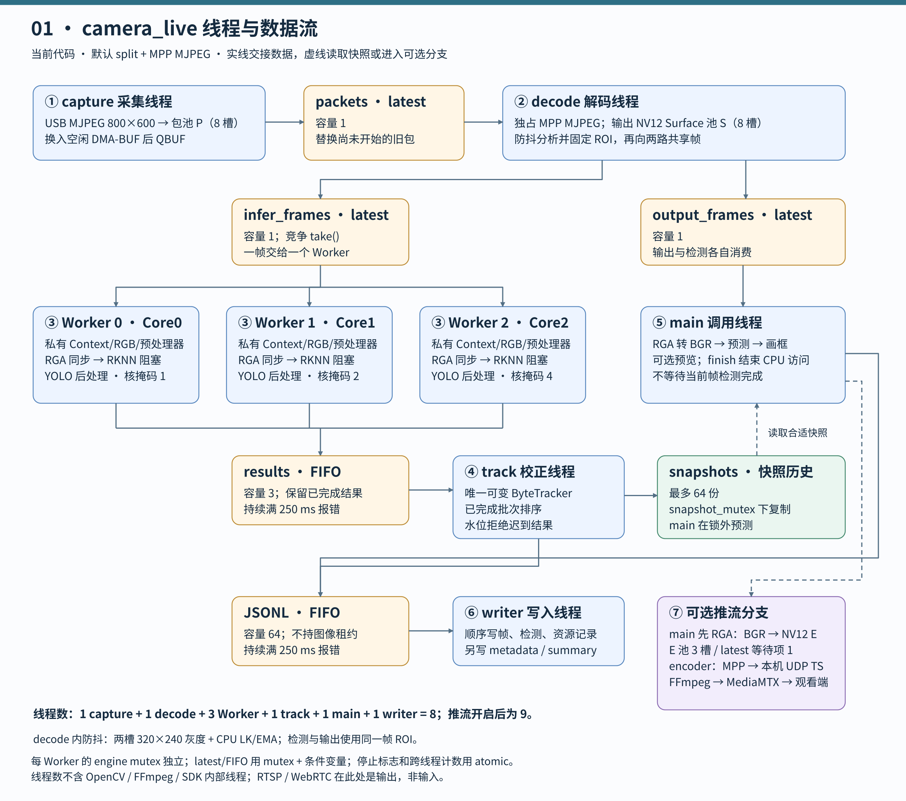
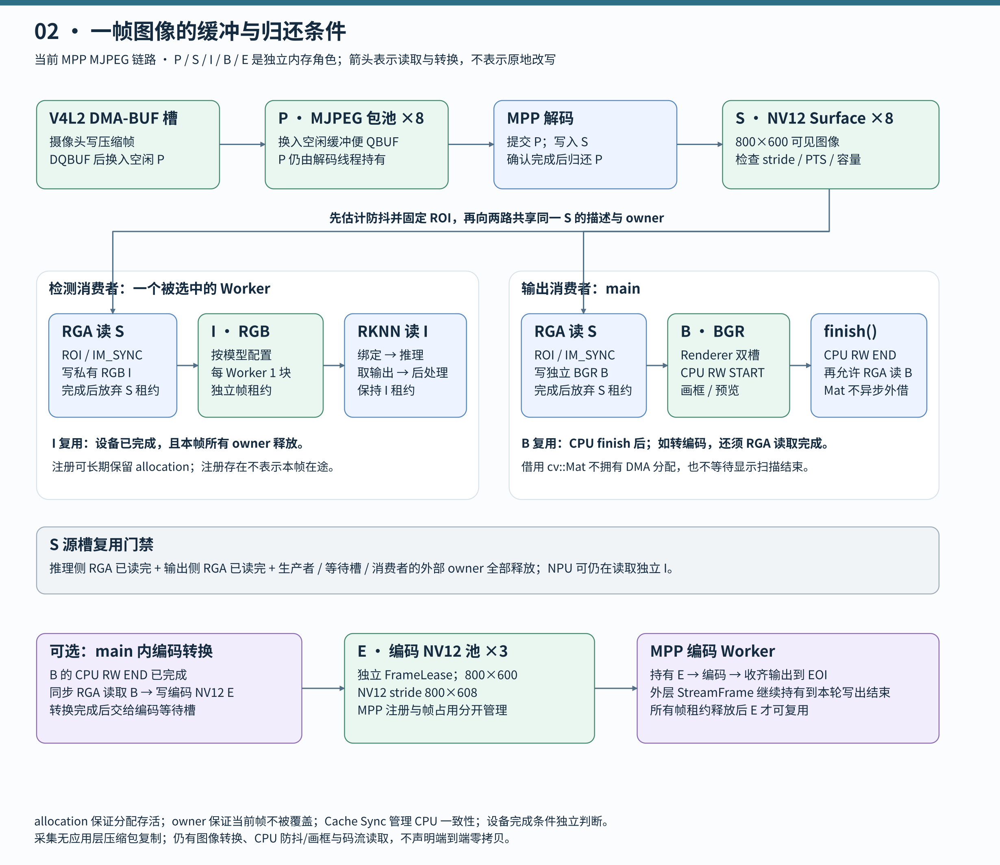
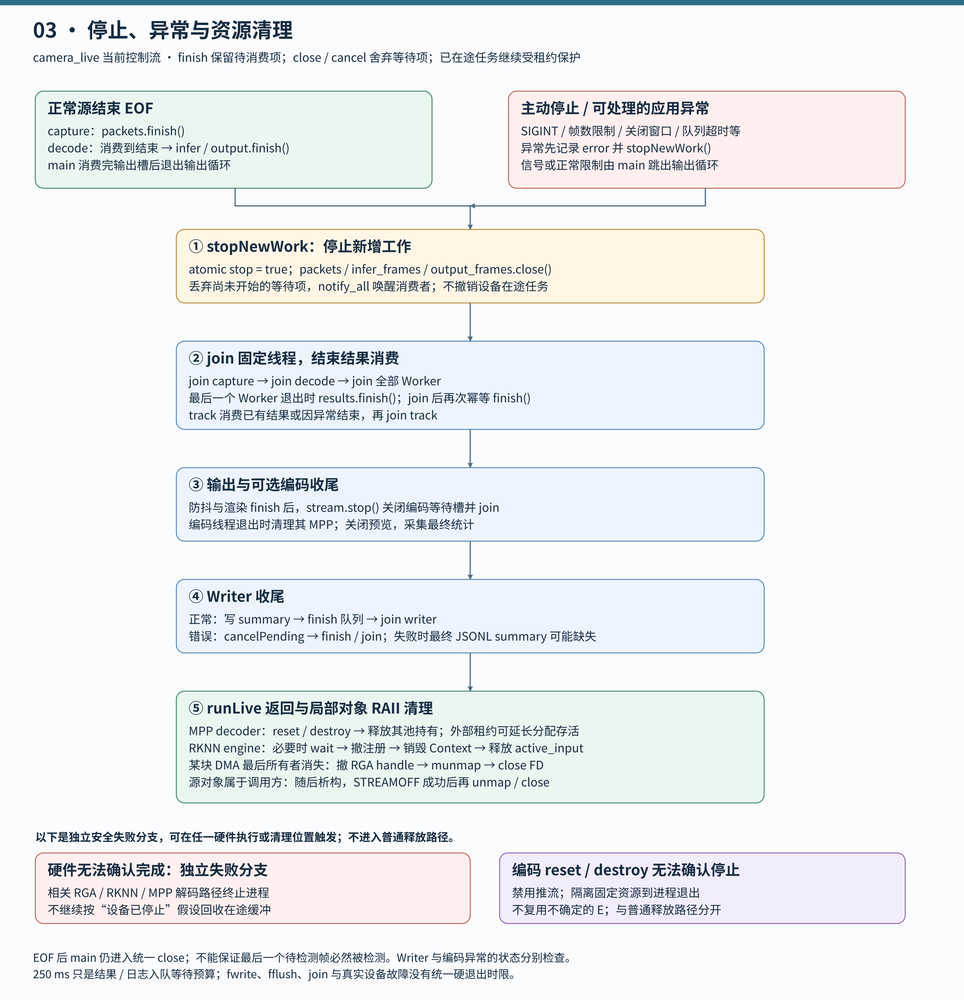
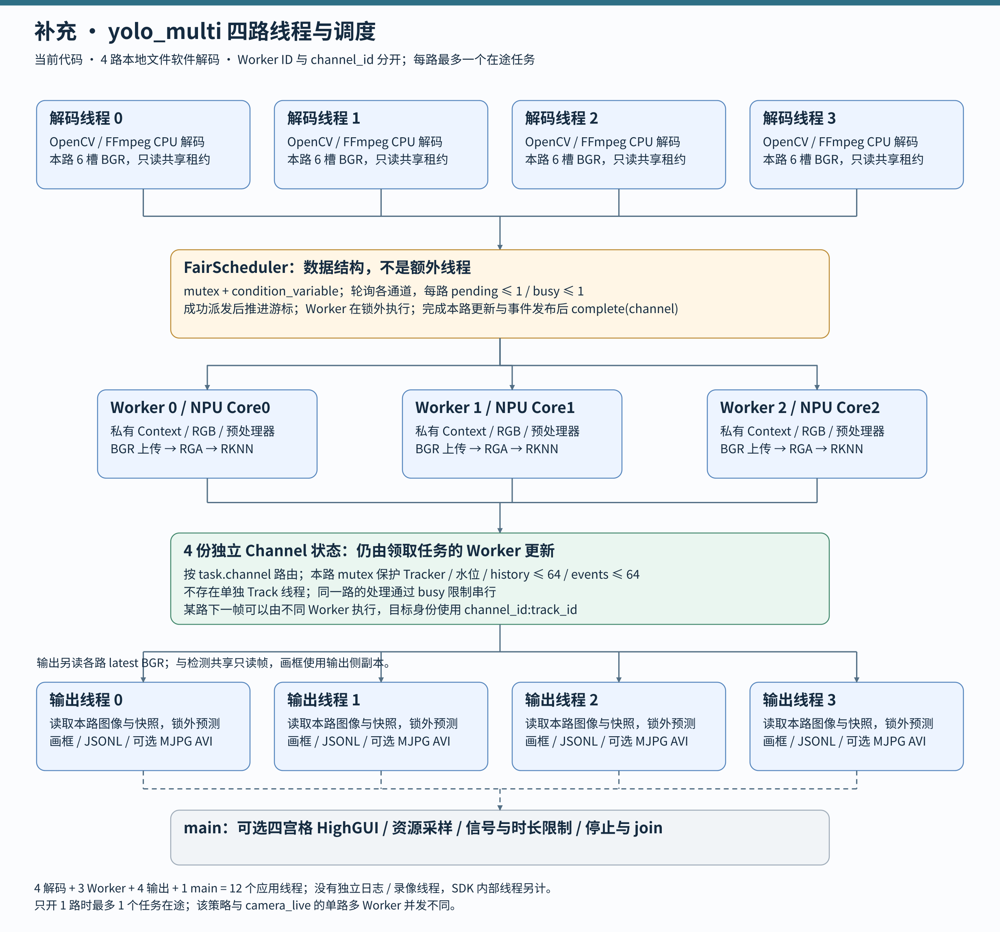

**RK3588 项目设计图与讲解**

依据 2026-11-18 当前维护源码整理。主图对应 `camera_live --decoder mpp --npu-mode split`；补充图对应四路本地文件 `yolo_multi`。图中描述的是已实现结构，后续规划中的 RTSP 输入、H.264 输入解码与自动重连没有画成现有能力。

[打开离线图册](diagrams/index.html) · [发展路线](development-roadmap.md) · [项目学习路线](../学习路线.md)

三张主图依次回答：线程怎样合作、缓冲何时能复用、程序怎样安全退出。PNG 可直接放进面试幻灯片；SVG 可无损缩放；Mermaid 文件保留可编辑的流程表达。离线图册内嵌 SVG，打开不需要服务器、网络或启动摄像头。

**图 1：线程与数据流**



[SVG 矢量图](diagrams/camera-live-threads.svg) · [PNG 图片](diagrams/camera-live-threads.png) · [Mermaid 源码](diagrams/camera-live-threads.mmd)

沿图讲解：摄像头使用四个 V4L2 队列槽和八块输入 DMA-BUF，出队后换入空闲缓冲并 QBUF，原压缩包直接交给 MPP。解码线程输出 NV12，完成防抖分析并固定本帧 ROI，再把只读租约分别交给检测和输出。三个 Worker 竞争领取待检测帧，各自使用私有的预处理器、RGB 输入和 RKNN Context。结果汇入唯一的轨迹校正线程，再发布快照；main 拷贝合适快照，在锁外预测、画框和输出。日志写入与可选编码分别有自己的固定线程。

| 共享位置或资源 | 同步与所有权 | 解决什么问题 |
|---|---|---|
| packets / infer_frames / output_frames | `mutex + condition_variable`，每槽一个等待项 | 原子交接；无任务阻塞；更新时仅替换等待项 |
| 每个 Worker 的 Context、RGB、输出缓冲 | 各 Worker 独占；engine 内还有自己的 mutex | 输入绑定和复用输出不会跨 Worker 相互覆盖 |
| results FIFO，容量 3 | 队列锁、数据/空间条件变量，入队等待预算 250 ms | 已完成结果有界交接，避免无限积压 |
| 权威 ByteTracker | 只在 track 线程内修改 | 三个 Worker 统一关联目标与分配 ID |
| snapshots，最多 64 份 | `snapshot_mutex` 下发布/复制，锁外纯预测 | main 不并发访问可变 Tracker |
| stop 与跨线程计数 | `std::atomic`；错误字符串另有 mutex | 安全传播停止状态与维护计数 |
| NV12 / RGB / 编码 NV12 | 帧租约 + 已确认的设备完成 | 防止仍在消费的图像提前被池覆盖 |

三个 Worker 可以乱序完成。track 只排序当前已经完成的一批，并通过源帧序号与源时间水位拒绝迟到结果，不无限等待更早慢帧。main 只选源时间不晚于当前图像的快照，不能用未来检测给过去图像画框。

线程数：`1 capture + 1 decode + 3 Worker + 1 track + 1 main + 1 writer = 8`。开启推流再加 1 个编码线程；库内部线程与外部 FFmpeg、MediaMTX 进程另计。图中 RGA 与 RKNN 在 Worker 内仍按同步顺序执行，多帧并发来自外层不同 Worker。

源码定位：[资源与队列](../yolo_run/camera/live_pipeline.cpp)、[track](../yolo_run/camera/live_pipeline.cpp)、[Worker](../yolo_run/camera/live_pipeline.cpp)、[main 快照读取](../yolo_run/camera/live_pipeline.cpp)、[LatestSlot](../yolo_run/camera/live_media.h)、[编码 Worker](../yolo_run/camera/stream_output.cpp)。

**图 2：缓冲区生命周期与复用条件**



[SVG 矢量图](diagrams/buffer-lifecycle.svg) · [PNG 图片](diagrams/buffer-lifecycle.png) · [Mermaid 时序源码](diagrams/buffer-lifecycle.mmd)

P、S、I、B、E 是不同的底层分配。解码、缩放和颜色转换会读写不同缓冲；共享 FD 不表示所有阶段原地读写同一块内存。

| 标记 | 内容与当前数量 | 当前帧什么时候允许归还/复用 |
|---|---|---|
| P | MJPEG 输入包池，实采 8 槽 / 回放 4 槽 | MPP 完成并校验本次输入/输出后，解码线程释放包持有 |
| G | 防抖灰度 NV12，两槽 320×240 | RGA 完成、CPU 读取/前帧分析结束后复用；由解码线程串行使用 |
| S | 解码 NV12 Surface 池，8 槽 | 实际持有它的生产者、等待槽、检测/输出消费者全部归还引用，相关设备读取完成 |
| I | 模型 RGB 输入，split 下每 Worker 1 块 | RGA 写入完成，RKNN 使用及后处理结束，所有本帧 `TensorInput.owner` 释放 |
| B | 输出 BGR，Renderer 双槽 | CPU 访问 `finish()`；若用于生成编码输入，还要同步 RGA 读完 B |
| E | 可选编码 NV12，3 槽 | MPP 完成当前帧输出；外层 `StreamFrame` 本轮写出结束，最后一份租约释放 |

最重要的时间关系是：**Worker 的 RGA 读完 S 后，NPU 继续读取独立的 I；main 的 RGA 也读完 S 且没有其他持有者时，S 可以复用，不必等 NPU 或编码结束。** 如果 main 仍持有 S，推理侧单独 `frame.reset()` 不会让 S 提前复用。

需要分清四种保证：

- `allocation` 保证底层分配、FD 和映射仍存在。
- `owner`/帧租约保证当前像素仍被占用，生产者不能覆盖。
- CPU 的 `DMA_BUF_IOCTL_SYNC START/END` 管理缓存一致性。
- RGA `IM_SYNC`、MPP 完成返回、RKNN 执行/取输出完成，分别确认设备结束访问。

`shared_ptr` 不会自动等待硬件。RKNN 注册可以长期保留 allocation，但不能据注册引用数判断本帧是否空闲。`Renderer` 返回的 Mat 是借用视图，不能交给异步消费者后马上覆盖；`finish()` 也不证明显示后端已经扫描呈现。

图中默认帧同时被检测与输出接收。若某等待项被 latest 替换或主动关闭，其持有的租约会释放；已被线程取走的在途帧仍受自己的租约保护。Mermaid 时序中的两条消费分支可并行，图上先后位置不是实测硬件时间线。

源码定位：[FrameLease](../yolo_run/image/frame_lease.h)、[两路发布](../yolo_run/camera/live_pipeline.cpp)、[推理侧归还 S](../yolo_run/camera/live_pipeline.cpp)、[输出侧归还 S](../yolo_run/camera/live_pipeline.cpp)、[RKNN 输入与注册](../yolo_run/model/yolo_engine.cpp)、[编码池租约](../yolo_run/camera/stream_output.cpp)。

**图 3：正常结束、停止与异常清理**



[SVG 矢量图](diagrams/shutdown.svg) · [PNG 图片](diagrams/shutdown.png) · [Mermaid 源码](diagrams/shutdown.mmd)

正常 EOF 通过 `finish()` 保留最后等待项，让下游观察结束；主动停止的 `close()` 舍弃等待项并唤醒阻塞线程。main 结束输出循环后仍会进入统一 `stopNewWork()`，因此正常 EOF 也不能表述为“每个源帧必然完成检测”。

当前主清理顺序：

```text
stopNewWork：stop = true；关闭三个 latest 槽并唤醒
  → join capture
  → join decode
  → join 全部 Worker
  → results.finish，join track
  → stabilizer.finish、renderer.finish，stream.stop / join 编码线程
  → 关闭预览、统计汇总、Writer 收尾
  → runLive 返回，局部对象按各自设备依赖执行 RAII 清理
```

最后一个 Worker 也会调用 `results.finish()`；它与 join 后的 finish 是幂等收尾。track 正常情况下消费已有结果；如果 track 自身异常退出，不能承诺排空所有结果。Writer 正常时写最终 summary；错误时会舍弃待写记录，最终 JSONL summary 可能缺失。

RAII 清理仍必须遵守设备完成条件。RKNN 在异常后可能继续持有 `active_input`，析构时先 wait，再撤输入注册、销毁 Context，最后结束输入持有。MPP decoder 先确认停止/销毁，再放弃池持有；外部租约可以延长对应分配存活。具体分配的最后所有者消失后，才撤 RGA handle、munmap、close FD。

源对象由调用方持有，capture 线程 join 不等于摄像头已经 STREAMOFF；调用方随后销毁源对象时，先 STREAMOFF 并关闭采集设备 FD。输入 DMA-BUF 的映射和导入对象在最后一个持有者释放时清理。

硬件无法确认完成时另走安全失败策略：相关 RGA/RKNN/MPP 解码路径会终止进程；编码 reset/destroy 无法确认停止则隔离固定资源，不继续复用。这些分支不能画成普通栈展开释放。

250 ms 是结果/日志队列的入队等待预算，不能推导为整个程序的退出上限；同步磁盘 I/O、join 和驱动故障没有因此得到统一硬时限。

源码定位：[停止与 join](../yolo_run/camera/live_pipeline.cpp)、[主收尾](../yolo_run/camera/live_pipeline.cpp)、[Writer](../yolo_run/camera/live_pipeline.cpp)、[RKNN drain](../yolo_run/model/yolo_engine.cpp)、[编码失败与隔离](../yolo_run/camera/stream_output.cpp)。

**补充图：四路 yolo_multi 的线程结构**



[SVG 矢量图](diagrams/multi-video-threads.svg) · [PNG 图片](diagrams/multi-video-threads.png) · [Mermaid 源码](diagrams/multi-video-threads.mmd)

| 对比项 | camera_live，split | yolo_multi，四路 |
|---|---|---|
| 输入/解码 | 单路 MJPEG，MPP | 四路本地文件，CPU OpenCV/FFmpeg |
| 推理 Worker | 3 个私有 Context，单路可多帧在途 | 3 个共享执行者，每路最多一个在途 |
| 跟踪更新 | 唯一 track 线程 | 领取该通道任务的 Worker 更新，无独立 track 线程 |
| 图像输出 | main 直接转换、预测、画框 | 每路 1 个输出线程；main 管可选四宫格 |
| 日志/录像 | 独立 Writer；可选独立 MPP 编码线程 | 每路输出线程写 JSONL 与可选 MJPG AVI |
| 应用线程数 | 8；推流开启为 9 | `4 解码 + 3 Worker + 4 输出 + 1 main = 12` |

`FairScheduler` 是共享数据结构，不是额外调度线程；Worker 调用 `take()` 领取任务。任务带 `channel_id`，Worker 可以先后处理不同通道。每路 Tracker、时间水位、快照和事件分开管理，完成更新与事件发布后才 `complete(channel)`。

源码定位：[Channel 与帧池](../yolo_run/video/multi_video.cpp)、[Worker 与通道路由](../yolo_run/video/multi_video.cpp)、[输出线程](../yolo_run/video/multi_video.cpp)、[调度器](../yolo_run/video/fair_scheduler.h)。

**面试时可以沿三张主图这样讲**

> 我在 RK3588 上把采集、解码、推理、跟踪和输出做成固定线程流水线。三个推理 Worker 各自独占 Context 和输入缓冲，通过加锁的有界槽与队列传递数据；唯一跟踪线程维护轨迹，main 读取快照并预测。内存管理区分分配存活、当前帧占用、缓存同步和设备完成，避免 DMA 缓冲提前复用。退出时先停止新任务、唤醒等待线程并 join，再按设备依赖清理；无法确认完成的硬件任务按独立失败策略处理。

自己检查是否真正掌握：能否指出每把锁保护的数据；解释 S 为何可早于 I 归还；说明 latest 替换不影响在途帧；区分 EOF 与主动停止；解释两个入口为什么使用不同的跟踪线程结构。

2026-11-18 已同步 DMA-BUF 轮换、包池容量、防抖分析/ROI 和模型输入尺寸；SVG、PNG 与离线图册一起更新。Mermaid 为可编辑源码，本机没有专用渲染器，未安装新依赖。实际回归和检查见 [本次整理记录](maintenance-20261118.md)。
