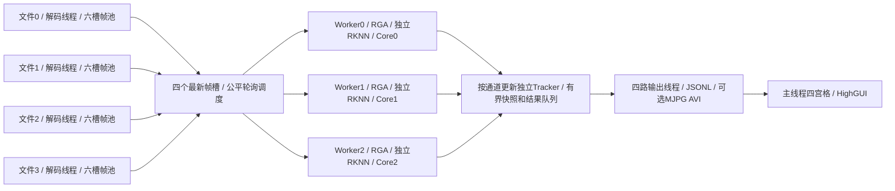

# 四路本地视频检测

`yolo_multi` 同时播放 1～4 个本地视频，由三个固定 Worker 分别使用 RK3588 NPU Core0/1/2。
默认使用现有 YOLO26 INT8 800×608 模型；四路独立 ByteTrack/Kalman，源帧实时播放，检测能力不足时替换过期等待帧。
检测之间直接使用跟踪器自带的 Kalman 预测；四路入口不运行 LK 或其他图像光流。

阅读实现时可以先核对单图契约，再沿下图跟踪派发、缓冲复用和各路输出。四路每路 30 FPS 真实检测需要合计约 120 次/秒；现有报告的约 30 FPS 输出包含预测和重复画面，不能作为该目标已达成的证据。



## 构建和运行

复用板端原有 GCC、Ninja、系统 OpenCV 4.10 和 `/opt` SDK，构建并发为4：

```bash
cd /home/yolo/yolo_run
cmake --preset rk3588-release
cmake --build --preset rk3588-release

out=$(mktemp -d)
./build-rk3588/yolo_multi \
  --input /path/channel0.mp4 --input /path/channel1.mp4 \
  --input /path/channel2.mp4 --input /path/channel3.mp4 \
  --output-dir "$out/channels" \
  --preview auto --record on
```

已有交通视频可同时打开四次作为竞争测试；四路具有独立解码器、帧池、序号和跟踪状态：

```bash
cd /home/yolo/yolo_run
clip=/path/to/your-video.mp4
out=$(mktemp -d)
./build-rk3588/yolo_multi \
  --input "$clip" --input "$clip" --input "$clip" --input "$clip" \
  --output-dir "$out/channels" --preview off --record on
```

输出目录必须不存在，重复运行请换目录。`--config` 默认指向 `config/video_multi.yaml`；`--model` 可覆盖该配置里的模型路径，不改变旧入口的默认 FP16 配置。

原单路配置中的 `video_detect_fps`、`video_stride_mode`、`video_model_async` 和 LK 设置不参与新入口调度；四路版通过 `--detect-fps` 控制请求频率，三个 Worker 始终公平处理符合领取条件的最新等待帧。

| 参数 | 默认值与行为 |
|---|---|
| `--input FILE` | 重复 1～4 次，仅本地常规文件 |
| `--output-dir NEW_DIR` | 必填，独占创建，保存各路结果和整体统计 |
| `--preview auto\|on\|off` | `auto`，有图形会话时显示 1280×720 四宫格；显式 `on` 且无显示环境时报错 |
| `--record on\|off` | `on`，保存各路原分辨率 MJPG AVI；录制要求偶数宽高 |
| `--duration-seconds N` | `0`，播放一次直到所有路结束；正值限制共享播放时长 |
| `--detect-fps N` | `0`，所有发布帧参与检测竞争；正值限制每路正常检测请求频率，支持至240，EOF补交最后一帧 |
| `--track-max-age-ms N` | `500`，框距最后一次真实检测匹配的最长显示时间，支持1～1000 ms |
| `--config FILE` / `--model FILE.rknn` | 共享同一模型及阈值，仍校验 YOLO26 tensor 契约 |

在图形会话中按 `q`、Esc 或关闭窗口停止；无显示环境用 SIGINT/SIGTERM 停止。正常结束及主动停止返回0，解码、推理、输出或录制失败返回1并保留已有结果。

## 调度和内存所有权

调度器的共享锁只保护待处理槽、在途标记和轮询游标。Worker 在锁外执行 RGA/RKNN。每路只保留一个最新等待项、最多一个在途任务；成功领取才移动游标。持续有帧且未在途的通道，在另外至多三次派发后获得机会。该保证针对派发次数；实际等待时间也受正在执行的硬件任务时长影响。

某路 EOF 后保留最后一个等待项供排空；某路解码异常记录错误、结束该路，其他路继续。取消会释放等待项，但在途任务保留自己的租约直到完成。执行失败沿用现有 RKNN 失败清理和完成确认规则，不自动重建 Context 后继续推理。

每路六个预分配 BGR 帧槽由解码器唯一写入；检测、最新画面和输出持有共享只读租约。没有空闲槽时跳过发布，不覆盖被消费者持有的图像。绘框使用输出线程自己的副本。仅写 JSONL 且关闭预览时不执行绘框或整帧复制。

OpenCV/FFmpeg 每路固定一个解码线程，输出 CPU BGR；预处理仍有一次 **CPU BGR → DMA-BUF 上传**，之后 RGA 写独立 RGB DMA-BUF，由该 Worker 的 RKNN Context 导入同一 RGB 分配。三个 Worker 提前预留所有输入所需的最大 BGR 容量，切换分辨率时复用分配。源图在同步 RGA 完成后归还；RGB 帧租约覆盖输入绑定、执行、取输出和后处理。RKNN 注册撤销、Context 销毁和底层分配释放继续遵守原有生命周期。因此此入口不属于端到端零拷贝。

各路跟踪状态由该路在途 Worker 串行更新，输出线程读取最多64份不可变快照。只使用源时间不晚于画面时间的快照，Kalman 预测有效期默认500 ms，轨迹标识为 `channel_id:track_id`。每路检测事件队列容量64；写入或队列失败被明确记录，Worker 不做磁盘 I/O，也不等待写盘。

## 跟踪器预测与检测校正

每路 ByteTracker 使用中心位置、宽高比、高度及相应速度构成八维状态。RKNN 返回结果时，在**检测源帧的媒体时间**上进行 Kalman 预测、两阶段检测关联和测量更新；每路只允许一个任务在途，检测源时间严格递增。检测间隔、推理耗时和解码跳帧都使用实际时间差，不按固定“一帧”推进速度。

在 RKNN 处理期间，输出线程对最新可用跟踪快照调用 `predictDetailedAt`，直接复用 ByteTracker 内部的时间制 Kalman 状态转移与过程噪声，得到当前画面时间的位置、尺寸和协方差。预测只操作快照副本，不修改检测侧跟踪器，也不被当作新的测量回灌。重复画面得到相同预测，不会重复推进状态。检测完成后，新快照取代旧快照，后续画面由校正后的状态继续预测，无需等待下一次检测才输出框。

短时漏检的确认轨迹进入 `lost` 状态，仍可在有效期内预测；重获关联后恢复原 ID。每个框都保存最后一次**真实检测匹配**的源帧号和时间，预测不能刷新该时间。超过 `--track-max-age-ms` 后隐藏，即使较新的推理仍含该条未匹配轨迹。内部最多保留约一秒用于再次关联，因此显示有效期上限为1000 ms。快速转向、长遮挡或新目标出现仍需下一次 RKNN 测量校正，Kalman 不观察中间帧的像素变化。

`--detect-fps 0` 保留四路对三个 NPU Worker 的持续竞争；例如设置 `--detect-fps 8`，则减少正常检测请求，中间画面仍按视频输出节奏预测。实际请求时刻量化到可用源帧，解码不足或 NPU 繁忙时检测率会降低，结束时额外补交最后一个已发布画面。频率受限的运行应标为“检测请求频率受限”，不能用来报告 NPU 最大吞吐。

```bash
out=$(mktemp -d)
./build-rk3588/yolo_multi \
  --input "$clip" --input "$clip" --input "$clip" --input "$clip" \
  --output-dir "$out/channels" \
  --preview off --record on --detect-fps 8 --track-max-age-ms 500
```

该实现复用原有 BGR 帧池、三个 RGA/RKNN 预处理器和快照队列，未增加灰度帧池、光流预处理或跟踪线程。

## 输出与时间口径

根目录包含 `metadata.json`、`summary.json` 和约每秒一行的 `resources.jsonl`；`stream_0`～`stream_3` 各含 `results.jsonl`、`summary.json`，开启录制时还有 `annotated.avi`。

JSONL 的 `type=detection` 是实际推理结果，包含 Worker/核编号、检测框和阶段耗时；`type=frame` 是输出画面和预测轨迹。零目标的推理仍计入检测帧数。输出帧数及视频 FPS 不能当作 NPU 检测 FPS。

| 字段 | 时间或身份含义 |
|---|---|
| `channel_id` / `source_frame_index` | 视频通道及其源帧号，检测结果据此路由 |
| `media_timestamp_ms` | 源帧号 ÷ 文件 FPS，对应媒体时间 |
| `scheduled_monotonic_ms` | 共享播放起点加媒体时间，与完成时间处于同一单调时钟域 |
| `completed_monotonic_ms` | 推理与后处理完成时间 |
| `output_index` / `output_timestamp_ms` | 输出固定帧率时间线，与实际源帧号分别保留 |
| `duplicate` | 该输出槽复用了前一幅源画面 |
| `detection_source_frame_index` / `detection_age_ms` | 画面使用的检测来源及媒体时间年龄 |
| `detection_correction_applied` | 本画面是否首次采用较新的检测侧跟踪快照，零目标结果也会校正状态 |
| `tracking_ms` / `predicted_boxes` / `lost_predictions` | 本画面跟踪预测耗时、预测框数和短时失配轨迹数 |

每个 `tracks` 项还含 `last_detection_source_frame_index`、`last_detection_timestamp_ms`、`detection_age_ms`、`prediction_ms`、`predicted`、`state` 和 `center_stddev_px`。其中 `prediction_ms` 从快照时间计算，`detection_age_ms` 从该目标最后一次真实匹配计算，二者可不同。`center_stddev_px` 是模型内部的中心坐标标准差估计，未经业务数据校准；保留的 `score` 是检测分数，不代表预测框重新经过模型确认。

`tracking.prediction_frames`、`predicted_boxes`、`lost_predictions` 仅累计不同源画面，重复录制帧不重复计数；`correction_frames` 统计采用新快照的输出次数。`detection_rate_skipped` 统计主动跳过的检测请求，与解码丢帧、等待槽替换分别记录。

文件按各自 FPS 播放，解码落后时只 `grab` 过期帧并跳过发布。首版使用标称 FPS 时间线，不承诺复现 VFR 文件的逐帧原始 PTS，也不处理音频。

录制使用系统 OpenCV `imencode` 编码 JPEG（质量85、复用压缩存储），再由现有系统 libavformat 封装 MJPG AVI，按源 FPS 写出并保留分数帧率。该实现避免再次经过 VideoWriter 的 MJPEG 编码器；板端编码对比见验证产物。封装参考 [FFmpeg 的同步写包接口](https://ffmpeg.org/doxygen/trunk/group__lavf__encoding.html)。错过输出槽时复用上一画面，使视频时长与播放时间一致。录制落后超过250 ms 时关闭该路录制、记录错误，检测及其他路继续，不把慢磁盘反压到 NPU。关闭录制后允许跳过过期输出槽，并单独计数。

耗时使用固定1 ms直方图报告 P50/P95/P99，≥4096 ms 的样本进入溢出桶。原始检测事件保留实际耗时，基准工具另按稳态事件计算分位数。CPU 单核=100%；NPU 为驱动窗口采样负载。RSS/PSS 指标不可相加，缺失资源项保留 null。

## 验证命令

用本页四路命令完成一次短测后，从结果目录读取各通道的汇总：

```bash
/usr/bin/python3 - "$out/channels" <<'PYTHON'
import json, sys
from pathlib import Path
for path in sorted(Path(sys.argv[1]).glob('stream_*/summary.json')):
    stats = json.loads(path.read_text())
    print(path.parent.name, stats['inference_count'], stats['output_fps'])
PYTHON
```

比较真实检测数、逐路分配与输出速率。长测可在输入足够长时加入 `--duration-seconds 600`，分别打开和关闭录像，观察推理吞吐与录像开销。

本入口不接摄像头、RTSP 或通用 MPP 文件解码。现有 `camera_live`、`camera_run`、`yolo_run` 保持各自行为。桌面窗口显示需要在真实图形会话单独验收。

原四路版板端基线：8/8相关回归通过、四路十分钟长测完成，每路检测约13 FPS，四路录制短测约12.2～12.5 FPS；输出约30 FPS含复用帧。

本次原生预测版：9/9相关回归通过、10次板端运行完成、四路120秒连续预测通过。设置检测请求上限8次/秒时，长测实际每路约7.25～7.28次检测/秒，不同源画面预测约22.7～22.9 FPS，输出约30.1 FPS含复用帧。两次运行的条件与数据见 [项目 README](../../README.md)。
