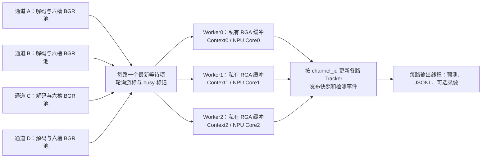
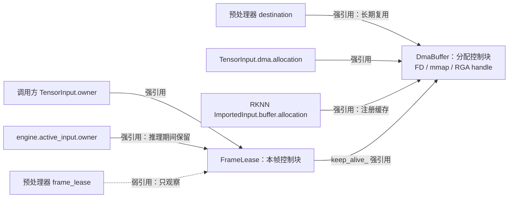

# 项目学习路线

建议沿着“一帧图像如何变成检测结果”学习，再扩展到摄像头、硬件缓冲、并发和推流。默认你能读基本 C++，RK3588 接口可以在遇到时补学。

[主 README](README.md) 提供构建与运行，[架构专题](docs/architecture.md) 负责原理查阅；本文件负责安排阅读顺序。第一轮先读调用关系和 `.h` 接口，第二轮再进入 `.cpp` 的实现与异常清理。

对照源码学习并发与所有权时，可打开[项目设计图与讲解](docs/design-diagrams.md)：包括线程/数据流、缓冲区生命周期、停止/异常清理三张主图，以及四路 `yolo_multi` 的结构对照。另有[离线图册](docs/diagrams/index.html)、PNG、SVG 和可编辑 Mermaid 源码。

## 先认清四个入口

| 程序 | 输入与职责 | 学习位置 |
|---|---|---|
| `yolo_run` | 本地图片/视频；图片只做检测，视频增加异步检测、LK 和跟踪 | 最先看图片分支 |
| `camera_run` | YUYV 800×600、请求 15 FPS；逐帧检测 | 学摄像头和缓冲生命周期 |
| `camera_live` | MJPEG 800×600、请求 30 FPS；MPP 解码、异步检测、跟踪，可选推流 | 掌握单帧后再看 |
| `yolo_multi` | 1～4 路本地视频，共享 3 个固定 NPU Worker，各路独立跟踪和输出 | 第 6 站重点学习 |

这四个程序复用 RKNN 推理和当前 YOLO26 后处理。`yolo_run` 默认 FP16，摄像头入口和 `yolo_multi` 默认 INT8。`camera_live` 默认 split：三个独立 Context/Worker 分别绑定一个 NPU 核；学习时可显式选择单 Worker 的 `default` 模式。`yolo_multi` 固定使用三个单核 Worker，四路调度方式见第 6 站。

阅读总顺序：

**整体地图 → 本地单图 → 预处理与模型契约 → DMA-BUF 与 YUYV 摄像头 → MJPEG 实时流水线 → 四路共享 3 个 NPU Worker → 跟踪 → 推流 → 测试与性能证据。**

## 第 1 站：建立地图，了解如何构建

依次读：

1. [开发环境](docs/environment.md)：知道哪些 SDK、工具链和系统设置必须复用。
2. [架构专题：整体架构](docs/architecture.md#整体架构)、[四个运行入口](README.md#四个运行入口)：先辨认模块，不必立刻读完整篇。
3. [生产 CMake](yolo_run/CMakeLists.txt)、[构建预设](yolo_run/CMakePresets.json)：看应用分别链接哪些库。
4. [运行说明](yolo_run/README.md)：找到构建和启动方法。

先记住各模块的职责：

| 目录 | 主要问题 |
|---|---|
| `config/` | 使用哪个模型、输入多大、置信度多少？ |
| `image/` | 图像如何转换为模型输入，内存怎样管理？ |
| `model/` | 怎样调用 RKNN，怎样解码输出？ |
| `camera/` | 怎样采集、解码、调度和编码？ |
| `tracking/` | 怎样关联目标、维持 ID、预测位置？ |
| `video/` | 文件视频怎样安排检测和 LK？ |
| `io/`、`metrics/` | 怎样输出结果、统计运行数据？ |
| `test/` | 如何证明功能、正确性和性能？ |

**读完应能回答：** RGA、RKNN、MPP 分别做什么？为什么正式程序与测试分开构建？

## 第 2 站：从一张图片读通最短路径

从 [main.cpp](yolo_run/main.cpp) 开始，先关注 `main()` 中创建 engine/preprocessor、定义 `infer` 回调和图片输出的部分。命令行解析先略读，视频分支留到后面。

沿着下面的调用关系跳转：

```text
loadAppConfig()                     读取配置
  → cv::imread()                    得到 BGR 图像
  → ImagePreprocessor::prepare()    生成 RGB 模型输入，记录 letterbox
  → YoloEngine::infer()             执行推理和后处理
  → ResultWriter::frame()           写 JSONL，可选画框图片
```

配合阅读：

- [config.yaml](yolo_run/config.yaml)、[AppConfig](yolo_run/config/app_config.h)：分清默认值、配置文件路径与 CLI 覆盖。
- [inference_types.h](yolo_run/model/inference_types.h)：先认识 `LetterBoxInfo`、`TensorInput`、`Detection`、`InferResult`。
- [预处理接口](yolo_run/image/image_processing.h)、[推理接口](yolo_run/model/yolo_engine.h)、[输出接口](yolo_run/io/result_writer.h)：先弄懂输入输出，再读实现。

可以先运行一张现有图片，建立代码和结果的对应关系：

```bash
cd /home/yolo/yolo_run
cmake --preset rk3588-release
cmake --build --preset rk3588-release

cd /home/yolo
mkdir -p test/results
study_dir=$(mktemp -d /home/yolo/test/results/study-image.XXXXXXXX)
env -u LD_LIBRARY_PATH -u LD_PRELOAD ./yolo_run/build-rk3588/yolo_run \
  --input test/camera/camera_800x608.jpg \
  --output "$study_dir/results.jsonl" \
  --annotated "$study_dir/marked.jpg"
```

构建预设已指定系统 GCC、Ninja、C++17 和并发度 4。运行命令清除可能干扰系统 SDK 的动态库环境变量；不需要安装新的依赖。

查看 JSONL 与画框图：找出检测类别、分数、坐标，再对照 `Detection` 和 writer 实现。程序退出成功只能证明完成运行；框是否正确仍需人工观察或标注评测。

**读完应能回答：** 一张图片经过哪几个函数？输入和输出坐标分别属于哪个尺寸？

## 第 3 站：弄懂预处理、RKNN 和后处理的约定

按顺序读：

1. [image_processing.cpp](yolo_run/image/image_processing.cpp)：`resizeGeometry()` → `ImagePreprocessor::Impl::prepare()`。阅读 RGA 缩放、BGR/RGB 和补边实现；OpenCV 像素参考位于 `test/support/cpu_reference.h`，生产预处理仅使用 DMA-BUF。
2. [yolo_engine.cpp](yolo_run/model/yolo_engine.cpp)：构造函数的模型加载与 `rknn_query()` → 输入绑定 → `infer()` → 输出归还。
3. [yolo_postprocess.cpp](yolo_run/model/yolo_postprocess.cpp)：`validateModelLayout()` → `decodeYolo26()`。
4. [架构专题：模型与坐标](docs/architecture.md#rknn-输入yolo26-后处理与坐标)：对照代码查输入输出契约。

当前项目必须记住的参数：

- 应用输入为 RGB UINT8、NHWC，逻辑形状 `[1,608,800,3]`。
- 默认交通模型：800×600 → 800×608，上下各补 4 行。COCO 配置：800×600 → 640×480，再上下各补 80 行至 640×640；填充值均为 114。
- 默认交通模型 boxes 为 `[1,4,9975]`、scores 为 `[1,10,9975]`；COCO 为 `[1,4,8400]`、`[1,80,8400]`。分数均已做 Sigmoid，模型和配套配置一同切换。
- 当前 YOLO26 one-to-one 导出使用约定的 Top-K 后处理，不额外添加 NMS；不能直接套用 YOLOv5/v8 后处理。
- `InputMemoryLayout` 描述 native stride 和容量要求，可见宽高不能代替实际分配要求。

**小练习：** 手算 800×600 → 800×608 的 padding，以及模型框映射回原图时的坐标变化，再到 `resizeGeometry()` 和 `decodeYolo26()` 核对。

**读完应能回答：** 为什么不能重复 `/255`、Sigmoid 或反量化？为什么换一个 RKNN 模型不一定只改文件路径？

## 第 4 站：结合 YUYV 摄像头理解 DMA-BUF 和所有权

先读较短的接口，再读调用点：

1. [dma_buffer.h](yolo_run/image/dma_buffer.h) → [dma_buffer.cpp](yolo_run/image/dma_buffer.cpp)：FD、mmap、RGA 导入句柄，以及 `CpuAccess`。
2. [frame_lease.h](yolo_run/image/frame_lease.h) 与 [TensorInput](yolo_run/model/inference_types.h)：分清分配存活和当前帧占用。
3. [camera/main.cpp](yolo_run/camera/main.cpp)：重点找 `prepareYuyv()` → `frame.reset()` → `engine.infer()`。
4. [v4l2_camera.h](yolo_run/camera/v4l2_camera.h) → [v4l2_camera.cpp](yolo_run/camera/v4l2_camera.cpp)：初始化入队、`next()` 出队、租约释放后归还。
5. 返回 [prepareYuyv()](yolo_run/image/image_processing.cpp) 和 [ImportedInput](yolo_run/model/yolo_engine.cpp)：把 RGA 写入与 RKNN FD 导入接起来。

用这两条时间线检查理解：

```text
源 A：QBUF → 摄像头写 → DQBUF → RGA 读完 → 最后源租约释放 → QBUF
目标 B：RGA 写 RGB → RKNN 使用 → 输入帧租约全部释放 → 可写下一帧
```

当前采用独立源/目标：RGA 读 A、写 B，RKNN 再导入同一块 B。QBUF 归还采集槽使用权，不释放物理内存。RKNN 注册可长期持有 allocation，不能据此判断当前帧是否仍被使用。

注意三种不同的保证：

- `allocation` 保证底层分配仍存在。
- 帧租约保证当前像素在消费完成前不被生产者覆盖。
- Cache Sync 管理 CPU 访问一致性；RGA/RKNN/MPP 的完成条件另行保证设备已结束访问。

**小练习：** 画出 A/B 的所有者、FD 导入方、最后一次读写和允许复用时刻，再对照 [架构专题：所有权与同步](docs/architecture.md#内存所有权缓存同步和执行同步)。

**读完应能回答：** 为什么源帧可以在 NPU 推理前归还？为什么 `shared_ptr` 仍存活不代表硬件任务已经完成？

## 第 5 站：扩展到 MJPEG、MPP 和实时并发

按调用层次读，主力放在 `live_pipeline.cpp`：

1. [live_main.cpp](yolo_run/camera/live_main.cpp) → [live_cli.cpp](yolo_run/camera/live_cli.cpp)：找到配置和 `runLive()` 的入口。
2. [live_media.h](yolo_run/camera/live_media.h)：认识 `Stamp`、`EncodedFrame`、`DecodedFrame`、`LatestSlot`。
3. [live_media.cpp](yolo_run/camera/live_media.cpp)：`CameraSource` → `PacketPool` → `MjpegDecoder`。结合 [MPP 注册封装](yolo_run/image/mpp_dma_buffer.h) 理解导入和释放。
4. [live_pipeline.cpp](yolo_run/camera/live_pipeline.cpp)：`runLive()` 的资源创建 → 采集/解码线程 → 推理 Worker → 校正线程 → 输出循环 → 停止与 join。

先画数据流，再给每个方框标线程：

```text
MJPEG DMA-BUF → MPP 解码 → NV12 Surface → 防抖分析并固定本帧 ROI
                                  ├→ RGA → RGB → RKNN → 检测结果 → 跟踪校正
                                  └→ RGA ROI → BGR → 画框/输出
```

重点追四个问题：

- 出队后将空闲 DMA-BUF 换入 V4L2 槽，为什么原压缩包仍可交给 MPP，而不用复制？
- 同一 NV12 Surface 同时被推理和输出使用，谁负责阻止它提前复用？
- `LatestSlot` 为什么替换旧等待帧？结果/JSONL 的 `BoundedQueue` 满了又怎样处理？
- split 的三个 Worker 为什么各有独立 engine、preprocessor 和 RGB？为什么它提高多帧吞吐，却不等于单帧耗时缩短三倍？

实际运行可先显式用 `--npu-mode default` 理解单 Worker，再用相同输入观察 `split`。摄像头短测命令见 [主 README](README.md#四个运行入口)；运行前确认摄像头未被其他采集进程占用。

**读完应能回答：** 哪些线程可以处理不同帧？哪些数据会丢弃？慢推理为什么不会让图像等待队列无限增长？

实时防抖另读 [frame_stabilizer.h](yolo_run/video/frame_stabilizer.h)、[实现](yolo_run/video/frame_stabilizer.cpp) 与 [防抖指南](yolo_run/deploy/STABILIZATION.md)：分流前估计并固定 ROI，检测和渲染使用同一防抖画布。关闭用 `--stabilize off`；默认开启时的 JSONL v2 不应直接按原图坐标解释。

## 第 6 站：仔细拆解四路视频与 3 个 NPU Worker 并发

这一章对应现有 `yolo_multi`，先读 [四路运行说明](yolo_run/video/MULTI_VIDEO.md)，再打开 [multi_video.cpp](yolo_run/video/multi_video.cpp) 的 `run()` 和 [fair_scheduler.h](yolo_run/video/fair_scheduler.h)。目标是能解释：**四个视频通道怎样竞争三个执行单元，怎样同时处理不同通道，又怎样保证同一路的状态和图像不被并发改坏。**

### 6.1 四路、三个 Worker、三个 NPU 核分别是什么

“路”是视频通道，有自己的解码器、帧号、时间、帧池、跟踪器和结果目录；Worker 是长期运行的 CPU 线程，负责提交 RGA/RKNN 任务；NPU 核是实际执行模型计算的硬件资源。它们的数量和职责不同。

| 层次 | 当前四路入口的实现 |
|---|---|
| 输入 | 4 路本地文件，4 个解码线程；OpenCV/FFmpeg 软件解码为 CPU BGR |
| 调度 | 一个共享 `FairScheduler<Frame>`；由 Worker 调用 `take()`，没有额外调度线程 |
| 推理 | 3 个固定 Worker，每个独占一个 engine、preprocessor 和输入/输出缓冲 |
| 硬件 | Worker0/1/2 的 Context 分别绑定 NPU Core0/1/2 |
| 跟踪校正 | 每路独立 ByteTracker，由领取该路任务的 Worker 更新，没有新增跟踪线程 |
| 输出 | 每路一个输出线程，写 JSONL、执行快照预测、可选画框和录像 |
| 主线程 | 管理停止、资源采样和可选四宫格 HighGUI |

因此四路时应用创建的线程加上主线程为 `4 + 3 + 4 + 1 = 12`；Runtime、FFmpeg 等库内部线程另计。三个 Worker 也不等于只占用三个 CPU 核，NPU 绑定与 CPU 线程亲和性是不同接口。



通道不永久绑定某个 Worker。A 的上一帧可以由 Worker0 处理，下一帧可以由 Worker2 处理；通道身份由 `task->channel` 保留，不能把 Worker 编号当作通道编号。当前模型 batch 仍为 1，每个 Worker 每次完成一整张图像。

### 6.2 三个 Worker 怎样真正并行

在 `run()` 启动线程前，先创建三份 `YoloEngine` 和 `ImagePreprocessor`，并预留所有输入中最大的 BGR 上传容量。下面是源码中的核心初始化关系：

```cpp
constexpr std::array<int, 3> masks{
    RKNN_NPU_CORE_0, RKNN_NPU_CORE_1, RKNN_NPU_CORE_2
};
for (size_t i = 0; i < engines.size(); ++i) {
    engines[i] = std::make_unique<YoloEngine>(config, masks[i]);
    processors[i] = std::make_unique<ImagePreprocessor>(
        config, engines[i]->inputMemoryLayout());
    processors[i]->reserveBgrSourceCapacity(upload_capacity);
}
```

随后三个线程分别只用 `processors[w]` 和 `engines[w]`。进入 [YoloEngine](yolo_run/model/yolo_engine.cpp) 可见，每个 engine 各自 `rknn_init()`，再调用并检查 `rknn_set_core_mask()` 的结果。核掩码实际为 `1、2、4`，不要用循环下标 `0、1、2` 代替；`0` 是 AUTO。定义可对照板端 `/opt/rknn/runtime-2.5.0/include/rknn_api.h` 和 [Rockchip 官方头文件](https://github.com/airockchip/rknn-toolkit2/blob/master/rknpu2/runtime/Linux/librknn_api/include/rknn_api.h)，实际运行以板端版本为准。

每个 Worker 内部按顺序执行：

```text
take() 领取一帧并退出调度锁
  → prepare()：CPU 上传、RGA 同步预处理
  → infer()：绑定输入、rknn_run、取输出、YOLO26 后处理、归还输出
  → 更新所属通道 Tracker，发布快照和检测事件
  → 本帧 tensor 租约释放
  → complete(channel)，再领取下一项
```

Worker0 等待 Core0 时，Worker1/2 可以提交自己的任务；解码、输出线程也可以继续推进。**并行来自三个独立 Context 处理不同通道的帧。** 当前 RKNN 初始化 `flags=0`，运行使用阻塞方式；外层输出不等待检测，就是这里的流水线异步，并没有开启 `RKNN_FLAG_ASYNC_MASK`。若将来启用该 flag，需要重新核对输出对应哪一帧。

`YoloEngine::infer()` 内部仍有自己的 mutex，覆盖输入绑定、执行、取输出和后处理。三份 engine 有三把锁，可以同时工作；把三个 Worker 改成共用同一个 engine，会被这一把锁串行化。只删锁则会让输入绑定和复用的输出数组互相覆盖。当前没有调用 `rknn_dup_context()`，也没有启用权重或内部工作区共享；不能假设三份 Context 已经共享模型内存。

### 6.3 四路抢三个位置，调度器如何保证公平

先记住每路两个独立状态：`pending` 是尚未开始、允许被新帧替换的等待项，`busy` 表示已经有一个任务在途。允许“一个在途 + 一个等待”，但不允许同一路同时有两个在途任务。

| 接口 | 在调度锁内完成什么 | 作用 |
|---|---|---|
| `put(channel, frame)` | 写入该路等待槽，已有等待项则替换；唤醒 Worker | 忙时只保留较新的候选帧 |
| `take()` | 从游标轮询，跳过空槽和 busy 通道；移走等待项，置 busy，再推进游标 | 领取与占位必须是同一个原子步骤 |
| `complete(channel)` | 清 busy 并唤醒 Worker | 允许该路的下一帧开始 |
| `finish(channel)` | 标记 EOF，保留最后等待项 | 读完文件后继续排空检测 |
| `cancel()` | 停止领取并清理等待项，保留在途状态 | 停止不抢走硬件仍在使用的帧 |

以 A/B/C/D 四路开始都有等待帧为例；下列编号只表示各路先后发布的帧，不是实际时间测量：

| 时刻/事件 | 在途任务 | 调度器等待项与决定 |
|---|---|---|
| 首批三个 Worker 领取 | A0、B0、C0 | D0 等待，游标指向 D |
| A 又发布 A1、A2 | A0 继续执行 | A 等待槽由 A1 替换为 A2，A0 不变 |
| B0 先完成 | A0、C0 | 空闲 Worker 优先领取 D0，不能再次领取仍 busy 的 A |
| A0 完成 | C0、D0 | 从 D 之后继续轮询；若 A2 就绪，可领取 A2，Worker 可以与上次不同 |

游标只在**成功派发**后移动，新帧发布得再快也不能抢改游标。某通道持续有等待帧且未在途时，至多再经过另外三次成功派发就能获得机会。这保证派发顺序的公平，不保证固定毫秒延迟、完全相等的计算时间或每个核恰好处理同样多的帧。

四路总等待项最多 4 个，实际在途最多 3 个；这不是无限 FIFO。`replaced` 表示某个尚未开始的候选帧被丢弃，不会取消正在执行的推理。业务若要求每一帧都检测，应重新评估容量和背压；加长队列不能提高吞吐，只会积压更旧的画面。

### 6.4 并发冲突分别由什么机制解决

不能指望一把“大锁”解决全部问题。当前实现按资源划分保护范围：

| 可能的冲突 | 当前保护方式 | 重点检查 |
|---|---|---|
| 两个 Worker 同时领到同一路 | 调度 mutex 内同时检查并设置 `busy` | 检查和置位不能拆成两次加锁 |
| 同一路后帧先完成、跟踪时间倒退 | 每路最多一个在途，完成跟踪和事件发布后才 `complete()` | busy 覆盖整个通道处理过程，不能在 `infer()` 返回时提前清除 |
| RKNN 输入绑定、输出缓冲互相覆盖 | 每 Worker 私有 Context/缓冲；engine 内部再加 mutex | 不跨 Worker 共用可写输入或输出 |
| 结果投到错误通道 | 始终通过 `task->channel` 取得对应 `Channel` | 日志同时保留 channel、源帧号、worker、core_mask |
| Worker 写 Tracker、输出读快照发生竞争 | 每路 `Channel::mutex` 保护 tracker/history/events/latest 等状态 | 复制快照后在锁外预测，不让输出修改检测侧 Tracker |
| 解码或画框覆盖推理中的图像 | 帧池租约、只读原图，画框使用输出线程自己的副本 | `cv::Mat` 浅拷贝不隔离像素 |
| CPU/设备看到旧缓存或设备未完成 | CPU Cache Sync、RGA 同步完成、RKNN 完成条件分别处理 | mutex 和引用计数都不能代替设备完成确认 |
| 慢写盘拖住 NPU | Worker 仅投递有界事件，由输出线程写盘 | 队列满明确报错，不能静默丢结果或无限增长 |

调度器的锁只覆盖槽、busy、EOF 和游标；RGA/RKNN 都在锁外运行。`Channel::mutex` 保护短时间的状态更新，输出线程取走事件后也在锁外写文件。以后增加统计或回调时，不要把硬件执行、阻塞 I/O 放进这些共享临界区。

锁还建立跨线程的可见性：即使 A 的相邻任务由不同 Worker 执行，前一任务完成并清 busy，后一任务才能领取；通道状态另由 `Channel::mutex` 保护。当前每路结果还检查 `frame.sequence > watermark`，防止状态回退。**只加 watermark 不能替代在途限制**：允许后帧先完成再丢掉前帧，会改变跟踪校正序列，需要额外的重排和超时策略。

特别注意与 `camera_live` 的差异：它有唯一校正线程；四路入口由各在途 Worker 更新对应通道 Tracker，通过同一路在途互斥保证顺序。两条路径不能直接套用彼此的线程图。

### 6.5 为什么图像不会被提前覆盖：跟着三块内存走

四路文件入口的真实数据路径是：

```text
通道帧池中的 CPU BGR
  → 按行复制到当前 Worker 的 BGR DMA-BUF
  → RGA 缩放、BGR→RGB、letterbox，写当前 Worker 的 RGB DMA-BUF
  → 该 Worker 的 RKNN Context 导入同一个 RGB FD
```

| 内存/对象 | 谁拥有 | 何时可以复用 |
|---|---|---|
| 每路 6 槽 CPU BGR | 解码器管理，各消费者持有共享只读引用 | 检测、latest、输出等外部引用都释放，仅池本身持有时才可重新写 |
| 每 Worker 一份 BGR 上传源 | 对应 preprocessor | CPU 写入和 Cache Sync 结束，RGA 已读完 |
| 每 Worker 一份 RGB 目标 | 对应 preprocessor 分配，RKNN 注册保持 allocation 存活 | RGA、RKNN 已完成，且本帧 `TensorInput.owner` 全部释放 |
| 每 engine 两份 FP32 输出数组 | 对应 engine，预分配复用 | 取输出、后处理和 `rknn_outputs_release()` 完成 |

帧池的 `acquire()` 检查 `use_count()==1`，成立的前提是**解码器为唯一生产者，其他线程只能从已发布引用中取得只读租约**。这是该帧池的所有权约定，不能把一次引用计数检查当作任意并发代码的通用锁。无空闲槽时跳过该帧发布，不覆盖仍被引用的像素。输出调用 `copyTo(drawing)` 后在自己的图上画框；仅写 JSONL 且关闭预览/录制时不做这次整帧复制。

一个容易混淆的释放点在 Worker：`prepare()` 同步完成后就 `frame.image.reset()`，释放该 Worker 的原始 BGR 引用，因为上传和 RGA 读取已结束；但输出还持有原图时，池槽仍不能覆盖。RGB 则由 `tensor` 继续占用，直到推理、后处理及本次作用域结束。下一次 `prepare()` 会通过 `requireAvailableInput()` 检查旧帧租约是否已结束。

RKNN 的 `ImportedInput` 长期缓存注册，因此不能用 RGB allocation 的引用数判断当前帧是否空闲；[FrameLease](yolo_run/image/frame_lease.h) 专门表示“当前像素仍被使用”。同样，FD 数字可能被系统复用，缓存命中还要比较 allocation 身份、地址、容量和 stride，不能只比较 FD。

还有四个硬件细节要对照 [预处理实现](yolo_run/image/image_processing.cpp) 和 [DMA 封装](yolo_run/image/dma_buffer.cpp)：

- BGR 上传源宽度按 16 像素对齐；`cv::Mat::step` 是字节，RGA 的宽 stride 是像素，换算 RGB/BGR 字节偏移还要乘 3。
- RGB 按 `inputMemoryLayout()` 分配，要同时满足 native stride 和容量要求，不能直接用可见宽高代替。Worker 切换到另一个分辨率的通道时，也要携带该帧自己的 letterbox 信息。
- CPU 上传和补边使用 `CpuAccess` 管理 Cache Sync；当前 RGB 目标复用板端已验证的 uncached heap。Cache Sync 解决 CPU/设备缓存一致性，设备是否完成仍看 RGA/RKNN 的执行条件。
- 当前 RGA 用 `IM_SYNC`，成功返回后才提交 NPU。三个 Worker 都可提交 RGA，但共享 RGA、DDR 和 CPU 带宽，实际重叠由驱动调度和硬件能力决定；不能推导出三倍性能。

四路读取本地文件仍有 CPU BGR 上传复制，**这条链路没有实现端到端零拷贝**。

#### 6.5.1 `weak_ptr` 在这里观察的究竟是什么

这里的 C++ 类型名是 `std::weak_ptr`，含义是弱引用。它能观察某个共享对象是否还有强引用；观察本身不会延长该对象的存活时间。当前工程中，预处理器的 `frame_lease` 是 `std::weak_ptr<void>`，它观察的是**本帧的 `FrameLease` 对象**，不是直接观察 DMA-BUF FD。

先把三个不同问题分开：

| 问题 | 当前由谁负责 |
|---|---|
| DMA-BUF 的 FD、mmap、RGA handle 还能不能使用？ | `shared_ptr<DmaBuffer>` 及保留它的 allocation 引用维持资源存活 |
| 同一块 RGB 内存里的这一帧，是否仍被消费者占用？ | `shared_ptr<FrameLease>` 表示占用，`weak_ptr frame_lease` 观察占用是否结束 |
| RGA/NPU 是否真的停止读写了？ | 同步 API、执行完成确认及异常等待路径；智能指针不负责查询设备 |

`weak_ptr` 不会自动执行 `close()`、发起 Cache Sync、等待 NPU，也不会在过期时自动唤醒条件变量。它在这里提供“上一帧租约是否还有人持有”的检查手段；能否安全复用还依赖整个交接协议。

#### 6.5.2 两套控制块，把分配存活与当前帧占用拆开

`shared_ptr` 的控制块记录共享所有权；同一个 `shared_ptr` 的副本共享控制块。这里 `make_shared<DmaBuffer>()` 与每帧的 `make_shared<FrameLease>()` 各自建立独立的共享所有权：一个分配可以连续承载很多帧，每帧有自己的租约对象。



图中两条指向分配的路径有不同用途：`TensorInput.dma.allocation` 提供分配所有权和布局描述，`TensorInput.owner` 提供当前帧租约。`FrameLease` 内部再保留 allocation，保证只要帧仍被占用，底层分配也不会提前析构。

为什么不直接用 `destination.use_count()` 判断能否写下一帧？因为 RKNN 注册会长期持有 allocation，推理结束后它也不会立刻释放。即使本帧已经没有消费者，分配仍有多个强引用，这是正常复用，不是内存泄漏。独立的帧控制块使“注册还在”和“像素还不能覆盖”可以分别表达。

反过来，预处理器也不能用自己的一个长期 `shared_ptr` 一直持有旧 `FrameLease`：这样消费者全部退出后，租约仍不过期，下一帧会一直被判为占用。当前预处理器持有分配的强引用，同时只保留帧租约的弱引用。

`FrameLease` 不持有预处理器，也没有 `DmaBuffer → FrameLease` 的强引用反向边，因此当前这条链没有形成引用环。这里引入弱引用的直接目的，是观察消费者占用而不延长占用。

#### 6.5.3 对着源码看一次租约的创建与检查

先读 [FrameLease](yolo_run/image/frame_lease.h)，它的核心很短：

```cpp
class FrameLease {
public:
    explicit FrameLease(std::shared_ptr<void> keep_alive)
        : keep_alive_(std::move(keep_alive)) {}
    FrameLease(const FrameLease&) = delete;
    FrameLease& operator=(const FrameLease&) = delete;
private:
    std::shared_ptr<void> keep_alive_;
};
```

它没有自定义等待逻辑；对象析构时，其成员 `keep_alive_` 释放一份分配引用。禁止复制的是 `FrameLease` 对象本身，多个消费者仍可复制指向同一个租约的 `shared_ptr`。

再看 [ImagePreprocessor](yolo_run/image/image_processing.cpp) 中的三处关键语句，以下是职责摘录，RGA 等步骤省略：

```cpp
// 成员：每个 Worker 有自己的一份预处理器与观察指针。
std::weak_ptr<void> frame_lease;

// requireAvailableInput()：覆盖 RGB 之前检查上一帧。
if (!frame_lease.expired())
    throw std::runtime_error("previous DMA input is still leased");

// makeDmaInput()：同步 RGA 成功后，创建并发布本帧租约。
input.owner = std::make_shared<FrameLease>(destination);
frame_lease = input.owner;
```

`std::shared_ptr<void>` 在这里是类型擦除：`owner` 可以统一保存不同类型的租约，仍沿用原控制块的销毁行为，不会因为变成 `void` 就漏掉 `FrameLease` 析构。`frame_lease = input.owner` 建立弱观察，不会增加租约的强引用数，也没有复制像素。

`auto copied = input;` 会共享同一个帧租约和底层分配；`std::move(input)` 则转移这些成员。不要给同一裸指针重新构造另一份独立 `shared_ptr`，否则会产生不相关的控制块和重复释放风险。借用 FD、`data` 或 RGA handle 的代码也不能擅自关闭或释放它们。

#### 6.5.4 从第 N 帧到第 N+1 帧，弱引用如何变化

| 阶段 | 谁仍持有第 N 帧 owner | `frame_lease.expired()` | RGB 分配的状态 |
|---|---|---|---|
| 首帧尚未创建 | 无 | `true`，默认弱引用为空 | 可以按需分配 |
| `prepare()` 返回 | Worker 的局部 `tensor` | `false` | 本帧不可覆盖 |
| `infer()` 进行中 | 局部 `tensor`、engine 的 `active_input`，以及可能的其他副本 | `false` | 保持存活且不可覆盖 |
| `infer()` 正常返回 | engine 已清空 `active_input`，局部 `tensor` 仍在 | `false` | 仍不能写下一帧 |
| 跟踪与事件发布结束，局部 `tensor` 退出作用域 | 若没有其他副本，则无 | `true` | 分配仍由预处理器/注册持有，可进入下帧准备 |
| 第 N+1 帧发布 | 新帧 owner 指向新的 `FrameLease` | 观察指针重新赋值后为 `false` | 通常继续使用同一 RGB FD |

因此 `infer()` 返回不自动代表调用方的租约已消失。调试中若保留了 `TensorInput` 副本，下一次 `prepare()` 被拒绝是保护逻辑在起作用；不要为了消除报错直接强制清 owner，同时继续通过原 FD 或地址使用旧像素。

第 N 帧的旧弱指针即使还保存在其他地方，也只观察旧租约，不会自动改为观察第 N+1 帧。预处理器通过 `frame_lease = input.owner` 主动切换观察目标。租约过期也不是“释放再重新分配 DMA”，通常只是允许下一帧覆盖同一分配。

#### 6.5.5 `expired()`、`lock()` 与并发边界

`expired()` 检查是否已无强引用；`lock()` 尝试原子地取得一份新的强引用，失败则返回空 `shared_ptr`。要访问一个可能随时消失的对象时，应直接取得并检查 `lock()` 的结果：

```cpp
if (auto lease = observed.lock()) {
    // 此作用域持有一份强引用，租约在这里保持存活。
    // 这里只说明所有权；实际访问像素仍要遵守读写和设备同步协议。
}
```

不要先 `if (!observed.expired())`，随后就假设对象肯定能取到；两次操作之间最后一个消费者可能释放引用。`lock()` 的 C++17 所有权语义可对照 [C++ 工作草案的 weak_ptr 观察接口](https://eel.is/c++draft/util.smartptr.weak.obs)。

当前生产者只是判断旧租约能否结束，所以用 `expired()`，不需要取得租约；若它在检查时 `lock()` 并一直保留结果，反而会延长旧帧占用。调试代码也要及时释放 `lock()` 得到的临时强引用。

这里的检查能作为复用门禁，有一个重要前提：**同一预处理器只由一个 Worker 顺序调用，而且不会有其他线程从旧弱引用重新取得租约并据此访问旧像素。** 消费者需要使用图像时，必须连续持有已有强租约，不能先放弃占用，再指望从 weak_ptr 重新申请旧帧。

若两个生产线程同时调用同一个预处理器，它们都可能看到旧租约过期，然后同时写同一 RGB。`weak_ptr` 不能提供排他写权限；增加这种用法时，需要把“选空闲槽 → 标记占用 → 写入 → 发布”纳入完整的互斥或槽位状态机。`YoloEngine::infer()` 的锁也保护不到调用前的 `prepare()`。

共享控制块的引用计数支持并发维护，不等于被指向的像素可以无锁读写，也不等于对同一个 `shared_ptr`/`weak_ptr` 变量一边赋值、一边读写是安全的。当前 `frame_lease` 仅由其所属 Worker 操作，避免了这种变量竞争。`expired()` 还不能证明另一个线程的析构收尾或设备任务已经完成。

#### 6.5.6 最终释放 DMA 与异常路径，还需要谁配合

正常路径通过“先完成设备访问，再释放占用”建立保证：RGA `IM_SYNC` 成功 → RKNN 执行并取输出成功 → 后处理与输出归还 → engine 清空 `active_input` → 调用方退出本帧作用域。弱引用只能观察这套协议产生的占用结束状态。

若 RKNN 执行失败，调用方局部对象退出仍不够。engine 会继续持有 `active_input`，所以本帧租约仍不过期，预处理器拒绝覆盖；随后析构路径必要时用 `rknn_wait()` 确认硬件完成，再清理注册、Context 和输入持有。无法确认完成时按当前策略终止进程。这里靠的是 engine 保存强租约并执行等待，不是 `weak_ptr` 自动识别了设备错误。

当不再使用整个缓冲时，撤销 SDK 注册并释放相关强引用；最后一个 `shared_ptr<DmaBuffer>` 释放时才触发 [DmaBuffer 析构](yolo_run/image/dma_buffer.cpp)，依次撤 RGA handle、`munmap()`、`close(fd)`。`DmaBuffer` 析构自身不等待硬件，调用方须先满足设备完成条件。C++ 对象析构也不等于内核立即回收全部物理页，内核或其他导入方仍可能保有自己的引用。

一个过期的 `weak_ptr` 可以继续保留控制块元数据，但不会阻止所观察对象的析构；即使 `make_shared` 的合并存储尚未回收，也不能据此认为 FD、映射或租约仍有效。

还要把 `CpuAccess` 与帧租约区分开：它管理 CPU 访问区间的 Cache Sync，内部也保留分配引用，但不会替代 RGA/NPU 完成等待。缓存一致性与设备执行同步是不同责任，见 [Linux DMA-BUF 文档](https://docs.kernel.org/driver-api/dma-buf.html#cpu-access-to-dma-buffer-objects)。

#### 6.5.7 用一个可运行的 C++17 例子观察两层生命周期

下面复用工程真实的 `FrameLease` 头文件，用普通对象模拟底层 allocation 和注册持有。它只验证 C++ 所有权关系，不分配 DMA-BUF、不访问 RGA/NPU，也不代表硬件同步已验证。临时示例不需要修改 CMake 或增加依赖：

```bash
lease_demo_dir=$(mktemp -d /tmp/yolo-weak-lease.XXXXXXXX)
cat > "$lease_demo_dir/lease_demo.cpp" <<'CPP'
#include "image/frame_lease.h"
#include <cassert>
#include <iostream>
#include <memory>

struct DemoAllocation {
    ~DemoAllocation() { std::cout << "allocation destroyed\n"; }
};
struct DemoInput {
    std::shared_ptr<void> owner;
    std::shared_ptr<void> allocation;
};
int main() {
    auto destination = std::make_shared<DemoAllocation>();
    std::weak_ptr<DemoAllocation> allocation_watch = destination;
    auto registration = destination; // 模拟 RKNN 注册长期持有分配。
    DemoInput first{std::make_shared<yolo::FrameLease>(destination), destination};
    std::weak_ptr<void> frame_watch = first.owner;
    auto copied = first;
    auto active_input = first; // 模拟 engine 正在使用本帧。

    first = {};
    copied = {};
    assert(!frame_watch.expired()); // engine 仍持有帧租约。
    active_input = {}; // 这里只模拟设备使用已经结束。
    assert(frame_watch.expired());
    assert(!allocation_watch.expired()); // 帧结束，分配仍存活。
    std::cout << "frame ended; allocation alive\n";

    {
        DemoInput next{std::make_shared<yolo::FrameLease>(destination), destination};
        frame_watch = next.owner; // 同一分配，新的一帧租约。
        assert(!frame_watch.expired());
    }
    assert(frame_watch.expired());
    destination.reset();
    assert(!allocation_watch.expired()); // 注册引用仍在。
    registration.reset(); // 最后一份分配强引用在此释放。
    assert(allocation_watch.expired());
    std::cout << "PASS lease/allocation lifetimes\n";
}
CPP
env -u CPATH -u CPLUS_INCLUDE_PATH -u LIBRARY_PATH \
  -u LD_LIBRARY_PATH -u LD_PRELOAD /usr/bin/g++ \
  -std=c++17 -Wall -Wextra -pedantic -I/home/yolo/yolo_run \
  "$lease_demo_dir/lease_demo.cpp" -o "$lease_demo_dir/lease_demo"
env -u LD_LIBRARY_PATH -u LD_PRELOAD "$lease_demo_dir/lease_demo"
```

预期依次输出 `frame ended; allocation alive`、`allocation destroyed` 和 `PASS lease/allocation lifetimes`。可以暂时保留 `active_input` 或 `registration`，观察它们分别阻止哪一层结束；不要把这个普通内存示例的释放动作直接移到设备尚在执行的代码中。

真实硬件约束的现有证据可按这三组源码阅读：

| 证据位置 | 验证什么 |
|---|---|
| [camera_test.cpp](test/cpp/camera_test.cpp) 中 `allocation_only` / `frame_lease` | 三份 `TensorInput` 副本中最后一份结束前禁止覆盖；只保留 allocation 不阻止同一 RGB FD 复用 |
| [hardware_test.cpp](test/cpp/hardware_test.cpp) 中 `retained_allocation` | 预处理器与调用方帧先销毁后，RKNN 注册仍能保住底层分配 |
| 同一硬件测试中 `observed_frame` / `inject_run_error` | 执行失败后仍保有帧占用，等待完成后才释放租约、注册和 FD |

需要复测上述硬件路径时，在没有其他硬件测试或推理并行占用的情况下，从 `/home/yolo/test` 构建后运行 `env -u LD_LIBRARY_PATH -u LD_PRELOAD ctest --preset rk3588-release -R '^(camera_preprocess|hardware)$'`。这两项会使用真实 DMA/RGA/RKNN；普通生命周期示例通过不能替代它们。

**小练习：** 如果 `frame_watch.expired()` 为真而 `allocation_watch.expired()` 为假，分别是谁已经退出、谁可能还持有分配？如果 engine 执行失败后没有保留 `active_input`，为什么“最后一个消费者释放了”也不能证明 RGB 可以覆盖？

### 6.6 检测结果异步回来后，四路跟踪和输出如何对齐

每个检测带有通道 ID、源帧号、媒体时间和完成时间。Worker 根据任务通道更新该路 ByteTracker，并发布 `TrackerSnapshot`；每路最多保留 64 份快照。跟踪状态属于通道，不能放在 Worker 里，否则同一路换一个 Worker 就会丢失历史，不同路也会混用目标 ID。

输出线程从历史中选择**源时间不晚于当前画面**的最新快照，复制后调用 `predictDetailedAt()`，预测当前画面位置，不修改检测侧状态，也不把预测当作新检测回灌。轨迹身份用 `channel_id:track_id`，因为不同通道可以各自出现相同的数字 ID。

媒体时间当前按 `源帧号 / 文件 FPS` 计算，控制实时播放和耗时用共享起点的单调时钟；不能把绝对媒体时间和单调时钟直接相减。这一版基于标称 FPS，不承诺恢复 VFR 视频逐帧原始 PTS。

默认显示有效期 500 ms，从目标最后一次**真实检测匹配**计时。预测或一次未匹配的新结果都不能刷新这个时间；零目标检测仍要更新跟踪器。四路版不运行 LK，Kalman 无法从中间图像观察到新目标或突然转向。

因此需要分别看 `type=detection` 的真实推理次数，以及 `type=frame` 的输出/预测次数。每路输出约 30 FPS 可以包含预测和重复画面，不表示每路每秒检测 30 次。四路各 30 次真实检测需要总计约 120 次/秒；按三个 Worker 均衡处理估算，平均完整任务周期需不超过约 `3 / 120 秒 = 25 ms`。这只是稳态容量条件，还要算解码、预处理、后处理、CPU、带宽和延迟余量，不能仅比较纯 NPU 耗时。

### 6.7 过载、EOF、异常和停止时怎样避免卡死

| 场景 | 当前策略与观察点 |
|---|---|
| 解码追不上实时播放 | 跳过过期源帧；帧池无槽也跳过发布，分别计数 |
| 检测追不上输入 | 最新等待项替换旧项；`--detect-fps` 可主动限制请求，实际完成频率可能更低 |
| 某路正常 EOF | `finish()` 保留最后等待项；等待 pending 和 busy 都清空，再完成该路输出 |
| 某路解码异常 | 记录该路错误并结束输入，其他路继续；最终摘要报告失败 |
| 输出事件队列满 | 每路容量 64，记录该路输出失败和丢失计数；Worker 不等待写盘 |
| 录制落后超过 250 ms 或写盘失败 | 关闭该路录制并记录错误，检测与其他路继续 |
| Worker 预处理或推理异常 | 记录全局错误，取消后续任务，走线程回收与资源清理；异常后也执行 `complete()` |
| SIGINT/SIGTERM、达到时长、关闭预览 | 清等待项、唤醒线程；在途任务完成或进入现有错误清理，再 join |

`complete()` 的时机不能提前，也不能漏掉。成功路径要等跟踪更新和事件发布完成；异常路径也要收尾，否则某路可能永远 busy。`condition_variable::wait()` 配合谓词检查可执行任务、取消和全局排空状态，避免丢失唤醒或空转轮询。

停止也不等于立即释放 DMA-BUF。实际 join 顺序为解码线程 → Worker → 输出线程，engine 和 preprocessor 在线程退出后才析构。若 RKNN 执行失败，engine 会标记不可再用并继续保留输入租约；析构时必要的 `rknn_wait()` 先确认完成，再撤销注册、销毁 Context、释放底层分配。无法确认完成时，当前代码终止进程，不继续释放可能仍被设备访问的内存，也不自动重建 Context 后接着跑。

这些退出机制不承诺任意驱动或磁盘阻塞都能在固定时间内中断。修改超时或恢复策略时，必须同时验证硬件完成条件和租约释放顺序。

### 6.8 按什么顺序阅读、运行和验证

建议先按这条源码路线各找一个关键点：

1. [multi_main.cpp](yolo_run/video/multi_main.cpp)、[multi_cli.cpp](yolo_run/video/multi_cli.cpp)、[video_multi.yaml](yolo_run/config/video_multi.yaml)：输入列表、默认模型、检测请求频率和输出路径。
2. [multi_video.cpp](yolo_run/video/multi_video.cpp)：`Channel`/帧池 → 创建三组资源 → Worker → 解码发布 → 输出快照 → 停止与 join。
3. [fair_scheduler.h](yolo_run/video/fair_scheduler.h)：`put()`、`take()`、`complete()`、`finish()`、`cancel()`，逐项检查谁持锁、谁持帧。
4. [yolo_engine.cpp](yolo_run/model/yolo_engine.cpp)、[image_processing.cpp](yolo_run/image/image_processing.cpp)：核绑定、同步调用和输入租约。
5. [调度测试](test/cpp/multi_scheduler_test.cpp)、[预测测试](test/cpp/multi_prediction_test.cpp)、[集成测试](test/python/multi_video_test.py)：公平派发、三消费者竞争、EOF、取消租约、时间和实际 NPU 结果路由。

先跑不使用摄像头/NPU 的两个核心回归：

```bash
cd /home/yolo/test
cmake --preset rk3588-release
cmake --build --preset rk3588-release
env -u LD_LIBRARY_PATH -u LD_PRELOAD ctest --preset rk3588-release \
  -R '^(multi_scheduler|multi_prediction)$'
```

再做四路短测。下面同一个现有视频打开四次，用独立解码器和通道状态验证竞争；输出目录取一个尚不存在的路径：

```bash
cd /home/yolo/yolo_run
cmake --preset rk3588-release
cmake --build --preset rk3588-release

clip=/home/yolo/test/rknn_video_compare_20261018_002d290d/video/002d290d-90f2bab2.mov
study_root=$(mktemp -d /home/yolo/test/results/study-multi.XXXXXXXX)
env -u LD_LIBRARY_PATH -u LD_PRELOAD ./build-rk3588/yolo_multi \
  --input "$clip" --input "$clip" --input "$clip" --input "$clip" \
  --output-dir "$study_root/run" --preview off --record off \
  --duration-seconds 10 --detect-fps 0
```

运行前确认没有其他推理或基准进程占用 NPU。短测后查看根目录与各 `stream_N` 的 `summary.json`：四路是否都有检测、`scheduler.replaced` 是否符合过载策略、最终 pending/busy 是否清空、`stale_results` 和 `event_dropped` 是否异常。`core_results` 是该通道由 Worker0/1/2 完成的检测次数，三者之和应等于该路 `inference_count`，不要求相等，也不代表硬件核利用率。再从各路 JSONL 核对源帧号递增、检测去重、通道路由，以及 `worker/core_mask` 对应 `(0,1)、(1,2)、(2,4)`；结合初始化的 API 检查确认绑定设置。仅凭计数或成功退出，不能证明检测框正确。

实际 NPU/串行参考对照、故障注入和长测命令见 [四路验证说明](yolo_run/video/MULTI_VIDEO.md#验证命令)。硬件测试和性能基准串行执行，性能先关录制再开录制对比，分别检查每路真实检测 FPS、源到结果 P95/P99、预测所用检测年龄、CPU/NPU、内存/FD 和温度。

已有 [原四路基线](test/reports/multi_video_validation.md) 和 [原生预测版报告](test/reports/multi_prediction_validation.md) 可作为阅读证据：原基线完成十分钟长测，每路真实检测约 13 FPS；后续预测版完成 120 秒测试，限制请求为 8 次/秒时实际每路约 7.25～7.28 次/秒。这些属于不同版本和条件，不能混作本次复测，也不能据输出约 30 FPS 宣称四路各 30 次真实检测已达标。

**小练习：** 假设 B0 比 A0 先完成，A 又连续发布三帧，在纸上列出各路 pending/busy、轮询游标和 BGR/RGB 所有者；再说明为什么 Worker 换路不混 ID、原图先释放不影响 NPU、只开一路时最多只有一个任务在途。最后一项是当前调度约束，不能因为创建三个 Worker 就推断一路有三帧并发。

**读完应能回答：** 三份 Context 的必要性是什么？调度锁、通道锁、engine 锁各保护什么？为什么 `complete()` 必须在跟踪和事件发布之后？如何区分派发公平、结果正确和性能达标？

## 第 7 站：理解检测、跟踪和补帧的区别

实时主线先看：

1. [byte_tracker.h](yolo_run/tracking/byte_tracker.h)：`updateAt()`、`TrackerSnapshot` 和预测接口。
2. [live_pipeline.cpp](yolo_run/camera/live_pipeline.cpp)：唯一校正线程、迟到结果丢弃、快照选择，以及输出按当前帧时间预测。
3. [byte_tracker.cpp](yolo_run/tracking/byte_tracker.cpp)：再进入 Kalman、目标关联和轨迹生命周期。

`yolo_run` 的文件视频作为另一分支，再看：

1. [video_inference.cpp](yolo_run/video/video_inference.cpp)：何时检测、何时走 LK、异步结果何时采用。
2. [video_inference_detail.h](yolo_run/video/video_inference_detail.h) 与对应实现：补充理解调度辅助逻辑。
3. [optical_flow_tracker.h](yolo_run/video/optical_flow_tracker.h) → [实现](yolo_run/video/optical_flow_tracker.cpp)：特征、金字塔、正反向 LK 和运动估计。

这部分实现较长，先掌握调度与接口，再读算法细节。RGA 只准备 LK 所需灰度图，LK 算法由 CPU/OpenCV 执行。实时 MJPEG 的目标跟踪依靠异步检测、ByteTrack 和 Kalman 预测；另有默认开启的背景 LK 防抖。背景运动估计与文件视频目标 LK 传播是不同用途，不把它们当作同一路目标跟踪。

**读完应能回答：** 一个输出框来自当前检测、历史观测预测还是 LK？为什么输出 30 FPS 不表示每秒完成 30 次检测？

## 第 8 站：最后看编码和远程观看

按顺序读：

1. [推流说明](yolo_run/deploy/STREAMING.md)：先弄清三个进程如何连接。
2. [stream_output.h](yolo_run/camera/stream_output.h) → [stream_output.cpp](yolo_run/camera/stream_output.cpp)：编码帧池、MPP H.264、MPEG-TS 和发送线程。
3. [live_media.cpp](yolo_run/camera/live_media.cpp) 中 `Renderer::finish()`、`convertForEncode()`：CPU 画框结束后如何生成编码用 NV12。
4. [publish_rtsp.py](yolo_run/deploy/publish_rtsp.py)、[mediamtx.yml](yolo_run/deploy/mediamtx.yml)：看发布与服务配置。

```text
画框 BGR → RGA 转编码 NV12 → MPP H.264 → MPEG-TS/本机 UDP
  → 独立 FFmpeg 复制编码流 → 独立 MediaMTX → RTSP / WebRTC
```

**读完应能回答：** 谁做编码、谁做发布、谁做分发？为什么“采集到编码完成”不能作为浏览器实际观看延迟？

## 第 9 站：用测试和报告检查自己的理解

先读 [测试指南](test/README.md) 与 [test/CMakeLists.txt](test/CMakeLists.txt)，按正在学习的模块挑对应测试源码，不必一次读完全部历史材料。

| 学习内容 | 优先看哪些证据 |
|---|---|
| 配置、后处理、文件视频 | [core_test.cpp](test/cpp/core_test.cpp) |
| 输入 FD 复用、RKNN 错误清理 | [hardware_test.cpp](test/cpp/hardware_test.cpp) |
| YUYV 颜色、stride、帧租约 | [camera_test.cpp](test/cpp/camera_test.cpp)、[camera_validation.cpp](test/cpp/camera_validation.cpp) |
| 时间、预测、不可变快照 | [live_core_test.cpp](test/cpp/live_core_test.cpp) |
| MPP 帧池、RGA 颜色、注册生命周期 | [live_media_test.cpp](test/cpp/live_media_test.cpp) |
| 三种 NPU 模式的固定输入对照 | [live_npu_test.cpp](test/cpp/live_npu_test.cpp) |
| 四路共享三个 Worker、公平调度、预测与异常收尾 | [multi_scheduler_test.cpp](test/cpp/multi_scheduler_test.cpp)、[multi_prediction_test.cpp](test/cpp/multi_prediction_test.cpp)、[multi_video_test.py](test/python/multi_video_test.py) |
| 编码和异常保护 | [stream_media_test.cpp](test/cpp/stream_media_test.cpp)、[stream_timeout_test.cpp](test/cpp/stream_timeout_test.cpp) |

先运行不需要摄像头/NPU 的路径与核心回归：

```bash
cd /home/yolo/test
cmake --preset rk3588-release
cmake --build --preset rk3588-release
env -u LD_LIBRARY_PATH -u LD_PRELOAD ctest --preset rk3588-release \
  -L cpu
```

其他硬件回归按测试指南串行运行，先确认所需设备可用。性能学习再读 [汇总指标](test/reports/metrics.md)、[DMA 整理验收](test/reports/dma_readability_validation.md)、[推流验收](test/reports/streaming_validation.md)，以及 README 中对应实验条件；历史报告不能代替当前环境复测。

**读完应能回答：** 哪些证据只证明编译或运行成功？哪些验证像素、检测正确性？性能数字的输入、模型、统计区间和延迟终点是什么？

## 第一次只安排 60～90 分钟时

1. 用约 15 分钟读架构和入口，画出模块关系。
2. 用约 25 分钟读 `main.cpp` 图片分支、`inference_types.h` 和三个核心接口。
3. 用约 20～30 分钟顺着 `prepare()` → `infer()` → `decodeYolo26()` 跳读实现；先记录底层问题。
4. 时间和设备条件允许时运行单图示例，对照画框图与 JSONL。首次构建耗时另计。

优先形成三个成果：**单图调用链、一张 A/B 缓冲生命周期图、一张实时线程/数据流图。** 这三张图能自己解释清楚后，再深入算法和性能优化。

第一轮可暂缓：官方 SDK 内部实现、主机模型转换细节和全部历史长测数据。遇到具体问题时再按专题回查。

## 核对范围

2026-11-18（Asia/Shanghai）已按当前源码更新四个入口、模型契约、DMA-BUF 单路径、防抖坐标域和 CPU 测试分组。当前构建、环境及回归结果记录在 [文档与测试整理](docs/maintenance-20261118.md)。历史硬件数字继续按 [报告索引](test/reports/README.md) 的日期、模型和输入解释。
